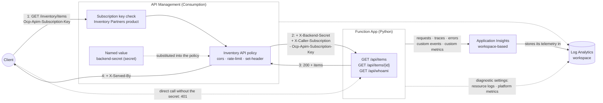

# API Management and Function App: an Azure Function published through an API gateway

This sample demonstrates [Azure API Management](https://learn.microsoft.com/en-us/azure/api-management/api-management-key-concepts) in front of an [Azure Function App](https://learn.microsoft.com/en-us/azure/azure-functions/functions-overview). The Function App serves a small *Inventory* API, but answers nothing unless the request carries a shared secret, and the only party holding that secret is the API Management gateway: it keeps it in a secret [named value](https://learn.microsoft.com/en-us/azure/api-management/api-management-howto-properties) and adds it to every backend call through a [policy](https://learn.microsoft.com/en-us/azure/api-management/api-management-howto-policies). Clients never see the backend. They call the gateway with a subscription key, and the gateway authorises the call, enforces a rate limit, answers browser preflights, and forwards what remains to the function.

The sample exercises both halves of API Management on the LocalStack Azure emulator: the control plane (service instance, OpenAPI import, product, subscription, named value, policy) and the gateway (subscription-key authorisation, policy execution, rate limiting, CORS).

## Architecture

The solution is composed of the following Azure resources:

1. [Azure Resource Group](https://learn.microsoft.com/en-us/azure/azure-resource-manager/management/manage-resource-groups-cli): A logical container scoping all resources in this sample.
2. [Azure Storage Account](https://learn.microsoft.com/en-us/azure/storage/common/storage-account-overview): The Function App's runtime storage (`AzureWebJobsStorage`).
3. [Azure App Service Plan](https://learn.microsoft.com/en-us/azure/app-service/overview-hosting-plans) (Linux, B1): Hosts the Function App.
4. [Azure Function App](https://learn.microsoft.com/en-us/azure/azure-functions/functions-overview) (Python v2 model): The *Inventory* backend, with three HTTP-triggered routes: `GET /api/items`, `GET /api/items/{id}` and `GET /api/whoami`. Every route refuses a request that does not carry a valid `X-Backend-Secret` header, so the Function App can only be reached through the gateway.
5. [Azure API Management](https://learn.microsoft.com/en-us/azure/api-management/api-management-key-concepts) (Consumption tier):
   - The **Inventory API**, imported from [`apim/openapi.json`](./apim/openapi.json) and published under `/inventory`, with the Function App as its backend (`serviceUrl`).
   - The **backend-secret** [named value](https://learn.microsoft.com/en-us/azure/api-management/api-management-howto-properties), marked secret, holding the shared secret.
   - The [API policy](./apim/inventory-api-policy.xml): a [`cors`](https://learn.microsoft.com/en-us/azure/api-management/cors-policy) policy that answers preflights at the gateway, a [`rate-limit`](https://learn.microsoft.com/en-us/azure/api-management/rate-limit-policy) of ten calls a minute per subscription, [`set-header`](https://learn.microsoft.com/en-us/azure/api-management/set-header-policy) policies that inject the secret from the named value and tell the backend which subscription is calling (`@(context.Subscription.Id)`), a pair that strips the subscription key in both forms a client may send it -- the header and the `subscription-key` query parameter -- and an outbound header marking responses that came through the gateway.
   - The **Inventory Partners** [product](https://learn.microsoft.com/en-us/azure/api-management/api-management-howto-add-products) containing the API, and the **partner-subscription** [subscription](https://learn.microsoft.com/en-us/azure/api-management/api-management-subscriptions) whose key clients present.
6. [Azure Log Analytics workspace](https://learn.microsoft.com/en-us/azure/azure-monitor/logs/log-analytics-workspace-overview): Stores the telemetry of Application Insights, and the resource logs and platform metrics that the [diagnostic settings](https://learn.microsoft.com/en-us/azure/azure-monitor/data-collection/diagnostic-settings) of the Function App, of the plan, of the storage account and of its services, of the API Management service and of the workspace itself send to it.
7. [Azure Application Insights](https://learn.microsoft.com/en-us/azure/azure-monitor/app/app-insights-overview): A workspace-based resource that the Function App sends its telemetry to through OpenTelemetry: its requests, its log records, the exceptions it logs, the `InventoryItemServed` custom event and the `inventory_items_served` custom metric.



The life of a request: the client calls `GET /inventory/items` on the gateway with an `Ocp-Apim-Subscription-Key` header → the gateway checks the key against the product's subscriptions → the API policy runs → the request is forwarded to the Function App's `/api/items` with `X-Backend-Secret` and `X-Caller-Subscription` added and the subscription key removed → the Function App verifies the secret and answers → the gateway adds `X-Served-By` and returns the response. A call without a key, with a wrong key, or beyond ten calls a minute never reaches the function.

Meanwhile the Function App sends the request, its log records and, for a single item, the `InventoryItemServed` custom event and the `inventory_items_served` custom metric to Application Insights, and the diagnostic settings send the resource logs and the platform metrics of the resources to the workspace.

## Prerequisites

- [Docker](https://docs.docker.com/get-docker/)
- [Azure CLI](https://learn.microsoft.com/en-us/cli/azure/install-azure-cli)
- [lstk CLI](https://docs.localstack.cloud/aws/developer-tools/running-localstack/lstk/)
- [jq](https://jqlang.org/), `zip` and `openssl`
- [Terraform](https://developer.hashicorp.com/terraform/downloads) (for the Terraform deployment)
- [Bicep](https://learn.microsoft.com/en-us/azure/azure-resource-manager/bicep/install) (for the Bicep deployment)
- A LocalStack account with a valid `LOCALSTACK_AUTH_TOKEN` (see the [Auth Token guide](https://docs.localstack.cloud/getting-started/auth-token/))

> [!IMPORTANT]
> **Macs with Apple silicon**: the function app runs natively on arm64, but the emulator builds each deployment with Microsoft's Oryx build image, which Microsoft publishes for amd64 only ([microsoft/Oryx#2133](https://github.com/microsoft/Oryx/issues/2133) asks for arm64).
> Docker Desktop runs that build under amd64 emulation: in Docker Desktop's settings, under **General**, select the **Apple Virtualization framework** as the Virtual Machine Manager and turn on **Use Rosetta for x86_64/amd64 emulation on Apple Silicon**.
> Under QEMU, which Docker Desktop uses otherwise (Rosetta off, or Docker VMM, which has no Rosetta), the build can crash, because Oryx is a .NET app and [.NET does not support QEMU](https://github.com/dotnet/core/blob/main/release-notes/8.0/supported-os.md).

## Setup

Start the LocalStack Azure emulator and route the Azure CLI to it:

```bash
export LOCALSTACK_AUTH_TOKEN=<your_auth_token>
lstk start --type azure
lstk az start-interception
az login --service-principal -u any-app -p any-pass --tenant any-tenant
```

## Deployment

### Azure CLI scripts

```bash
bash scripts/deploy.sh
```

The script provisions all resources idempotently: it creates the Function App and deploys it from a zip package, creates the API Management instance, stores the generated shared secret both as the Function App's `BACKEND_SECRET` setting and as the secret named value, imports the API from the OpenAPI document with the Function App as its backend, applies the policy, and creates the product and the subscription. It also creates the Log Analytics workspace and the Application Insights resource, hands its connection string to the Function App, and gives every resource that offers diagnostic settings one that sends to the workspace. It ends by printing the gateway URL and the command that reads the subscription key. A re-run reuses the stored secret, so the gateway and the Function App stay in agreement.

### Terraform

```bash
cd terraform
bash deploy.sh
```

The Terraform variant provisions the same resources declaratively and then deploys the function from a zip package with the Azure CLI. The API is imported from the same `apim/openapi.json`, and the policy is read from the same `apim/inventory-api-policy.xml`.

### Bicep

```bash
cd bicep
bash deploy.sh
```

The Bicep variant validates and deploys `main.bicep` into the resource group (generating the shared secret per run) and then deploys the function from a zip package with the Azure CLI. It shares the OpenAPI document and the policy with the other two variants through `loadTextContent`.

## Testing

```bash
bash scripts/validate.sh
bash scripts/call-api.sh
```

`validate.sh` walks the whole chain and exits non-zero on any failure:

1. The Function App refuses a direct call without the shared secret (401): the gateway is the only way in.
2. The OpenAPI import produced the three operations, matched case-insensitively. API Management normalises `operationId` into the operation's name — it replaces characters that are not allowed and truncates at 76 — and Microsoft's import-restrictions page also lists lower-casing, though a deployment to real Azure kept the casing (`getItems` stayed `getItems`, `Get Items` became `Get-Items`). The check does not depend on either behaviour.
3. A keyless call is refused with Azure's *missing subscription key* message, and a wrong key with its *invalid subscription key* message.
4. With the subscription key, `listItems` and `getItem` are authorised, matched (including the `{id}` template parameter) and answered by the function; a 404 from the backend passes through untouched; every response carries the outbound `X-Served-By` header.
5. `whoAmI` shows what the backend received: the injected secret, the calling subscription in `X-Caller-Subscription`, and no `Ocp-Apim-Subscription-Key`. The same holds for a key passed as the `subscription-key` query parameter: it authenticates the call and is stripped from the URL the function sees.
6. A CORS preflight is answered by the gateway itself, from the `cors` policy (asserted on Azure only; see the LocalStack notes).
7. A path that matches no operation gets the gateway's own 404.
8. The eleventh call within a minute is refused with a 429 and a `Retry-After` header.
9. The Application Insights resource stores its telemetry in the workspace, and the Function App sends its telemetry to it (the check reads the names of the app settings, never their values).

`call-api.sh` is the user-level smoke test: it reads the key, lists the items and reads one of them. Run right after `validate.sh` it may be told to wait: the rate limit is still in force for the rest of the minute, and the script honours the `Retry-After` the gateway sends.

### Calling the API by hand

```bash
APIM_ID=$(az apim show --name local-inventory-apim-test --resource-group local-rg --query id --output tsv)
KEY=$(az rest --method post \
  --url "$APIM_ID/subscriptions/partner-subscription/listSecrets?api-version=2022-08-01" \
  --query primaryKey --output tsv)
GATEWAY=http://local-inventory-apim-test.apim.azure.localhost.localstack.cloud:4566

# Refused by the gateway
curl -s "$GATEWAY/inventory/items"
```

```json
{"statusCode": 401, "message": "Access denied due to missing subscription key. Make sure to include subscription key when making requests to an API."}
```

```bash
# Forwarded to the Function App
curl -s -H "Ocp-Apim-Subscription-Key: $KEY" "$GATEWAY/inventory/items/2"
```

```json
{"id": 2, "sku": "APIM-002", "name": "Gateway sticker pack", "quantity": 500}
```

```bash
# What the backend received: the caller's subscription, no subscription key
curl -s -H "Ocp-Apim-Subscription-Key: $KEY" "$GATEWAY/inventory/whoami" | jq .headers
```

```json
{
  "x-caller-subscription": "partner-subscription",
  "accept": "*/*",
  "user-agent": "curl/7.81.0",
  "host": "local-inventory-functionapp-test.azurewebsites.azure.localhost.localstack.cloud:4566"
}
```

The eleventh call within a minute is refused before it reaches the function:

```json
{"statusCode": 429, "message": "Rate limit is exceeded. Try again in 59 seconds."}
```

The key can also be passed as the `subscription-key` query parameter.

## Application Insights

The Function App sends its telemetry to `<prefix>-insights-<suffix>`, a workspace-based [Application Insights](https://learn.microsoft.com/en-us/azure/azure-monitor/app/app-insights-overview) resource that stores it in the `<prefix>-log-analytics-<suffix>` [Log Analytics workspace](https://learn.microsoft.com/en-us/azure/azure-monitor/logs/log-analytics-workspace-overview). The `APPLICATIONINSIGHTS_CONNECTION_STRING` app setting holds the connection string of the resource: `scripts/deploy.sh` passes `--app-insights <prefix>-insights-<suffix>` to `az functionapp create`, which sets it, and sets it again with the other app settings, and the Bicep and Terraform modules set it themselves. The app uses [OpenTelemetry with Azure Functions](https://learn.microsoft.com/en-us/azure/azure-functions/opentelemetry-howto):

- `host.json` sets `"telemetryMode": "OpenTelemetry"`, so that the Functions host exports its own telemetry through OpenTelemetry.
- `requirements.txt` adds `azure-monitor-opentelemetry`, and the `PYTHON_APPLICATIONINSIGHTS_ENABLE_TELEMETRY` app setting, set to `true`, has the Python worker send the telemetry of the functions itself, instead of the host forwarding their log records.
- The `PYTHON_APPLICATIONINSIGHTS_LOGGER_NAME` app setting, set to `function_app`, has the worker send the records of the functions' logger only (the worker passes it to `configure_azure_monitor` as `logger_name`, see its [source](https://github.com/Azure/azure-functions-python-worker/blob/dev/workers/azure_functions_worker/dispatcher.py)). Without it the worker sends the records of every logger, its own and the OpenTelemetry exporter's HTTP requests included, and the exporter's startup messages about the optional instrumentations it can't import arrive as exceptions.

The `get_item` function sends a [custom event](https://learn.microsoft.com/en-us/azure/azure-monitor/app/opentelemetry-add-modify#send-custom-events) for each inventory item it serves and counts the items per SKU in the `inventory_items_served` [custom metric](https://learn.microsoft.com/en-us/azure/azure-monitor/app/opentelemetry-add-modify#add-custom-metrics); the functions log a warning for a call without the shared secret and for an item that doesn't exist. The worker sends a log record that carries the `microsoft.custom_event.name` attribute as a custom event named after its value, with the other attributes as its custom dimensions:

```python
inventory_items_served = metrics.get_meter(LOGGER_NAME).create_counter(
    "inventory_items_served", unit="{item}", description="The number of inventory items the backend served."
)

logger.info(
    f"InventoryItemServed: {item['sku']}",
    extra={
        "microsoft.custom_event.name": "InventoryItemServed",
        "inventory.sku": item["sku"],
        "inventory.quantity": item["quantity"],
    },
)
inventory_items_served.add(1, {"sku": item["sku"]})
```

The workspace keeps the telemetry in these tables:

| Table           | What the Function App sends                                                                                                                   |
| --------------- | --------------------------------------------------------------------------------------------------------------------------------------------- |
| `AppRequests`   | The invocations of the `list_items`, `get_item` and `whoami` functions                                                                        |
| `AppTraces`     | The log records of the functions and of the Functions host, such as the warning for an item that doesn't exist (`/items/99`)                  |
| `AppEvents`     | The `InventoryItemServed` custom event of each item the backend served, with its SKU and quantity in `inventory.sku` and `inventory.quantity` |
| `AppMetrics`    | The `inventory_items_served` custom metric, with the SKU in `sku`                                                                             |
| `AppExceptions` | The exceptions the functions log with their stack trace: none in a healthy run                                                                |

The `az monitor log-analytics query` command of the `log-analytics` extension of the Azure CLI reads them, given the workspace id (`customerId`) of the workspace:

```bash
az extension add --name log-analytics

WORKSPACE_ID=$(az monitor log-analytics workspace show \
  --resource-group local-rg \
  --workspace-name local-log-analytics-test \
  --query customerId \
  --output tsv)

az monitor log-analytics query \
  --workspace "$WORKSPACE_ID" \
  --analytics-query "AppRequests | summarize Invocations = count() by Name | order by Name asc" \
  --output table
```

[`scripts/query-telemetry.sh`](./scripts/query-telemetry.sh) calls the API through the gateway with the subscription key, reading three items and one that doesn't exist, then reads the tables back, retrying until their records arrive. The API allows ten calls a minute per subscription, so the script waits as long as the gateway asks when it answers 429. It shows the exceptions without waiting for them: a healthy run has none. It exits with a non-zero code when the API doesn't answer, or when a query still lacks its records, after `RETRY_COUNT` attempts (30 by default) made `SLEEP` seconds apart (10 by default).

## Logs and metrics

Each resource that offers [diagnostic settings](https://learn.microsoft.com/en-us/azure/azure-monitor/data-collection/diagnostic-settings) has one named `default` that sends its resource logs and its platform metrics to the same workspace:

| Resource                       | Log categories                                 | Tables in the workspace                                                   | What the sample leaves there                                                                                                      |
| ------------------------------ | ---------------------------------------------- | ------------------------------------------------------------------------- | --------------------------------------------------------------------------------------------------------------------------------- |
| Function App                   | `FunctionAppLogs`                              | `FunctionAppLogs`                                                         | The records the Functions host writes when an invocation of a function starts and completes, whose category names the function    |
| App Service plan               | None: metrics only                             | `AzureMetrics`                                                            | The CPU and memory use of its instances                                                                                           |
| Storage account                | None: metrics only                             | `AzureMetrics`                                                            | The transactions of the account                                                                                                   |
| Blob, queue and table services | `StorageRead`, `StorageWrite`, `StorageDelete` | `StorageBlobLogs`, `StorageQueueLogs`, `StorageTableLogs`, `AzureMetrics` | The requests of the Functions host, which keeps its locks and keys in blobs and authenticates with the account key (`AccountKey`) |
| API Management service         | None on the Consumption tier: metrics only     | `AzureMetrics`                                                            | The requests of the gateway, such as `Requests`                                                                                   |
| Log Analytics workspace        | `Audit`                                        | `LAQueryLogs`, `AzureMetrics`                                             | The queries run on the workspace, such as the ones of the scripts                                                                 |

The Consumption tier of API Management [doesn't support the collection of resource logs](https://learn.microsoft.com/en-us/azure/api-management/api-management-howto-use-azure-monitor#resource-logs), so its diagnostic setting sends the metrics of the service only. On the other tiers the three deployment methods also send `GatewayLogs`, the record of every request through the gateway, to the resource-specific `ApiManagementGatewayLogs` table. The Application Insights resource has no diagnostic setting: its telemetry is already in the workspace it's based on, and a diagnostic setting of a workspace-based Application Insights resource [can't send to that workspace](https://learn.microsoft.com/en-us/azure/azure-monitor/app/export-telemetry#diagnostic-settings-based-export).

The platform metrics of the Function App land in the `AzureMetrics` table too. On Azure these are its memory, I/O and HTTP metrics, such as `MemoryWorkingSet`, but not the executions of its functions (`FunctionExecutionCount`), which only the metrics API serves (observed on Azure on 2026-11-16). A few queries to try:

```kusto
// The records of the invocations, per function
FunctionAppLogs
| where Category startswith "Function."
| summarize Records = count() by FunctionName

// The inventory items the backend served, per SKU
AppEvents
| where Name == "InventoryItemServed"
| summarize Events = count() by Sku = tostring(Properties["inventory.sku"])

// The requests to the blobs, all from the Functions host (AccountKey)
StorageBlobLogs
| summarize Requests = count() by OperationName, AuthenticationType
```

The platform metrics need no diagnostic setting: the Azure Monitor metrics API serves them directly, for example with `az monitor metrics list --resource <api-management-id> --metrics Requests --aggregation Total`.

[`scripts/query-logs-and-metrics.sh`](./scripts/query-logs-and-metrics.sh) does all of this in one go: it lists the diagnostic settings of the Function App, of the plan, of the storage account and of its services, of the workspace and of the API Management service, and reads until their records arrive the invocation records, the exported platform metrics of the Function App and of the plan, the requests to the blobs, the transaction metrics of the storage account and of its services, and the audit records of the queries run on the workspace. It ends with the executions of the Function App, the transactions of the storage account and the requests of the gateway read from the metrics API. Run it after `query-telemetry.sh` or `call-api.sh`, which call the API. It exits with a non-zero code when a query still lacks its records after `RETRY_COUNT` attempts. On Azure an execution can be counted in the minute after the one in which it ran.

### Delivery times

On the emulator the records are queryable within seconds, and the platform metrics (`AzureMetrics`) once their one-minute window is over. On Azure the telemetry of Application Insights takes a few minutes, and the first records of a new diagnostic setting can take [up to 90 minutes](https://learn.microsoft.com/en-us/azure/azure-monitor/data-collection/diagnostic-settings#expected-latency-after-creating-a-diagnostic-setting): run the queries again later, or raise `RETRY_COUNT` for the scripts.

## Cleanup

```bash
az group delete --name local-rg --yes
```

Deleting an API Management instance soft-deletes it: the name stays reserved until the instance is purged or the retention period ends. To free the name straight away:

```bash
az apim deletedservice purge --service-name local-inventory-apim-test --location westeurope
```

## LocalStack notes

- **Gateway address.** API Management reports Azure's gateway address, `https://<name>.azure-api.net`, in `gatewayUrl`. The emulator claims that name too, but it only resolves once LocalStack's DNS is in front of the machine, so the scripts call the gateway through its local alias, `http://<name>.apim.azure.localhost.localstack.cloud:4566`, whenever the Azure CLI is pointed at the emulator (`az account show --query environmentName` is `LocalStack`). On Azure they use `gatewayUrl`.
- **Backend over plain HTTP.** The emulator serves the Function App under its own hostname (the `defaultHostName` it reports) over HTTP, so the API's `serviceUrl` is `http://<function app host>/api` there and `https://...` on Azure. The Azure CLI scripts pick the scheme from the environment. Terraform and Bicep take it as an input that defaults to the emulator's `http`, so a real deployment overrides one value rather than editing the template — `terraform apply -var backend_scheme=https` or `az deployment group create --parameters backendScheme=https`. The Bicep variant derives the Function App's `httpsOnly` from the same parameter, so the app stops accepting plain HTTP in the same step.
- **Shared secret rather than a function key.** On Azure the usual way to lock a Function App to its gateway is the function's host key, injected the same way (an `x-functions-key` header from a secret named value). This sample has the function check a secret of its own instead, so the same code, policy and deployment run unchanged on the emulator and on Azure without listing host keys.
- **CORS is answered by the emulator, not by the policy.** LocalStack enforces CORS for every hostname it serves, the API Management gateway included: a browser origin outside its allow-list gets a bodiless 403 before the gateway sees the request, and an allowed origin gets the emulator's own preflight answer and response headers rather than those of the API's `cors` policy. To call the emulated gateway from a browser app, allow its origin with `EXTRA_CORS_ALLOWED_ORIGINS=http://localhost:3000` (or `DISABLE_CORS_CHECKS=1`) when starting LocalStack. The `cors` policy in this sample is what answers preflights on Azure, and `validate.sh` asserts it there only.
- **Consumption tier.** It provisions in minutes on Azure and has no per-instance health probe; the emulator reproduces both. The rate limit is enforced per subscription and the counts are exact on the emulator, while Azure documents them as approximate, so `validate.sh` keeps calling until it sees the 429 rather than asserting the exact call at which it happens.
- **Updating API Management entities needs an `If-Match` header**, which is why `scripts/deploy.sh` only applies the policy with `If-Match: *` when it already exists and skips entities that are already there.

## References

- [Azure API Management Documentation](https://learn.microsoft.com/en-us/azure/api-management/)
- [API Management policy reference](https://learn.microsoft.com/en-us/azure/api-management/api-management-policies)
- [Azure Functions Documentation](https://learn.microsoft.com/en-us/azure/azure-functions/)
- [Import an Azure Function App as an API](https://learn.microsoft.com/en-us/azure/api-management/import-function-app-as-api)
- [LocalStack for Azure](https://docs.localstack.cloud/azure/)
- [LocalStack for Azure: API Management](https://docs.localstack.cloud/azure/services/api-management/)
- [lstk CLI](https://docs.localstack.cloud/aws/developer-tools/running-localstack/lstk/)
