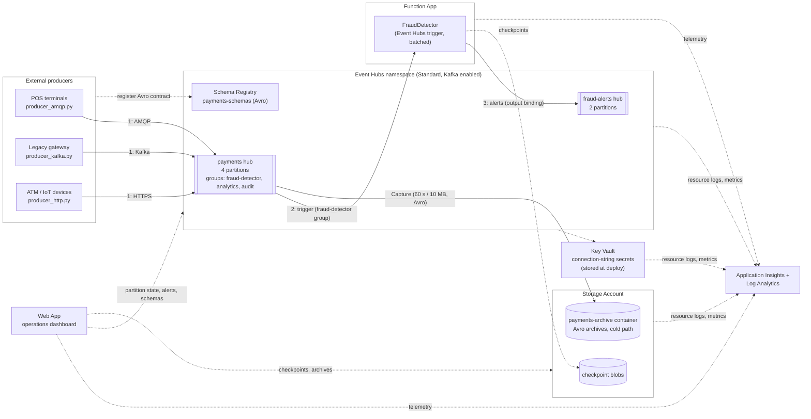

# Real-time payment fraud detection with Azure Event Hubs

A streaming platform in miniature, running entirely on LocalStack for Azure. Payments
arrive from three different kinds of producer, a serverless processor scores them for
fraud in real time, alerts flow onto a second stream, and every event is archived to a
data lake without a line of code being written for it.

The sample is built around the properties that make Event Hubs different from a queue:
**one log, many protocols, many independent readers, and a replayable history**.

## Architecture

The following diagram illustrates the architecture of the solution:



**Deployment flow.** The deploy script creates Log Analytics and Application Insights, a
storage account with the Capture container, the Event Hubs namespace with both hubs, three
consumer groups, least-privilege authorization rules and a Schema Registry group; stores
the connection strings in Key Vault; then deploys the Function App and the dashboard Web
App. Every resource gets a diagnostic setting that sends its resource logs and platform
metrics to the Log Analytics workspace, and both apps send their telemetry to Application
Insights.

**At runtime.** Producers publish payments over AMQP, Kafka and HTTPS to the same hub. The
Function App's Event Hubs trigger reads the `fraud-detector` consumer group in batches,
applies the fraud rules, and writes alerts to the `fraud-alerts` hub through an output
binding. Event Hubs Capture independently archives everything to Blob Storage as Avro. The
dashboard reads the runtime state of both hubs, the checkpoints, the archives and the
schema registry.

## What this demonstrates

| Capability                                                                                    | Where to see it                                                                      |
| --------------------------------------------------------------------------------------------- | ------------------------------------------------------------------------------------ |
| **Multi-protocol ingestion** - AMQP 1.0, Kafka and HTTPS into one hub                         | `src/producers/`, step 2 of `run-pipeline.sh`                                        |
| **Kafka compatibility** - an existing librdkafka app with no Azure SDK                        | `src/producers/producer_kafka.py`                                                    |
| **Partition keys and ordering** - all of an account's payments on one partition               | `producer_amqp.py`, the velocity rule in `function_app.py`                           |
| **Consumer groups** - three independent readers of the same stream                            | `deploy.sh` step 6                                                                   |
| **Serverless stream processing** - Event Hubs trigger, batched                                | `src/functions/function_app.py`                                                      |
| **Checkpointing and recovery** - restart resumes where it left off                            | Step 4 of `run-pipeline.sh`                                                          |
| **Event Hubs Capture** - Avro archives to Blob Storage, no consumer code                      | Step 5 of `run-pipeline.sh`, `scripts/read_capture.py`                               |
| **Schema Registry** - a versioned Avro contract                                               | `src/producers/schema_register.py`                                                   |
| **Least-privilege SAS** - send-only and listen-only rules                                     | `deploy.sh` step 7, `validate.sh` check 5                                            |
| **Auto-inflate** - throughput units scale with ingress                                        | `deploy.sh` step 4                                                                   |
| **Geo-disaster recovery** - namespace pairing behind an alias                                 | `validate.sh` check 11                                                               |
| **Application groups** - client throttling policies                                           | `validate.sh` check 10                                                               |
| **Observability** - OpenTelemetry in both apps, diagnostic settings on every resource         | [Application Insights](#application-insights), [Logs and metrics](#logs-and-metrics) |
| **Service integration** - Event Hubs with Storage, Key Vault, Functions, App Service, Monitor | the whole sample                                                                     |

## Prerequisites

- [lstk CLI](https://docs.localstack.cloud/aws/developer-tools/running-localstack/lstk/)
  (`brew install localstack/tap/lstk` or `npm install -g @localstack/lstk`) with a valid
  `LOCALSTACK_AUTH_TOKEN`
- [Docker](https://docs.docker.com/get-docker/)
- [Azure CLI](https://learn.microsoft.com/en-us/cli/azure/install-azure-cli)
- Python 3.12+ with `src/producers/requirements.txt` installed
- `jq` and `zip`
- [Terraform](https://developer.hashicorp.com/terraform/downloads) or the Bicep CLI, for
  the alternative deployments

> [!IMPORTANT]
> **Macs with Apple silicon**: this sample's dashboard is a web app deployed from code. The emulator builds it with Microsoft's Oryx build image and runs it on an Oryx runtime image, and Microsoft publishes both for amd64 only ([microsoft/Oryx#2133](https://github.com/microsoft/Oryx/issues/2133) asks for arm64).
> On a Mac with Apple silicon they run only under Docker Desktop's amd64 emulation: in Docker Desktop's settings, under **General**, select the **Apple Virtualization framework** as the Virtual Machine Manager and turn on **Use Rosetta for x86_64/amd64 emulation on Apple Silicon**.
> Under QEMU, which Docker Desktop uses otherwise (Rosetta off, or Docker VMM, which has no Rosetta), the sample is not expected to work: Oryx is a .NET app, and [.NET does not support QEMU](https://github.com/dotnet/core/blob/main/release-notes/8.0/supported-os.md).
> The sample does not run on an arm64 Linux host without amd64 emulation.

## Quick start

```bash
# Start the LocalStack Azure emulator
export LOCALSTACK_AUTH_TOKEN=<your_auth_token>
lstk start --type azure

# Route the Azure CLI to the emulator
lstk az start-interception

cd samples/eventhubs/python
pip install -r src/producers/requirements.txt

bash scripts/deploy.sh                  # create the pipeline
bash scripts/validate.sh                # verify every capability
bash scripts/run-pipeline.sh            # run the end-to-end demo
bash scripts/query-telemetry.sh         # read the telemetry of the two apps
bash scripts/query-logs-and-metrics.sh  # read the resource logs and metrics
```

Then open the dashboard URL printed at the end of the deployment.

> [!NOTE]
> The first deployment downloads the Azure Functions build image and core tools inside the
> emulator, which can take several minutes. Later runs reuse them.

## Alternative deployments

```bash
bash bicep/deploy.sh        # Bicep
bash terraform/deploy.sh    # Terraform
```

Both provision the same topology and then publish the same application packages.

## The demo, step by step

`scripts/run-pipeline.sh` walks through the whole story:

1. **Publish the contract.** The Avro payment schema is registered in the Schema Registry
   and read back by id, the way a serializer resolves one at runtime.
2. **Ingest over three protocols.** 40 payments over AMQP (keyed by account, plus a burst
   that trips the velocity rule), 15 over Kafka, 8 over HTTPS. The partition counts show
   they all landed in the same log.
3. **Detect fraud.** The Function App picks up each batch, applies the amount and velocity
   rules, and emits alerts to `fraud-alerts`.
4. **Prove checkpointing.** Once the function has exported its metrics, the function app is
   restarted while new payments arrive. It resumes from its checkpoint: nothing is lost and
   nothing is processed twice.
5. **Read the archive.** Once a Capture window flushes, the newest Avro blob is decoded
   and its records printed - the cold path, with no consumer code.
6. **Point at the dashboard** for the live view.

Each step asserts its own result rather than reporting it: the script exits non-zero (and,
on the emulator, prints the Function App's container logs) if the hub does not grow by the events that were
published, if no alert arrives, if the processor replays instead of resuming, or if Capture
writes nothing decodable. A run that completes is evidence the pipeline works, which is
what makes it usable as a CI test.

## Application

### Producers (`src/producers/`)

| File                 | Role                                                                           |
| -------------------- | ------------------------------------------------------------------------------ |
| `common.py`          | Shared config, the Avro contract, the payment generator                        |
| `producer_amqp.py`   | POS terminals - official SDK, batches, partition keys                          |
| `producer_kafka.py`  | Legacy gateway - confluent-kafka, bootstrap derived from the connection string |
| `producer_http.py`   | ATM/IoT - HTTP runtime API with a hand-built SAS token                         |
| `schema_register.py` | Registers and resolves the Avro contract                                       |

### Processor (`src/functions/`)

`function_app.py` is an Event Hubs-triggered function with an Event Hubs output binding.
Two rules: an amount threshold, and a per-account velocity window that is only correct
because producers key events by account, which pins each account to one partition.

### Dashboard (`src/dashboard/`)

A Flask app that polls the Event Hubs runtime API, the checkpoint blobs, the alerts hub,
the Capture container and the Schema Registry, and refreshes every five seconds. Reading the
Schema Registry takes a Microsoft Entra token for the Event Hubs data plane, from
`EVENTHUB_DATAPLANE_TOKEN` or from a credential `DefaultAzureCredential` finds. The deployments
give the web app no managed identity, so on Azure that panel stays empty and the dashboard logs
`SCHEMA_TOKEN_UNAVAILABLE`, unless you give the web app an identity with the
[Schema Registry Reader](https://learn.microsoft.com/azure/event-hubs/schema-registry-concepts#azure-role-based-access-control) role.

| Route           | Description                         |
| --------------- | ----------------------------------- |
| `/`             | The dashboard                       |
| `/api/overview` | JSON snapshot of the whole pipeline |
| `/health`       | Health check                        |

## Application Insights

Both apps send their telemetry to `<prefix>-eh-insights`, a workspace-based [Application Insights](https://learn.microsoft.com/en-us/azure/azure-monitor/app/app-insights-overview) resource that stores it in the `<prefix>-eh-logs` [Log Analytics workspace](https://learn.microsoft.com/en-us/azure/azure-monitor/logs/log-analytics-workspace-overview). The three deployment methods set their `APPLICATIONINSIGHTS_CONNECTION_STRING` app setting to the connection string of the resource (`scripts/deploy.sh` passes `--app-insights` to `az functionapp create`, which otherwise creates an Application Insights resource of its own).

- **Function App.** It uses [OpenTelemetry with Azure Functions](https://learn.microsoft.com/en-us/azure/azure-functions/opentelemetry-howto): `host.json` sets `"telemetryMode": "OpenTelemetry"`, `requirements.txt` adds `azure-monitor-opentelemetry`, and `function_app.py` calls `configure_azure_monitor(logger_name="function_app")`, so that the Azure Monitor OpenTelemetry Distro sends the records of the function's `function_app` logger. The app configures the distro itself, which works on every hosting plan: on the Linux Consumption plan this sample uses, the Python worker sent none of the app's telemetry when the `PYTHON_APPLICATIONINSIGHTS_ENABLE_TELEMETRY` app setting asked it to. For each alert the function sends a `FraudDetected` [custom event](https://learn.microsoft.com/en-us/azure/azure-monitor/app/opentelemetry-add-modify#send-custom-events), with the account, the amount, the channel and the rules the payment tripped in `payment.account_id`, `payment.amount`, `payment.channel` and `fraud.reasons`, and it counts the payments it screens in the `payments_screened` [custom metric](https://learn.microsoft.com/en-us/azure/azure-monitor/app/opentelemetry-add-modify#add-custom-metrics), by `outcome` (`legitimate`, `flagged`). A payment whose amount isn't a number is logged with its stack trace and skipped.
- **Dashboard.** It uses the [Microsoft OpenTelemetry Distro](https://pypi.org/project/microsoft-opentelemetry/), set up before Flask is imported: the requests it serves, its calls to Event Hubs, Blob Storage and, when it has a token for it, the Schema Registry, the records of its `webapp` logger, such as `OVERVIEW`, and the exceptions it logs when a part of the pipeline can't be read.

The workspace keeps the telemetry in `AppRequests` (the invocations of `FraudDetector` and the requests of the dashboard), `AppDependencies`, `AppTraces`, `AppEvents`, `AppMetrics` and `AppExceptions`; each record names the app that sent it in `AppRoleName`.

[`scripts/query-telemetry.sh`](./scripts/query-telemetry.sh) asks the dashboard for its overview, then reads these tables back, retrying until their records arrive: run it after `run-pipeline.sh`, which sends the payments the function screens. On Azure the telemetry takes a few minutes: raise `RETRY_COUNT` there.

## Logs and metrics

Each resource that offers [diagnostic settings](https://learn.microsoft.com/en-us/azure/azure-monitor/data-collection/diagnostic-settings) has one that sends its resource logs, its platform metrics or both to the workspace. `scripts/deploy.sh` creates each of them right after the resource and before anything runs on it, so the first operations are logged too.

| Resource                       | Log categories                                                                        | Tables in the workspace                                                                 |
| ------------------------------ | ------------------------------------------------------------------------------------- | --------------------------------------------------------------------------------------- |
| Function App                   | `FunctionAppLogs`                                                                     | `FunctionAppLogs`                                                                       |
| Web App                        | `AppServiceHTTPLogs`, `AppServiceConsoleLogs`, `AppServicePlatformLogs` and four more | `AppServiceHTTPLogs`, `AppServiceConsoleLogs`, `AppServicePlatformLogs`, `AzureMetrics` |
| App Service plans              | None: metrics only                                                                    | `AzureMetrics`                                                                          |
| Storage account                | None: metrics only                                                                    | `AzureMetrics`                                                                          |
| Blob, queue and table services | `StorageRead`, `StorageWrite`, `StorageDelete`                                        | `StorageBlobLogs`, `StorageQueueLogs`, `StorageTableLogs`, `AzureMetrics`               |
| Event Hubs namespace           | `ArchiveLogs`, `OperationalLogs` and the other eight categories                       | `AZMSOperationalLogs`, `AzureDiagnostics`, `AzureMetrics`                               |
| Key vault                      | `AuditEvent`, `AzurePolicyEvaluationDetails`                                          | `AZKVAuditLogs`, `AZKVPolicyEvaluationDetailsLogs`, `AzureMetrics`                      |
| Log Analytics workspace        | `Audit`                                                                               | `LAQueryLogs`, `AzureMetrics`                                                           |

The namespace writes its operational logs to their resource-specific table, its other categories to `AzureDiagnostics`; its setting leaves out the runtime audit logs, which Event Hubs writes [only in the Premium and Dedicated tiers](https://learn.microsoft.com/azure/event-hubs/monitor-event-hubs). The blob service records the Capture archives Event Hubs writes, the leases and checkpoints of the Functions host and the reads of the dashboard, and the key vault the reads of the secrets by `validate.sh`.

[`scripts/query-logs-and-metrics.sh`](./scripts/query-logs-and-metrics.sh) shows the diagnostic settings and reads back the requests, console output and platform events of the dashboard, the invocation records of the function, the requests to the blobs, the reads of the secrets, the operations on the namespace, the exported platform metrics and the audit records of the queries run on the workspace, then reads platform metrics from the Azure Monitor metrics API. On Azure the first records of a new diagnostic setting can take [up to 90 minutes](https://learn.microsoft.com/en-us/azure/azure-monitor/data-collection/diagnostic-settings#expected-latency-after-creating-a-diagnostic-setting): raise `RETRY_COUNT` there. On Azure the script reads the exported platform metrics (`AzureMetrics`) only once: Azure exports them late and irregularly, so the script shows those that arrived and notes how many are still missing, without failing.

## Scripts

| Script                                   | Description                                                                |
| ---------------------------------------- | -------------------------------------------------------------------------- |
| `scripts/deploy.sh`                      | Creates the full topology and deploys both workloads                       |
| `scripts/validate.sh`                    | Numbered checks over the control plane, data plane and bonus capabilities  |
| `scripts/run-pipeline.sh`                | The end-to-end demo                                                        |
| `scripts/query-telemetry.sh`             | Reads back the telemetry of the two apps from Application Insights         |
| `scripts/query-logs-and-metrics.sh`      | Shows the diagnostic settings and reads back the resource logs and metrics |
| `scripts/cleanup.sh`                     | Deletes the resource group and local artifacts                             |
| `bicep/deploy.sh`, `terraform/deploy.sh` | The alternative deployment paths                                           |

## Cleanup

```bash
bash scripts/cleanup.sh
```

## Emulator notes

- Data-plane authorization is existence-checked by the emulator, so the send-only and
  listen-only rules demonstrate the *deployment* pattern rather than an enforced boundary.
  Both rules are used exactly as they would be against Azure.
- The emulator serves the HTTP runtime API on the gateway port; `common.py` derives it
  from the connection string so the same code works against Azure unchanged.

## References

- [Azure Event Hubs documentation](https://learn.microsoft.com/en-us/azure/event-hubs/event-hubs-about)
- [Event Hubs Capture](https://learn.microsoft.com/en-us/azure/event-hubs/event-hubs-capture-overview)
- [Event Hubs for Apache Kafka](https://learn.microsoft.com/en-us/azure/event-hubs/azure-event-hubs-apache-kafka-overview)
- [Azure Schema Registry](https://learn.microsoft.com/en-us/azure/event-hubs/schema-registry-overview)
- [Azure Functions Event Hubs trigger](https://learn.microsoft.com/en-us/azure/azure-functions/functions-bindings-event-hubs-trigger)
- [Event Hubs quotas and limits](https://learn.microsoft.com/en-us/azure/event-hubs/event-hubs-quotas)
- [LocalStack for Azure](https://docs.localstack.cloud/azure/)
