# Front Door and Function Apps: a catalog API published through an edge

This sample demonstrates [Azure Front Door Standard](https://learn.microsoft.com/en-us/azure/frontdoor/front-door-overview) in front of two [Azure Function Apps](https://learn.microsoft.com/en-us/azure/azure-functions/functions-overview). The Function Apps serve a small *Catalog* API and are otherwise identical: each one reports its own name in every response, so which origin answered, which route matched and what path the origin was asked for can all be read straight off the body.

Clients only ever call the Front Door endpoint. Between the client and the function, the edge picks an origin by priority, decides which of two routes applies, caches what the origin allows it to cache, and runs a [rule set](https://learn.microsoft.com/en-us/azure/frontdoor/front-door-rules-engine) that stamps a response header, rewrites one path prefix into another and answers a retired path with a redirect without calling an origin at all.

The sample exercises both halves of Front Door on the LocalStack Azure emulator: the control plane (profile, endpoint, origin groups, origins, routes, rule set, rules, purge) and the data plane (routing, origin selection, health probes, caching, the rules engine and the headers the edge adds).

## Architecture

The solution is composed of the following Azure resources:

1. [Azure Resource Group](https://learn.microsoft.com/en-us/azure/azure-resource-manager/management/manage-resource-groups-cli): A logical container scoping all resources in this sample.
2. [Azure Storage Accounts](https://learn.microsoft.com/en-us/azure/storage/common/storage-account-overview) (two): The Function Apps' runtime storage (`AzureWebJobsStorage`), one each.
3. [Azure App Service Plan](https://learn.microsoft.com/en-us/azure/app-service/overview-hosting-plans) (Linux, B1): Shared by both Function Apps.
4. [Azure Function Apps](https://learn.microsoft.com/en-us/azure/azure-functions/functions-overview) (Python v2 model), **primary** and **secondary**: the *Catalog* origin, with four HTTP routes — `GET /api/catalog/{item}` (cacheable, `Cache-Control: public, max-age=300`), `GET /api/whoami` (what the origin received, `no-store`), `GET /api/status` and `GET|HEAD /api/health` (the health probe target). An `ORIGIN_NAME` app setting is the only difference between the two apps.
5. [Azure Front Door Standard](https://learn.microsoft.com/en-us/azure/frontdoor/front-door-overview) profile:
   - One **endpoint**, the address clients call.
   - The **catalog origin group**, holding the primary origin at priority 1 and the secondary as a priority-2 standby, with a [health probe](https://learn.microsoft.com/en-us/azure/frontdoor/health-probes) that sends `HEAD /api/health` every 30 seconds.
   - The **status origin group**, holding the secondary origin alone.
   - The **catalog route** (`/*`), which sends traffic to the catalog origin group with [caching](https://learn.microsoft.com/en-us/azure/frontdoor/front-door-caching) switched on and the rule set attached.
   - The **status route** (`/status`), a more specific pattern pointing at the other origin group, with the origin path `/api/status`, no caching and no rules. On Azure an origin path replaces the part of the request path the pattern matched, and an exact pattern matches the whole path, so this route's origin path is the function's full path. Azure Front Door forwards it with a trailing slash, `/api/status/`, which the Functions host serves like `/api/status`.
   - The **catalogrules** [rule set](https://learn.microsoft.com/en-us/azure/frontdoor/front-door-rules-engine): `stampHeader` (adds `X-Served-By` to every GET response, which is what its `RequestMethod Equal GET` condition matches), `rewriteShop` (`/shop/*` → `/catalog/*` on the way to the origin) and `redirectLegacy` (`/legacy` → `302` to `/status`, answered at the edge).
6. [Azure Log Analytics workspace](https://learn.microsoft.com/en-us/azure/azure-monitor/logs/log-analytics-workspace-overview): Stores the telemetry of Application Insights, and the resource logs and platform metrics that the [diagnostic settings](https://learn.microsoft.com/en-us/azure/azure-monitor/data-collection/diagnostic-settings) of the Function Apps, of the plan, of the storage accounts and of their services, of the Front Door profile and of the workspace itself send to it.
7. [Azure Application Insights](https://learn.microsoft.com/en-us/azure/azure-monitor/app/app-insights-overview): A workspace-based resource that both Function Apps send their telemetry to through OpenTelemetry: their requests, their log records, the exceptions they log, the `CatalogItemServed` custom event and the `catalog_items_served` custom metric.

```mermaid
%%{init: {"flowchart": {"nodeSpacing": 50, "rankSpacing": 70}}}%%
flowchart LR
    client((Client))

    subgraph afd["Front Door Standard profile"]
        direction TB
        routes["Routes<br/>/* · /status"]
        rules["Rule set catalogrules<br/>stampHeader · rewriteShop · redirectLegacy"]
        cache["Edge cache<br/>on the /* route"]
        routes --> rules --> cache
    end

    subgraph origins["Origin groups"]
        direction TB
        primary["catalog-origin-group<br/>primary (priority 1)<br/>standby (priority 2)"]
        secondary["status-origin-group<br/>secondary"]
    end

    subgraph apps["Function Apps (Python)"]
        direction TB
        app1["primary<br/>/api/catalog/{item} · /api/whoami<br/>/api/status · /api/health"]
        app2["secondary<br/>same code, ORIGIN_NAME=secondary"]
    end

    insights["Application Insights<br/>workspace-based"]
    workspace[("Log Analytics<br/>workspace")]
    insights -->|"stores its telemetry in"| workspace

    client -->|"1: GET /catalog/1"| routes
    cache -->|"2: on a miss, GET /api/catalog/1<br/>+ X-Forwarded-Host · X-Azure-ClientIP · X-Azure-FDID"| primary
    primary --> app1
    secondary --> app2
    cache -->|"3: 200 + X-Served-By + X-Cache"| client
    client -. "GET /status: the more specific route" .-> secondary
    apps -->|"requests · traces · errors<br/>custom events · custom metrics"| insights
    afd -. "diagnostic settings:<br/>resource logs · platform metrics" .-> workspace
    apps -.-> workspace

    style afd fill:#ffffff,stroke:#999999,color:#333333
    style origins fill:#ffffff,stroke:#999999,color:#333333
    style apps fill:#ffffff,stroke:#999999,color:#333333
```



The life of a request: the client calls `GET /catalog/1` on the endpoint → the `/*` route matches, since no more specific pattern does → the rule set runs → the edge looks in its cache, and on a miss picks the healthy origin with the lowest priority number → the route's origin path puts `/api` back on the front of the path and the request goes to the primary Function App as `GET /api/catalog/1` → the response comes back, is stored because its `Cache-Control` allows it, gets `X-Served-By` from the rule set and `X-Cache`/`X-Azure-Ref` from Front Door, and reaches the client. The second identical request never leaves the edge.

Meanwhile the Function App that answered sends the request, its log records and, for a catalog item, the `CatalogItemServed` custom event and the `catalog_items_served` custom metric to Application Insights, and the diagnostic settings send the resource logs and the platform metrics of the resources to the workspace: the access log of the Front Door profile records the request with the route, the origin and the cache status.

## Prerequisites

- [Docker](https://docs.docker.com/get-docker/)
- [Azure CLI](https://learn.microsoft.com/en-us/cli/azure/install-azure-cli)
- [lstk CLI](https://docs.localstack.cloud/aws/developer-tools/running-localstack/lstk/)
- [jq](https://jqlang.org/) and `zip`
- A LocalStack account with a valid `LOCALSTACK_AUTH_TOKEN` (see the [Auth Token guide](https://docs.localstack.cloud/getting-started/auth-token/))

> [!IMPORTANT]
> **Macs with Apple silicon**: the function app runs natively on arm64, but the emulator builds each deployment with Microsoft's Oryx build image, which Microsoft publishes for amd64 only ([microsoft/Oryx#2133](https://github.com/microsoft/Oryx/issues/2133) asks for arm64).
> Docker Desktop runs that build under amd64 emulation: in Docker Desktop's settings, under **General**, select the **Apple Virtualization framework** as the Virtual Machine Manager and turn on **Use Rosetta for x86_64/amd64 emulation on Apple Silicon**.
> Under QEMU, which Docker Desktop uses otherwise (Rosetta off, or Docker VMM, which has no Rosetta), the build can crash, because Oryx is a .NET app and [.NET does not support QEMU](https://github.com/dotnet/core/blob/main/release-notes/8.0/supported-os.md).

## Setup

Start LocalStack for Azure and point the Azure CLI at it:

```bash
export LOCALSTACK_AUTH_TOKEN=<your-auth-token>
lstk start --type azure
lstk az start-interception
az login --service-principal -u any-app -p any-pass --tenant any-tenant
az account set --subscription 00000000-0000-0000-0000-000000000000
```

Every command below is the same against real Azure; sign in with `az login` instead.

## Deployment

```bash
bash scripts/deploy.sh
```

The script provisions the resource group, the App Service plan, the Log Analytics workspace, the Application Insights resource, the two storage accounts and the two Function Apps, deploys the same zip package to both, then creates the Front Door profile, endpoint, origin groups, origins, rule set, rules and routes. Every resource that offers diagnostic settings gets one that sends to the workspace. It finishes by printing the endpoint URL and a handful of `curl` commands to try.

It is safe to re-run: the Azure resources it creates are either checked for first or created with an idempotent `PUT`.

## Testing

```bash
bash scripts/validate.sh
bash scripts/call-front-door.sh
```

`validate.sh` walks the whole chain and exits non-zero on any failure:

| #   | Check                                                                        | What it proves                                                                                                                                          |
| --- | ---------------------------------------------------------------------------- | ------------------------------------------------------------------------------------------------------------------------------------------------------- |
| 1   | Both Function Apps answer `/api/health`, including on `HEAD`                 | The origins are up and answer the method the health probe uses                                                                                          |
| 2   | `GET /catalog/1` through the endpoint                                        | The catch-all route, the priority-1 origin, and the route's origin path                                                                                 |
| 3   | `X-Served-By` and `X-Azure-Ref` on the response                              | The rule set ran; the edge stamped its reference id                                                                                                     |
| 4   | `GET /status`                                                                | A more specific route wins, and sends the request to a different origin group                                                                           |
| 5   | `GET /shop/2`                                                                | The `UrlRewrite` rule: the origin is asked for `/api/catalog/2`                                                                                         |
| 6   | `GET /legacy`                                                                | The `UrlRedirect` rule answers `302` at the edge, without calling an origin                                                                             |
| 7   | `/catalog/3` twice, then a purge, then a `no-store` path                     | Caching, `X-Cache`, `Age`, purge, and the origin's power to refuse caching                                                                              |
| 8   | `GET /whoami`                                                                | `X-Forwarded-Host`, `X-Azure-ClientIP` and `X-Azure-FDID` reach the origin                                                                              |
| 9   | Ten requests to an uncached path                                             | Priority is a strict tier: all ten are answered by the priority-1 origin                                                                                |
| 10  | `GET /catalog/99`                                                            | The origin's own `404` passes through the edge untouched                                                                                                |
| 11  | The endpoint disabled, then enabled again                                    | `enabledState` takes the endpoint out of service and back                                                                                               |
| 12  | The Application Insights resource and the app settings of both Function Apps | The resource stores its telemetry in the workspace, and both apps send theirs to it (the check reads the names of the app settings, never their values) |

`call-front-door.sh` is the short version: read a catalog item, read it again from the cache, follow the rewrite and the redirect, and print what the origin received. On Azure, a change to the endpoint reaches the edge locations of Front Door one after the other, so the script retries the read, the rewrite and the origin call until the edge answers with status 200.

### Calling the endpoint by hand

```bash
ENDPOINT_URL=http://local-catalog-test.afd.azure.localhost.localstack.cloud:4566

# A cacheable response: the first request is a miss, the second a hit
curl -si $ENDPOINT_URL/catalog/1 | grep -iE "^(HTTP|x-cache|age|x-served-by)"
```

```text
HTTP/1.1 200 OK
x-served-by: front-door
x-cache: MISS
```

```bash
# The rules engine rewrites the path before the origin sees it
curl -s $ENDPOINT_URL/shop/2 | jq '{origin, path, sku: .item.sku}'
```

```json
{
  "origin": "primary",
  "path": "/api/catalog/2",
  "sku": "AFD-002"
}
```

```bash
# What Front Door tells the origin about the caller and about itself
curl -s $ENDPOINT_URL/whoami | jq .front_door_headers
```

```json
{
  "host": "local-catalog-primary-test.azurewebsites.azure.localhost.localstack.cloud:4566",
  "via": "1.1 Azure",
  "x-azure-clientip": "127.0.0.1",
  "x-azure-fdid": "8c7dc56e48154939834f0469a7e5c1bf",
  "x-azure-requestchain": "hops=1",
  "x-azure-socketip": "127.0.0.1",
  "x-forwarded-for": "127.0.0.1",
  "x-forwarded-host": "local-catalog-test.afd.azure.localhost.localstack.cloud",
  "x-forwarded-proto": "http"
}
```

```bash
# Empty the cache for a set of paths
az afd endpoint purge \
  --endpoint-name local-catalog-test \
  --profile-name local-catalog-afd-test \
  --resource-group local-rg \
  --content-paths '/catalog/*'
```

## Application Insights

Both Function Apps send their telemetry to `<prefix>-insights-<suffix>`, a workspace-based [Application Insights](https://learn.microsoft.com/en-us/azure/azure-monitor/app/app-insights-overview) resource that stores it in the `<prefix>-log-analytics-<suffix>` [Log Analytics workspace](https://learn.microsoft.com/en-us/azure/azure-monitor/logs/log-analytics-workspace-overview). The `APPLICATIONINSIGHTS_CONNECTION_STRING` app setting of each app holds the connection string of the resource: `deploy.sh` passes `--app-insights <prefix>-insights-<suffix>` to `az functionapp create`, which sets it, and sets it again with the other app settings. One resource serves both apps: the `AppRoleName` column of each record names the Function App that sent it. The apps use [OpenTelemetry with Azure Functions](https://learn.microsoft.com/en-us/azure/azure-functions/opentelemetry-howto):

- `host.json` sets `"telemetryMode": "OpenTelemetry"`, so that the Functions host exports its own telemetry through OpenTelemetry.
- `requirements.txt` adds `azure-monitor-opentelemetry`, and the `PYTHON_APPLICATIONINSIGHTS_ENABLE_TELEMETRY` app setting, set to `true`, has the Python worker send the telemetry of the functions itself, instead of the host forwarding their log records.
- The `PYTHON_APPLICATIONINSIGHTS_LOGGER_NAME` app setting, set to `function_app`, has the worker send the records of the functions' logger only (the worker passes it to `configure_azure_monitor` as `logger_name`, see its [source](https://github.com/Azure/azure-functions-python-worker/blob/dev/workers/azure_functions_worker/dispatcher.py)). Without it the worker sends the records of every logger, its own and the OpenTelemetry exporter's HTTP requests included, and the exporter's startup messages about the optional instrumentations it can't import arrive as exceptions.

The `catalog` function sends a [custom event](https://learn.microsoft.com/en-us/azure/azure-monitor/app/opentelemetry-add-modify#send-custom-events) for each catalog item it serves and counts the items per origin in the `catalog_items_served` [custom metric](https://learn.microsoft.com/en-us/azure/azure-monitor/app/opentelemetry-add-modify#add-custom-metrics), so the split between the two apps that Front Door's origin selection produces shows up in Application Insights. The worker sends a log record that carries the `microsoft.custom_event.name` attribute as a custom event named after its value, with the other attributes as its custom dimensions:

```python
catalog_items_served = metrics.get_meter(LOGGER_NAME).create_counter(
    "catalog_items_served", unit="{item}", description="The number of catalog items the origin served."
)

logger.info(
    f"CatalogItemServed: {item['sku']}",
    extra={
        "microsoft.custom_event.name": "CatalogItemServed",
        "catalog.sku": item["sku"],
        "origin.name": ORIGIN_NAME,
    },
)
catalog_items_served.add(1, {"origin": ORIGIN_NAME})
```

Front Door caches the catalog responses for five minutes, so the event and the metric count the items the origins served, not the requests of the clients: a request answered from the cache reaches no Function App. The workspace keeps the telemetry in these tables:

| Table           | What the Function Apps send                                                                                                                                                                                                                                                                                                                      |
| --------------- | ------------------------------------------------------------------------------------------------------------------------------------------------------------------------------------------------------------------------------------------------------------------------------------------------------------------------------------------------ |
| `AppRequests`   | The invocations of the functions, with the app that served them in `AppRoleName`. On Azure most are the `health` function's: each Front Door point of presence sends its own health probes, [about 200 a minute to each origin](https://learn.microsoft.com/en-us/azure/frontdoor/origin#origin-group) with 100 of them and a 30-second interval |
| `AppTraces`     | The log records of the functions and of the Functions host, such as the warning of the `catalog` function for an item that doesn't exist (`/catalog/99`)                                                                                                                                                                                         |
| `AppEvents`     | The `CatalogItemServed` custom event of each catalog item an origin served, with the SKU and the origin in `catalog.sku` and `origin.name`                                                                                                                                                                                                       |
| `AppMetrics`    | The `catalog_items_served` custom metric, with the origin in `origin`                                                                                                                                                                                                                                                                            |
| `AppExceptions` | The exceptions the functions log with their stack trace: none in a healthy run                                                                                                                                                                                                                                                                   |

The `az monitor log-analytics query` command of the `log-analytics` extension of the Azure CLI reads them, given the workspace id (`customerId`) of the workspace:

```bash
az extension add --name log-analytics

WORKSPACE_ID=$(az monitor log-analytics workspace show \
  --resource-group local-rg \
  --workspace-name local-log-analytics-test \
  --query customerId \
  --output tsv)

az monitor log-analytics query \
  --workspace "$WORKSPACE_ID" \
  --analytics-query "AppRequests | summarize Invocations = count() by AppRoleName, Name | order by AppRoleName asc, Name asc" \
  --output table
```

[`scripts/query-telemetry.sh`](./scripts/query-telemetry.sh) waits for the endpoint to answer, calls its catalog, status and whoami routes `CALLS` times each (3 by default), then reads the tables back, retrying until their records arrive. It shows the exceptions without waiting for them: a healthy run has none. It exits with a non-zero code when the endpoint doesn't answer, or when a query still lacks its records, after `RETRY_COUNT` attempts (30 by default) made `SLEEP` seconds apart (10 by default).

### Query the telemetry on the Logs page

Besides the `CatalogItemServed` custom event, each function app logs `Catalog item read: <id> (<sku>, origin <origin>)` for each catalog item it serves, and the warning `Catalog item not found: <id> (origin <origin>)` for an unknown item. [`scripts/query-telemetry.sh`](./scripts/query-telemetry.sh) waits for the `Catalog item read` traces of the items it asks for through Front Door.

To query the telemetry yourself, open the `<prefix>-insights-<suffix>` Application Insights resource and select **Logs** under **Monitoring**:

- On Azure, open the resource in the [Azure portal](https://portal.azure.com).
- On the emulator, open the emulated Azure portal at `http://localhost:4566/_localstack/portal/` (see [Azure Portal Emulator](https://docs.localstack.cloud/azure/developer-tools/portal/)) and select **Sign in**: the sign-in is a mock and asks for no credentials. Then select **Resource groups**, `local-rg`, the `local-insights-test` resource and **Logs**.

Type a query in the [Kusto Query Language](https://docs.localstack.cloud/azure/developer-tools/kusto-query-language/) (KQL) and select **Run**: the **Results** tab lists the records, and the **Chart** tab draws the chart of a query that ends with `render`. The Logs page of an Application Insights resource reads the classic Application Insights tables, which hold the same records as the tables of the Log Analytics workspace under other names:

| Application Insights | Log Analytics workspace | Records                                       |
| -------------------- | ----------------------- | --------------------------------------------- |
| `requests`           | `AppRequests`           | The invocations of the functions              |
| `dependencies`       | `AppDependencies`       | The calls to other services                   |
| `traces`             | `AppTraces`             | The records of the loggers                    |
| `exceptions`         | `AppExceptions`         | The exceptions logged, with their stack trace |
| `customEvents`       | `AppEvents`             | The custom events                             |
| `customMetrics`      | `AppMetrics`            | The custom metrics                            |

Their columns are renamed too, for example `timestamp` (`TimeGenerated`), `name` (`Name`), `success` (`Success`), `duration` (`DurationMs`), `resultCode` (`ResultCode`), `operation_Id` (`OperationId`), `operation_Name` (`OperationName`), `cloud_RoleName` (`AppRoleName`), `severityLevel` (`SeverityLevel`), `message` (`Message`), `type` (`ExceptionType`), `valueSum` (`Sum`) and `customDimensions` (`Properties`). To run the queries below on the workspace, with its **Logs** page or `az monitor log-analytics query`, use the names in parentheses.

The `customDimensions` column holds the custom properties of each record: the `CatalogItemServed` events carry the SKU and the origin in `catalog.sku` and `origin.name`, and the `catalog_items_served` metric carries the origin in `origin`. Each record also names the function app that sent it in `cloud_RoleName`. Read a property with `tostring(customDimensions["<name>"])`, for example in the latest `CatalogItemServed` events:

```kusto
customEvents
| where timestamp > ago(1h) and name == "CatalogItemServed"
| project timestamp, Origin = tostring(customDimensions["origin.name"])
| order by timestamp desc
```

These queries read the telemetry and draw charts of it:

- **Requests and failures over time.** The requests and the failed requests (`success == false`) in 5-second buckets, to spot traffic spikes and error regressions:

  ```kusto
  requests
  | where timestamp > ago(6h)
  | summarize
      TotalRequests = count(),
      FailedRequests = countif(success == false)
      by bin(timestamp, 5s)
  | render timechart
  ```

- **Latency percentiles per function.** The 50th, 95th and 99th percentiles of the duration of each function, which show the slow requests that an average hides:

  ```kusto
  requests
  | where timestamp > ago(24h)
  | summarize
      RequestCount = count(),
      P50_ms = percentile(duration, 50),
      P95_ms = percentile(duration, 95),
      P99_ms = percentile(duration, 99)
      by name
  | where RequestCount > 1
  | top 10 by P95_ms desc
  | project name, P50_ms, P95_ms, P99_ms
  | render columnchart
  ```

- **Status codes over time.** The `2xx`, `4xx` and `5xx` responses over time, to tell client errors from server faults:

  ```kusto
  requests
  | where timestamp > ago(12h)
  | extend StatusBucket = strcat(substring(resultCode, 0, 1), "xx")
  | summarize Count = count() by bin(timestamp, 15m), StatusBucket
  | render columnchart with (kind=stacked)
  ```

- **Top exceptions.** The exceptions by type and by the operation that raised them, to find the most frequent failures:

  ```kusto
  exceptions
  | where timestamp > ago(24h)
  | summarize ExceptionCount = count() by type, operation_Name
  | top 10 by ExceptionCount desc
  | render barchart
  ```

- **Traces by severity.** The records of the loggers by severity level (`0` Verbose, `1` Information, `2` Warning, `3` Error, `4` Critical), to catch a storm of warnings before requests start failing:

  ```kusto
  traces
  | where timestamp > ago(6h)
  | extend Severity = case(
      severityLevel == 0, "Verbose",
      severityLevel == 1, "Information",
      severityLevel == 2, "Warning",
      severityLevel == 3, "Error",
      severityLevel == 4, "Critical",
      "Unknown")
  | summarize LogCount = count() by bin(timestamp, 5m), Severity
  | render areachart with (kind=stacked)
  ```

- **The catalog items served.** The requests for one catalog item, by origin:

  ```kusto
  requests
  | where name startswith "GET api/catalog/"
  | project timestamp, name, resultCode, cloud_RoleName
  ```

- **Traces that start with a text.** The traces of the last 30 minutes whose message starts with a given text, here the confirmations of the catalog items served:

  ```kusto
  let text = "Catalog item read";
  traces
  | where timestamp > ago(30m) and message startswith text
  | project timestamp, message
  ```

- **Requests by name.** The number of requests of each name:

  ```kusto
  requests
  | summarize Count = count() by Name = name
  | render scatterchart
  ```

- **Custom events per minute.** The custom events per minute, by name:

  ```kusto
  customEvents
  | summarize Count = count() by bin(timestamp, 1m), Name = name
  | render timechart
  ```

- **Custom metric.** The `catalog_items_served` custom metric per minute, by origin:

  ```kusto
  customMetrics
  | where timestamp > ago(6h) and name == "catalog_items_served"
  | summarize Total = sum(valueSum) by bin(timestamp, 1m), Origin = tostring(customDimensions["origin"])
  | render columnchart with (kind=stacked)
  ```

## Logs and metrics

Each resource that offers [diagnostic settings](https://learn.microsoft.com/en-us/azure/azure-monitor/data-collection/diagnostic-settings) has one named `default` that sends its resource logs and its platform metrics to the same workspace:

| Resource                                               | Log categories                                                                        | Tables in the workspace                                                   | What the sample leaves there                                                                                                                                                                                                                                                                                                                                                   |
| ------------------------------------------------------ | ------------------------------------------------------------------------------------- | ------------------------------------------------------------------------- | ------------------------------------------------------------------------------------------------------------------------------------------------------------------------------------------------------------------------------------------------------------------------------------------------------------------------------------------------------------------------------ |
| Function Apps                                          | `FunctionAppLogs`                                                                     | `FunctionAppLogs`                                                         | The records the Functions host writes when an invocation of a function starts and completes, whose category names the function, such as `Function.catalog`                                                                                                                                                                                                                     |
| App Service plan                                       | None: metrics only                                                                    | `AzureMetrics`                                                            | The CPU and memory use of its instances                                                                                                                                                                                                                                                                                                                                        |
| Storage accounts                                       | None: metrics only                                                                    | `AzureMetrics`                                                            | The transactions of each account                                                                                                                                                                                                                                                                                                                                               |
| Blob, queue and table services of each storage account | `StorageRead`, `StorageWrite`, `StorageDelete`                                        | `StorageBlobLogs`, `StorageQueueLogs`, `StorageTableLogs`, `AzureMetrics` | The requests of the Functions hosts, which keep their locks and keys in blobs and authenticate with the account key (`AccountKey`)                                                                                                                                                                                                                                             |
| Front Door profile                                     | `FrontDoorAccessLog`, `FrontDoorHealthProbeLog`, `FrontDoorWebApplicationFirewallLog` | `AzureDiagnostics`, `AzureMetrics`                                        | [Every request](https://learn.microsoft.com/en-us/azure/frontdoor/monitor-front-door#access-log) the endpoint served, with the route, the origin that answered and the cache status, and [every failed health probe](https://learn.microsoft.com/en-us/azure/frontdoor/monitor-front-door#health-probe-log); the firewall log stays empty, since the profile has no WAF policy |
| Log Analytics workspace                                | `Audit`                                                                               | `LAQueryLogs`, `AzureMetrics`                                             | The queries run on the workspace, such as the ones of the scripts below                                                                                                                                                                                                                                                                                                        |

Front Door writes its resource logs to the `AzureDiagnostics` table only, whose columns carry a suffix for their type, such as `requestUri_s` and `httpStatusCode_s`; its platform metrics, such as `RequestCount`, `OriginRequestCount` and `OriginHealthPercentage`, land in `AzureMetrics`. The Application Insights resource has no diagnostic setting: its telemetry is already in the workspace it's based on, and a diagnostic setting of a workspace-based Application Insights resource [can't send to that workspace](https://learn.microsoft.com/en-us/azure/azure-monitor/app/export-telemetry#diagnostic-settings-based-export).

The platform metrics of the Function Apps land in the `AzureMetrics` table too. On Azure these are their memory, I/O and HTTP metrics, such as `MemoryWorkingSet`, but not the executions of their functions (`FunctionExecutionCount`), which only the metrics API serves (observed on Azure on 2026-11-16). A few queries to try:

```kusto
// The requests the endpoint served, with the route, the origin that answered and the cache status
AzureDiagnostics
| where Category == "FrontDoorAccessLog"
| project TimeGenerated, httpMethod_s, requestUri_s, httpStatusCode_s, routingRuleName_s, originName_s, cacheStatus_s

// The catalog items each origin served
AppEvents
| where Name == "CatalogItemServed"
| summarize Events = count() by Origin = tostring(Properties["origin.name"])

// The records of the invocations, per Function App and function
FunctionAppLogs
| where Category startswith "Function."
| summarize Records = count() by AppName, FunctionName
```

The platform metrics need no diagnostic setting: the Azure Monitor metrics API serves them directly, for example with `az monitor metrics list --resource <profile-id> --metrics RequestCount --aggregation Total`.

[`scripts/query-logs-and-metrics.sh`](./scripts/query-logs-and-metrics.sh) does all of this in one go: it lists the diagnostic settings of the Function Apps, of the plan, of the storage accounts and of their services, of the Front Door profile and of the workspace, and reads until their records arrive the invocation records, the requests the endpoint served, the requests to the blobs, the exported platform metrics and the audit records of the queries run on the workspace. It ends with the executions of the Function Apps and the requests of the endpoint read from the metrics API. Run it after `query-telemetry.sh` or `call-front-door.sh`, which call the endpoint. It exits with a non-zero code when a query still lacks its records after `RETRY_COUNT` attempts. On Azure an execution can be counted in the minute after the one in which it ran.

### Delivery times

On the emulator the records are queryable within seconds, and the platform metrics (`AzureMetrics`) once their one-minute window is over. On Azure the telemetry of Application Insights takes a few minutes, and the first records of a new diagnostic setting can take [up to 90 minutes](https://learn.microsoft.com/en-us/azure/azure-monitor/data-collection/diagnostic-settings#expected-latency-after-creating-a-diagnostic-setting): run the queries again later, or raise `RETRY_COUNT` for the scripts. The exported platform metrics (`AzureMetrics`) are the exception: Azure exports them late and irregularly, so on Azure `query-logs-and-metrics.sh` reads them once, shows those that arrived and notes how many are still missing, without failing. On Azure a new endpoint also takes minutes to reach the edge, which `query-telemetry.sh` waits for.

## Cleanup

```bash
bash scripts/cleanup.sh
```

## LocalStack notes

- **The endpoint's local address.** Front Door assigns the endpoint a `*.azurefd.net` host name, and the emulator reports one too, but that name only resolves once [LocalStack's DNS server](https://docs.localstack.cloud/aws/capabilities/networking/dns-server/) is in front of the machine. The scripts use the emulator's own alias instead, `http://<endpoint-name>.afd.azure.localhost.localstack.cloud:4566`, which resolves to `127.0.0.1` without any DNS setup.
- **Plain HTTP to the origins.** The emulator serves Function Apps over HTTP on port 4566, so the routes forward with `HttpOnly` and do not redirect HTTP to HTTPS. Against real Azure the same script uses `HttpsOnly` and `--https-redirect Enabled`, because `*.azurewebsites.net` is HTTPS-only. This is the only difference in what the script deploys.
- **The origin's host name and port.** An origin's `--host-name` is a bare host name, so the script splits the `host:4566` the emulator reports and passes the port as `--http-port`. The `--origin-host-header` keeps the port, because that is the name the emulator routes the Function App by.
- **Cache status values.** The emulator reports `X-Cache: HIT`, `MISS` and `UNCACHEABLE`; Azure reports `TCP_HIT`, `TCP_MISS` and friends. `validate.sh` looks for the word, not the whole value.

## Two Azure details worth knowing

- **`UrlPath` conditions see the path without its leading slash.** A rule that should fire on `/shop/2` matches on `shop`; `UrlRewrite`'s `--source-pattern`, on the other hand, keeps it (`/shop`). Real Azure [ignores a leading slash in the match value](https://learn.microsoft.com/en-us/azure/frontdoor/rules-match-conditions), so `/shop` matches there too, while the emulator compares the configured value as written. Writing the match value without the slash works on both.
- **`az afd rule create` has two spellings.** Up to Azure CLI 2.83 the `afd` commands are part of the CLI and take one flattened condition and action per rule (`--match-variable`, `--action-name`, …). From 2.85 they live in the [`cdn` extension](https://github.com/Azure/azure-cli-extensions/tree/main/src/cdn), which takes `--conditions` and `--actions` in its own shorthand syntax, and spells the route's rule sets and caching differently too. `deploy.sh` detects which one is installed and uses it.

## What this sample does not cover

[Custom domains](https://learn.microsoft.com/en-us/azure/frontdoor/standard-premium/how-to-add-custom-domain) and their certificates, [WAF policies and security policies](https://learn.microsoft.com/en-us/azure/web-application-firewall/afds/afds-overview), [private link origins](https://learn.microsoft.com/en-us/azure/frontdoor/private-link), and the older [classic Front Door](https://learn.microsoft.com/en-us/azure/frontdoor/front-door-overview) and [classic CDN](https://learn.microsoft.com/en-us/azure/cdn/cdn-overview) profiles. The emulator implements all of them; see the [Front Door coverage page](https://docs.localstack.cloud/azure/services/front-door/) for what each one supports.

## References

- [Azure Front Door documentation](https://learn.microsoft.com/en-us/azure/frontdoor/)
- [Routing architecture](https://learn.microsoft.com/en-us/azure/frontdoor/front-door-routing-architecture) and [route matching](https://learn.microsoft.com/en-us/azure/frontdoor/front-door-routing-methods)
- [Rules engine actions](https://learn.microsoft.com/en-us/azure/frontdoor/front-door-rules-engine-actions) and [match conditions](https://learn.microsoft.com/en-us/azure/frontdoor/rules-match-conditions)
- [Caching with Azure Front Door](https://learn.microsoft.com/en-us/azure/frontdoor/front-door-caching)
- [How Front Door forwards requests to origins](https://learn.microsoft.com/en-us/azure/frontdoor/front-door-http-headers-protocol)
- [LocalStack for Azure: Front Door](https://docs.localstack.cloud/azure/services/front-door/)
