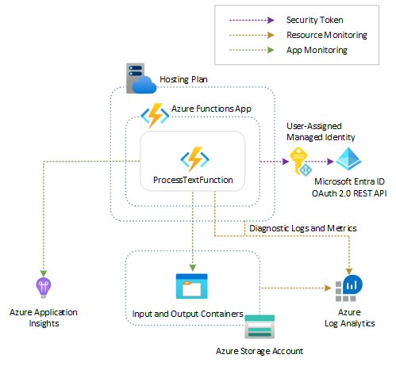
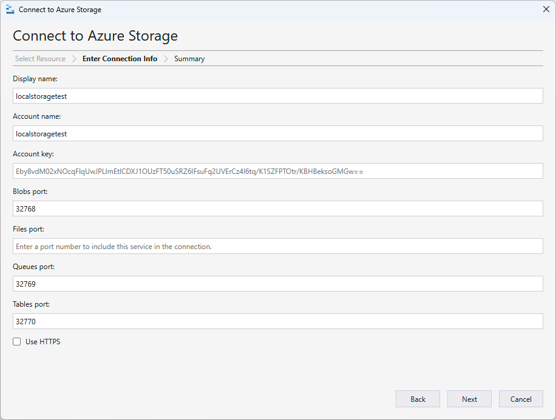

# Azure Functions App with Managed Identity

This sample demonstrates a serverless application hosted on [Azure Functions](https://learn.microsoft.com/en-us/azure/azure-functions/functions-overview), written in C# for the [.NET isolated worker model](https://learn.microsoft.com/en-us/azure/azure-functions/dotnet-isolated-process-guide), that reads text blobs from an `input` container, converts the text to uppercase, and stores the result as a blob in the `output` container of an [Azure Storage Account](https://learn.microsoft.com/en-us/azure/storage/blobs/storage-blobs-introduction). The application runs on an Azure App Service Plan and uses either a user-assigned or system-assigned managed identity to access storage.

A managed identity from Microsoft Entra ID enables your application to seamlessly access other Microsoft Entra-protected resources, such as Azure Key Vault. The Azure platform manages the identity, eliminating the need to provision or rotate secrets. For more information about managed identities in Microsoft Entra ID, see [Managed identities for Azure resources](https://learn.microsoft.com/en-us/azure/active-directory/managed-identities-azure-resources/overview).

You can configure the Azure Functions App to use two types of managed identities:

- A **system-assigned identity** is tied to the application and is deleted when the application is deleted. An application can have only one system-assigned identity.
- A **user-assigned identity** is a standalone Azure resource that can be assigned to your application. An application can have multiple user-assigned identities. A single user-assigned identity can be assigned to multiple Azure resources, such as multiple App Service applications.

For more information on how to create a managed identity for Azure App Service and Azure Functions applications, and how to use it to access other resources, see [Use managed identities for App Service and Azure Functions](https://learn.microsoft.com/en-us/azure/app-service/overview-managed-identity).

## Architecture

The following diagram illustrates the architecture of the solution:



- **Azure Functions App**: Hosts the serverless application that processes text blobs
- **Azure App Service Plan**: Provides compute resources for the Functions app: a Linux plan of the Basic (B1) tier, with Always On turned on so that the blob trigger keeps running. The sample doesn't use the Linux Consumption plan, because .NET 9 is the last .NET version that it supports ([Supported languages in Azure Functions](https://learn.microsoft.com/en-us/azure/azure-functions/supported-languages)).
- **Azure Blob Storage**: Contains `input` and `output` containers for storing text blobs
- **Managed Identity**: Enables secure access to Azure Storage without storing credentials
- **Azure Entra ID**: Issues security tokens for the managed identity to authenticate with Azure Storage
- **Azure Application Insights**: Collects the invocations, the log records, the exceptions, the custom events and the custom metric of the function, and the log records of the Functions host
- **Azure Log Analytics Workspace**: Stores the telemetry of Application Insights, the logs and metrics that the diagnostic settings of the function app, of the App Service plan, of the storage account and of its blob, queue and table services send to it, and the audit records of the queries run on it

## Security

This sample demonstrates how to configure an [Azure App Service](https://learn.microsoft.com/en-us/azure/app-service/configure-authentication-provider-aad?tabs=workforce-configuration), specifically an Azure Functions App, to use either a user-assigned identity or a system-assigned identity to acquire a security token from [Microsoft Entra ID](https://learn.microsoft.com/en-us/entra/fundamentals/what-is-entra) for accessing downstream services such as Azure Blob Storage. You must configure the target resource to allow access from your app. For most Azure services, configure the target resource by [creating a role assignment](https://learn.microsoft.com/en-us/azure/role-based-access-control/role-assignments-steps) for the user-assigned or system-assigned managed identity used by the application via Azure role-based access control (Azure RBAC). For more information, see [What is Azure RBAC?](https://learn.microsoft.com/en-us/azure/role-based-access-control/overview)

Some services use mechanisms other than Azure role-based access control. To understand how to configure access using an identity, refer to the Azure documentation for each target resource. To learn more about which resources support Microsoft Entra tokens, see [Azure services that support Microsoft Entra authentication](https://learn.microsoft.com/en-us/azure/active-directory/managed-identities-azure-resources/services-support-managed-identities#azure-services-that-support-azure-ad-authentication).

For example, if you [request a token](https://learn.microsoft.com/en-us/azure/app-service/overview-managed-identity?tabs=portal%2Chttp#connect-to-azure-services-in-app-code) to access a secret in Azure Key Vault, you must also create a role assignment that allows the managed identity to work with secrets in the target vault. Otherwise, Key Vault will reject your calls even if you use a valid token. The same is true for Azure SQL Database and other Azure services.

In this sample, the provisioning process assigns the [Storage Blob Data Contributor](https://learn.microsoft.com/en-us/azure/role-based-access-control/built-in-roles/storage#storage-blob-data-contributor) built-in role to the managed identity used by the Azure Functions App, with the demo storage account as the scope. This ensures the managed identity has the proper permissions to allow the application code to read and write blobs in the target `input` and `output` containers.

The LocalStack emulator emulates the following services, which are necessary at provisioning time and runtime:

- **Microsoft Entra Tenant**: This REST API is responsible for issuing a security token to the application to access the target service. For more information, see [Microsoft identity platform and OAuth 2.0 authorization code flow](https://learn.microsoft.com/en-us/entra/identity-platform/v2-oauth2-auth-code-flow).
- **Microsoft Graph REST API**: Microsoft Graph is the gateway to Microsoft cloud services like Microsoft Entra and Microsoft 365. In particular, it provides access to [service principals](https://learn.microsoft.com/en-us/graph/api/resources/serviceprincipal?view=graph-rest-1.0) used by applications via [workload identities](https://learn.microsoft.com/en-us/entra/workload-id/workload-identities-overview). In Microsoft Entra, workload identities are applications, service principals, and managed identities.
- **Azure Role-Based Access Control (RBAC)**: Azure role-based access control (Azure RBAC) helps you manage who has access to Azure resources, what they can do with those resources, and what areas they have access to. LocalStack for Azure fully supports and mocks built-in [role definitions](https://learn.microsoft.com/en-us/azure/role-based-access-control/role-definitions), custom role definitions, and [role assignments](https://learn.microsoft.com/en-us/azure/role-based-access-control/role-assignments), but does not enforce or check permissions.

## Prerequisites

- [lstk CLI](https://docs.localstack.cloud/aws/developer-tools/running-localstack/lstk/)
- [Azure Subscription](https://azure.microsoft.com/free/)
- [Azure CLI](https://learn.microsoft.com/en-us/cli/azure/install-azure-cli)
- [Azure Functions Core Tools](https://learn.microsoft.com/en-us/azure/azure-functions/functions-run-local)
- [.NET SDK 10](https://dotnet.microsoft.com/en-us/download), to build and publish the function app
- [Bicep extension](https://marketplace.visualstudio.com/items?itemName=ms-azuretools.vscode-bicep), if you plan to install the sample via Bicep.
- [Terraform](https://developer.hashicorp.com/terraform/downloads), if you plan to install the sample via Terraform.

> [!IMPORTANT]
> **Macs with Apple silicon**: the function app runs natively on arm64, but the emulator builds each deployment with Microsoft's Oryx build image, which Microsoft publishes for amd64 only ([microsoft/Oryx#2133](https://github.com/microsoft/Oryx/issues/2133) asks for arm64).
> Docker Desktop runs that build under amd64 emulation: in Docker Desktop's settings, under **General**, select the **Apple Virtualization framework** as the Virtual Machine Manager and turn on **Use Rosetta for x86_64/amd64 emulation on Apple Silicon**.
> Under QEMU, which Docker Desktop uses otherwise (Rosetta off, or Docker VMM, which has no Rosetta), the build can crash, because Oryx is a .NET app and [.NET does not support QEMU](https://github.com/dotnet/core/blob/main/release-notes/8.0/supported-os.md).

## Deployment

Set up the Azure emulator using the LocalStack for Azure Docker image. Before starting, ensure you have a valid `LOCALSTACK_AUTH_TOKEN` to access the Azure emulator. Refer to the [Auth Token guide](https://docs.localstack.cloud/getting-started/auth-token/) to obtain your Auth Token and set it in the `LOCALSTACK_AUTH_TOKEN` environment variable. The Azure Docker image is available on the [LocalStack Docker Hub](https://hub.docker.com/r/localstack/localstack-azure). To pull the image, execute:

```bash
docker pull localstack/localstack-azure
```

Start the LocalStack Azure emulator by running:

```bash
# Set the authentication token
export LOCALSTACK_AUTH_TOKEN=<your_auth_token>

# Start the LocalStack Azure emulator
lstk start --type azure

# Route all Azure CLI calls to the LocalStack Azure emulator
lstk az start-interception
```

Deploy the application to LocalStack for Azure using one of these methods:

- [Azure CLI Deployment](./scripts/README.md)
- [Bicep Deployment](./bicep/README.md)
- [Terraform Deployment](./terraform/README.md)

All deployment methods have been fully tested with both user-assigned and system-assigned managed identities against Azure and the LocalStack for Azure local emulator.

> [!NOTE]
> When you deploy the application to LocalStack for Azure for the first time, the initialization process involves downloading and building Docker images. This is a one-time operation—subsequent deployments will be significantly faster. Depending on your internet connection and system resources, this initial setup may take several minutes.

## Test

Once the resources and serverless application have been deployed, you can use the [test.sh](./scripts/test.sh) script below to copy a sample file to the `input` container and monitor whether the Azure Functions App processes the input blob file and generates a result file in the `output` container. 

```bash
#!/bin/bash

# Variables
PREFIX="${PREFIX:-local}"
SUFFIX="${SUFFIX:-test}"
FILE_PATH="input.txt"
INPUT_CONTAINER_NAME="input"
OUTPUT_CONTAINER_NAME="output"
STORAGE_ACCOUNT_NAME="${PREFIX}storage${SUFFIX}"
CURRENT_DIR="$(cd "$(dirname "$0")" && pwd)"
TEMP_OUTPUT_FILE=""

# On Windows, Git Bash and MSYS2 shells pass a path such as /tmp/... unconverted to Windows programs
# (az, curl, jq, python, docker) when MSYS_NO_PATHCONV=1 is set, as the README asks. cygpath, which
# those shells provide, returns the C:/... form those programs can open; elsewhere the path is unchanged.
native_path() {
	if command -v cygpath >/dev/null 2>&1; then
		cygpath -m "$1"
	else
		echo "$1"
	fi
}

cleanup() {
	if [ -n "$TEMP_OUTPUT_FILE" ] && [ -f "$TEMP_OUTPUT_FILE" ]; then
		rm -f "$TEMP_OUTPUT_FILE"
	fi
}

trap cleanup EXIT

# Change the current directory to the script's directory
cd "$CURRENT_DIR" || exit
# Generate a timestamp in the format YYYY-MM-DD-HH-MM-SS
TIMESTAMP=$(date +"%Y-%m-%d-%H-%M-%S")

# Extract the file name and extension
FILE_NAME=$(basename -- "$FILE_PATH")
FILE_BASE_NAME="${FILE_NAME%.*}"  # File name without extension
FILE_EXTENSION="${FILE_NAME##*.}" # File extension

# Construct the blob name with the timestamp
BLOB_NAME="${FILE_BASE_NAME}-${TIMESTAMP}.${FILE_EXTENSION}"

# Check whether the input container already exists
CONTAINER_EXISTS=$(az storage container exists \
	--name "$INPUT_CONTAINER_NAME" \
	--account-name "$STORAGE_ACCOUNT_NAME" \
	--auth-mode login | jq .exists)

if [ "$CONTAINER_EXISTS" == "true" ]; then
	echo "Container [$INPUT_CONTAINER_NAME] already exists."
else
	echo "Container [$INPUT_CONTAINER_NAME] does not exist."

	# Create the input container if it doesn't exist
	az storage container create \
		--name $INPUT_CONTAINER_NAME \
		--account-name $STORAGE_ACCOUNT_NAME \
		--auth-mode login
fi

# Check whether the output container already exists
CONTAINER_EXISTS=$(az storage container exists \
	--name "$OUTPUT_CONTAINER_NAME" \
	--account-name "$STORAGE_ACCOUNT_NAME" \
	--auth-mode login | jq .exists)

if [ "$CONTAINER_EXISTS" == "true" ]; then
	echo "Container [$OUTPUT_CONTAINER_NAME] already exists."
else
	echo "Container [$OUTPUT_CONTAINER_NAME] does not exist."

	# Create the output container if it doesn't exist
	az storage container create \
		--name $OUTPUT_CONTAINER_NAME \
		--account-name $STORAGE_ACCOUNT_NAME \
		--auth-mode login
fi

# Upload the file to the container
az storage blob upload \
	--container-name $INPUT_CONTAINER_NAME \
	--file "$FILE_PATH" \
	--name "$BLOB_NAME" \
	--account-name $STORAGE_ACCOUNT_NAME \
	--auth-mode login 1>/dev/null

echo "[$BLOB_NAME] file uploaded successfully to the [$INPUT_CONTAINER_NAME] container."

# Verify the upload by checking if the blob exists in the input container
BLOB_EXISTS=$(az storage blob exists \
	--container-name "$INPUT_CONTAINER_NAME" \
	--name "$BLOB_NAME" \
	--account-name "$STORAGE_ACCOUNT_NAME" \
	--auth-mode login \
	--query "exists" \
	--output tsv)

if [ "$BLOB_EXISTS" == "true" ]; then
	echo "Blob [$BLOB_NAME] exists in container [$INPUT_CONTAINER_NAME]. Upload verified."
else
	echo "Blob [$BLOB_NAME] does not exist in container [$INPUT_CONTAINER_NAME]. Upload failed."
	exit 1
fi

# Loop n times to check whether the function app processed the input file and generated the result file in the output container.
# On Azure the blob trigger of a new function app took over four minutes to pick up its first blob (2026-11-26), so the
# default wait there is ten minutes.
if [[ $(az cloud show --query name --output tsv | tr -d '\r') == "LocalStack" ]]; then
	n="${RETRY_COUNT:-36}"
else
	n="${RETRY_COUNT:-120}"
fi
seconds="${SLEEP:-5}"

for ((i=1; i<=n; i++)); do
	echo "Checking for [$BLOB_NAME] file in the [$OUTPUT_CONTAINER_NAME] container (Attempt $i of $n)..."
	
	BLOB_EXISTS=$(az storage blob exists \
		--container-name "$OUTPUT_CONTAINER_NAME" \
		--name "$BLOB_NAME" \
		--account-name "$STORAGE_ACCOUNT_NAME" \
		--auth-mode login \
		--query "exists" \
		--output tsv)

	if [ "$BLOB_EXISTS" == "true" ]; then
		echo "Processed file [$BLOB_NAME] found in the [$OUTPUT_CONTAINER_NAME] container."
		TEMP_OUTPUT_FILE="$(mktemp "${TMPDIR:-/tmp}/processed-output.XXXXXX")" || { echo "Failed to create temporary file." >&2; exit 1; }
		TEMP_OUTPUT_FILE="$(native_path "$TEMP_OUTPUT_FILE")"

		az storage blob download \
			--container-name "$OUTPUT_CONTAINER_NAME" \
			--name "$BLOB_NAME" \
			--file "$TEMP_OUTPUT_FILE" \
			--account-name "$STORAGE_ACCOUNT_NAME" \
			--auth-mode login 1>/dev/null || { echo "Failed to download processed blob [$BLOB_NAME] from container [$OUTPUT_CONTAINER_NAME]." >&2; exit 1; }

		echo "Input file [$FILE_PATH]:"
		cat "$FILE_PATH"

		echo ""
		echo "Processed output file [$BLOB_NAME]:"
		cat "$TEMP_OUTPUT_FILE"
		echo ""

		exit 0
	fi

	echo "Processed file not found yet. Waiting for $seconds seconds before retrying..."
	sleep $seconds
done

echo "Processed file was not found in the [$OUTPUT_CONTAINER_NAME] container after $n attempts. Exiting with failure."
exit 1
```

If everything works as expected, you should see output similar to the following:

```bash
./test.sh
Container [input] already exists.
Container [output] already exists.
Finished[#############################################################]  100.0000%
[input-2026-11-16-14-37-05.txt] file uploaded successfully to the [input] container.
Blob [input-2026-11-16-14-37-05.txt] exists in container [input]. Upload verified.
Checking for [input-2026-11-16-14-37-05.txt] file in the [output] container (Attempt 1 of 36)...
Processed file not found yet. Waiting for 5 seconds before retrying...
Checking for [input-2026-11-16-14-37-05.txt] file in the [output] container (Attempt 2 of 36)...
Processed file [input-2026-11-16-14-37-05.txt] found in the [output] container.
Finished[#############################################################]  100.0000%
Input file [input.txt]:
Hi mate, how are you?
Processed output file [input-2026-11-16-14-37-05.txt]:
HI MATE, HOW ARE YOU?
```

## Application Insights

The function app sends its telemetry to `<prefix>-insights-<suffix>`, a workspace-based [Application Insights](https://learn.microsoft.com/en-us/azure/azure-monitor/app/app-insights-overview) resource that stores it in the `<prefix>-log-analytics-<suffix>` [Log Analytics workspace](https://learn.microsoft.com/en-us/azure/azure-monitor/logs/log-analytics-workspace-overview). The `APPLICATIONINSIGHTS_CONNECTION_STRING` app setting holds the connection string of the resource: the Azure CLI scripts pass `--app-insights <prefix>-insights-<suffix>` to `az functionapp create`, which sets it, and the Bicep and Terraform modules set it themselves. The app uses [OpenTelemetry with Azure Functions](https://learn.microsoft.com/en-us/azure/azure-functions/opentelemetry-howto):

- `host.json` sets `"telemetryMode": "OpenTelemetry"`, so that the Functions host exports its own telemetry through OpenTelemetry.
- `Program.cs` adds the OpenTelemetry of the isolated worker (`Microsoft.Azure.Functions.Worker.OpenTelemetry`) with the Azure Monitor exporter (`Azure.Monitor.OpenTelemetry.Exporter`) and the meter of `BlobTelemetry`, so that the worker sends the log records of the function, the exceptions it logs, the custom event and the custom metric.

The function sends a [custom event](https://learn.microsoft.com/en-us/azure/azure-monitor/app/opentelemetry-add-modify#send-custom-events) for each file it processes and counts the files in the `processed_blobs` [custom metric](https://learn.microsoft.com/en-us/azure/azure-monitor/app/opentelemetry-add-modify#add-custom-metrics). The exporter sends a log record whose message template carries the `microsoft.custom_event.name` attribute as a custom event named after its value, with the other attributes as its custom dimensions:

```csharp
private static readonly Counter<long> ProcessedBlobs = Meter.CreateCounter<long>(
    "processed_blobs",
    unit: "{blob}",
    description: "The number of blobs the function processed.");

logger.LogInformation(
    "{microsoft.custom_event.name} {blob.name} {blob.size}",
    "BlobProcessed",
    blobName,
    blobSize);
ProcessedBlobs.Add(1, new KeyValuePair<string, object?>("container", outputContainer));
```

The workspace keeps the telemetry in these tables:

| Table           | What the function app sends                                                                                                    |
| --------------- | ------------------------------------------------------------------------------------------------------------------------------ |
| `AppRequests`   | The invocations of the `ProcessTextFunction` function, one per processed blob                                                  |
| `AppTraces`     | The log records of the function and of the Functions host, such as `Executed 'Functions.ProcessTextFunction'`                  |
| `AppEvents`     | The `BlobProcessed` custom event of each processed file, with the name and the size of the blob in `blob.name` and `blob.size` |
| `AppMetrics`    | The `processed_blobs` custom metric, with the output container in `container`                                                  |
| `AppExceptions` | The exceptions the function logs with their stack trace, such as a file that isn't UTF-8 text                                  |

The `az monitor log-analytics query` command of the `log-analytics` extension of the Azure CLI reads them, given the workspace id (`customerId`) of the workspace:

```bash
az extension add --name log-analytics

WORKSPACE_ID=$(az monitor log-analytics workspace show \
  --resource-group local-rg \
  --workspace-name local-log-analytics-test \
  --query customerId \
  --output tsv)

az monitor log-analytics query \
  --workspace "$WORKSPACE_ID" \
  --analytics-query "AppRequests | where Name == 'ProcessTextFunction' | project TimeGenerated, Name, Success, DurationMs | order by TimeGenerated desc | take 3" \
  --output table
```

[`scripts/query-telemetry.sh`](./scripts/query-telemetry.sh) runs `test.sh`, which uploads a text file that the function processes, then reads the tables back, retrying until their records arrive. When the custom metric is three minutes late, it uploads another file once a minute: the function app exports its metrics once a minute, and on Azure the Functions host can restart right after the first invocation that follows a deployment, before it exported that point. It shows the exceptions without waiting for them: a healthy run has none. It exits with a non-zero code when `test.sh` fails, or when a query still lacks its records after `RETRY_COUNT` attempts (30 by default) made `SLEEP` seconds apart (10 by default).

### Query the telemetry on the Logs page

Besides the `BlobProcessed` custom event, the function logs `Blob processed: <name> (<size> bytes)` for each blob it processes, and a failure logs the exception with its stack trace. [`scripts/query-telemetry.sh`](./scripts/query-telemetry.sh) waits for these traces after [`scripts/test.sh`](./scripts/test.sh) uploads a file.

To query the telemetry yourself, open the `<prefix>-insights-<suffix>` Application Insights resource and select **Logs** under **Monitoring**:

- On Azure, open the resource in the [Azure portal](https://portal.azure.com).
- On the emulator, open the emulated Azure portal at `http://localhost:4566/_localstack/portal/` (see [Azure Portal Emulator](https://docs.localstack.cloud/azure/developer-tools/portal/)) and select **Sign in**: the sign-in is a mock and asks for no credentials. Then select **Resource groups**, `local-rg`, the `local-insights-test` resource and **Logs**.

Type a query in the [Kusto Query Language](https://docs.localstack.cloud/azure/developer-tools/kusto-query-language/) (KQL) and select **Run**: the **Results** tab lists the records, and the **Chart** tab draws the chart of a query that ends with `render`. The Logs page of an Application Insights resource reads the classic Application Insights tables, which hold the same records as the tables of the Log Analytics workspace under other names:

| Application Insights | Log Analytics workspace | Records                                       |
| -------------------- | ----------------------- | --------------------------------------------- |
| `requests`           | `AppRequests`           | The invocations of the functions              |
| `dependencies`       | `AppDependencies`       | The calls to other services                   |
| `traces`             | `AppTraces`             | The records of the loggers                    |
| `exceptions`         | `AppExceptions`         | The exceptions logged, with their stack trace |
| `customEvents`       | `AppEvents`             | The custom events                             |
| `customMetrics`      | `AppMetrics`            | The custom metrics                            |

Their columns are renamed too, for example `timestamp` (`TimeGenerated`), `name` (`Name`), `success` (`Success`), `duration` (`DurationMs`), `resultCode` (`ResultCode`), `operation_Id` (`OperationId`), `operation_Name` (`OperationName`), `cloud_RoleName` (`AppRoleName`), `severityLevel` (`SeverityLevel`), `message` (`Message`), `type` (`ExceptionType`), `valueSum` (`Sum`) and `customDimensions` (`Properties`). To run the queries below on the workspace, with its **Logs** page or `az monitor log-analytics query`, use the names in parentheses.

The `customDimensions` column holds the custom properties of each record: the `BlobProcessed` events carry the name and the size of the blob in `blob.name` and `blob.size`, and the `processed_blobs` metric carries the output container in `container`. Read a property with `tostring(customDimensions["<name>"])`, for example in the latest `BlobProcessed` events:

```kusto
customEvents
| where timestamp > ago(1h) and name == "BlobProcessed"
| project timestamp, Blob = tostring(customDimensions["blob.name"])
| order by timestamp desc
```

These queries read the telemetry and draw charts of it:

- **Requests and failures over time.** The requests and the failed requests (`success == false`) in 5-second buckets, to spot traffic spikes and error regressions:

  ```kusto
  requests
  | where timestamp > ago(6h)
  | summarize
      TotalRequests = count(),
      FailedRequests = countif(success == false)
      by bin(timestamp, 5s)
  | render timechart
  ```

- **Latency percentiles per function.** The 50th, 95th and 99th percentiles of the duration of each function, which show the slow requests that an average hides:

  ```kusto
  requests
  | where timestamp > ago(24h)
  | summarize
      RequestCount = count(),
      P50_ms = percentile(duration, 50),
      P95_ms = percentile(duration, 95),
      P99_ms = percentile(duration, 99)
      by name
  | where RequestCount > 1
  | top 10 by P95_ms desc
  | project name, P50_ms, P95_ms, P99_ms
  | render columnchart
  ```

- **Status codes over time.** The `2xx`, `4xx` and `5xx` responses over time, to tell client errors from server faults:

  ```kusto
  requests
  | where timestamp > ago(12h)
  | extend StatusBucket = strcat(substring(resultCode, 0, 1), "xx")
  | summarize Count = count() by bin(timestamp, 15m), StatusBucket
  | render columnchart with (kind=stacked)
  ```

- **Top exceptions.** The exceptions by type and by the operation that raised them, to find the most frequent failures:

  ```kusto
  exceptions
  | where timestamp > ago(24h)
  | summarize ExceptionCount = count() by type, operation_Name
  | top 10 by ExceptionCount desc
  | render barchart
  ```

- **Traces by severity.** The records of the loggers by severity level (`0` Verbose, `1` Information, `2` Warning, `3` Error, `4` Critical), to catch a storm of warnings before requests start failing:

  ```kusto
  traces
  | where timestamp > ago(6h)
  | extend Severity = case(
      severityLevel == 0, "Verbose",
      severityLevel == 1, "Information",
      severityLevel == 2, "Warning",
      severityLevel == 3, "Error",
      severityLevel == 4, "Critical",
      "Unknown")
  | summarize LogCount = count() by bin(timestamp, 5m), Severity
  | render areachart with (kind=stacked)
  ```

- **The invocations of the function.** The invocations of `ProcessTextFunction`:

  ```kusto
  requests
  | where name startswith "ProcessTextFunction"
  | project timestamp, name, success, duration
  ```

- **Traces that start with a text.** The traces of the last 30 minutes whose message starts with a given text, here the confirmations of the blobs processed:

  ```kusto
  let text = "Blob processed";
  traces
  | where timestamp > ago(30m) and message startswith text
  | project timestamp, message
  ```

- **Requests by name.** The number of requests of each name:

  ```kusto
  requests
  | summarize Count = count() by Name = name
  | render scatterchart
  ```

- **Custom events per minute.** The custom events per minute, by name:

  ```kusto
  customEvents
  | summarize Count = count() by bin(timestamp, 1m), Name = name
  | render timechart
  ```

- **Custom metric.** The `processed_blobs` custom metric per minute, by output container:

  ```kusto
  customMetrics
  | where timestamp > ago(6h) and name == "processed_blobs"
  | summarize Total = sum(valueSum) by bin(timestamp, 1m), Container = tostring(customDimensions["container"])
  | render columnchart with (kind=stacked)
  ```

## Logs and metrics

Each resource that offers [diagnostic settings](https://learn.microsoft.com/en-us/azure/azure-monitor/data-collection/diagnostic-settings) has one named `default` that sends its resource logs and its platform metrics to the same workspace:

| Resource                       | Log categories                                 | Tables in the workspace                                                   | What the function app leaves there                                                                                                                                                                                                      |
| ------------------------------ | ---------------------------------------------- | ------------------------------------------------------------------------- | --------------------------------------------------------------------------------------------------------------------------------------------------------------------------------------------------------------------------------------- |
| Function App                   | `FunctionAppLogs`                              | `FunctionAppLogs`                                                         | The records the Functions host writes when an invocation of a function starts and completes, whose category names the function (`Function.ProcessTextFunction`)                                                                         |
| App Service plan               | None: metrics only                             | `AzureMetrics`                                                            | The CPU and memory use of its instances                                                                                                                                                                                                 |
| Storage account                | None: metrics only                             | `AzureMetrics`                                                            | The transactions of the account                                                                                                                                                                                                         |
| Blob, queue and table services | `StorageRead`, `StorageWrite`, `StorageDelete` | `StorageBlobLogs`, `StorageQueueLogs`, `StorageTableLogs`, `AzureMetrics` | Each request to the blobs, the queues and the tables: the function reads the input files and writes the output files with its managed identity (`OAuth`), and the Functions host keeps its own data with the account key (`AccountKey`) |
| Log Analytics workspace        | `Audit`                                        | `LAQueryLogs`, `AzureMetrics`                                             | The queries run on the workspace, such as the ones of the scripts below                                                                                                                                                                 |

The Application Insights resource has no diagnostic setting: its telemetry is already in the workspace it's based on, and a diagnostic setting of a workspace-based Application Insights resource [can't send to that workspace](https://learn.microsoft.com/en-us/azure/azure-monitor/app/export-telemetry#diagnostic-settings-based-export). The user-assigned managed identity offers no diagnostic settings.

The platform metrics of the function app land in the `AzureMetrics` table too. On Azure these are its memory, I/O and HTTP metrics, such as `MemoryWorkingSet`, but not the executions of its functions (`FunctionExecutionCount`), which only the metrics API serves (observed on Azure on 2026-11-16). A few queries to try:

```kusto
// The records of the invocations of the function
FunctionAppLogs
| where Category == "Function.ProcessTextFunction"
| project TimeGenerated, EventName, Level, Message

// The memory the function app uses, minute by minute
AzureMetrics
| where MetricName == "MemoryWorkingSet"
| project TimeGenerated, Average

// The requests to the blobs: the function's, authenticated with its managed identity (OAuth), and the Functions host's (AccountKey)
StorageBlobLogs
| summarize Requests = count() by OperationName, AuthenticationType
```

The platform metrics need no diagnostic setting: the Azure Monitor metrics API serves them directly, for example with `az monitor metrics list --resource <function-app-id> --metrics FunctionExecutionCount --aggregation Total`.

[`scripts/query-logs-and-metrics.sh`](./scripts/query-logs-and-metrics.sh) does all of this in one go: it lists the diagnostic settings of the function app, of the plan, of the storage account, of its services and of the workspace, runs `test.sh`, and reads until their records arrive the invocation records, the exported platform metrics of the function app and of the plan, the requests to the blobs and to the queues, the transaction metrics of the storage account and of its services, and the audit records of the queries run on the workspace. It ends with the executions of the function app and the transactions of the storage account read from the metrics API. It exits with a non-zero code in the same cases as `query-telemetry.sh`, except for the exported platform metrics on Azure (see below). On Azure an execution can be counted in the minute after the one in which it ran.

### Delivery times

On the emulator the records are queryable within seconds, and the platform metrics (`AzureMetrics`) once their one-minute window is over. On Azure the telemetry of Application Insights takes a few minutes, and the first records of a new diagnostic setting can take [up to 90 minutes](https://learn.microsoft.com/en-us/azure/azure-monitor/data-collection/diagnostic-settings#expected-latency-after-creating-a-diagnostic-setting): run the queries again later, or raise `RETRY_COUNT` for the scripts. The exported platform metrics (`AzureMetrics`) are the exception: Azure exports them late and irregularly, so on Azure `query-logs-and-metrics.sh` reads them once, shows those that arrived and notes how many are still missing, without failing. On Azure the records of what the app did while it started can be missing for good when its diagnostic setting was created shortly before: the scripts read the latest records, which their own calls produced.

## Storage Contents

You can use [Azure Storage Explorer](https://learn.microsoft.com/en-us/azure/storage/storage-explorer/vs-azure-tools-storage-manage-with-storage-explorer) to confirm that your Azure Functions App creates the blobs in the `output` container in the emulated storage account. To do this:

- Expand **Emulator & Attached**.
- Right-click **Storage Accounts**.
- Select **Connect to Azure Storage...**.
- In the dialog that appears, enter the name of the emulated storage account and specify the published ports, as shown in the following picture:



> [!TIP]
> When sending commands to an emulated storage account, make sure to use the primary key generated by the emulator itself. For convenience, if you're connecting to the storage account directly with Azure Storage Explorer, you can use the default Azurite password. For more details, see [Connect to Azurite with SDKs and tools](https://learn.microsoft.com/en-us/azure/storage/common/storage-connect-azurite).

## References

- [Azure Functions Documentation](https://docs.microsoft.com/en-us/azure/azure-functions/)
- [What is Azure Blob storage?](https://learn.microsoft.com/en-us/azure/storage/blobs/storage-blobs-overview)
- [What is managed identities for Azure resources?](https://learn.microsoft.com/en-us/entra/identity/managed-identities-azure-resources/overview)
- [How managed identities for Azure resources work with Azure virtual machines](https://learn.microsoft.com/en-us/entra/identity/managed-identities-azure-resources/how-managed-identities-work-vm)
- [Application Insights overview](https://learn.microsoft.com/en-us/azure/azure-monitor/app/app-insights-overview)
- [Diagnostic settings in Azure Monitor](https://learn.microsoft.com/en-us/azure/azure-monitor/data-collection/diagnostic-settings)
- [Log Analytics workspace overview](https://learn.microsoft.com/en-us/azure/azure-monitor/logs/log-analytics-workspace-overview)
- [Monitor executions in Azure Functions](https://learn.microsoft.com/en-us/azure/azure-functions/functions-monitoring)
- [LocalStack for Azure](https://docs.localstack.cloud/azure/)
- [lstk CLI](https://docs.localstack.cloud/aws/developer-tools/running-localstack/lstk/)
- [lstk GitHub repository](https://github.com/localstack/lstk)
