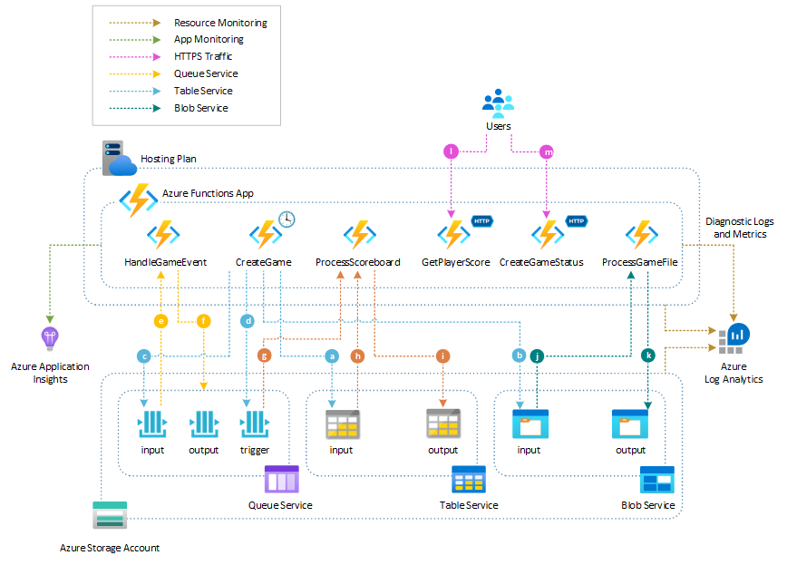
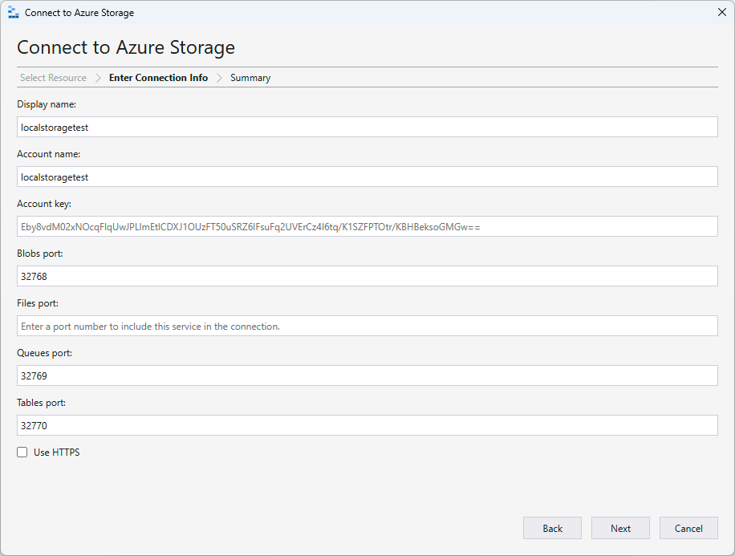
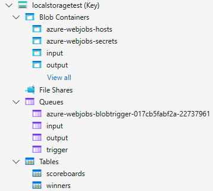
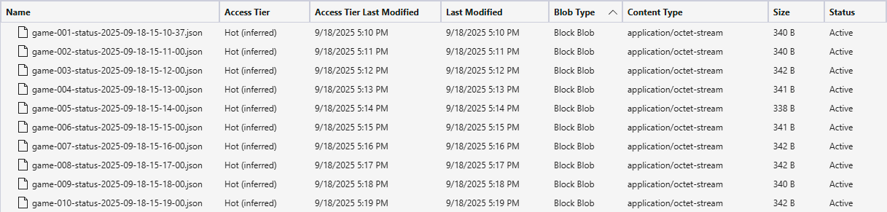
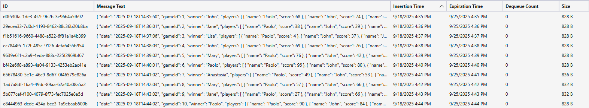
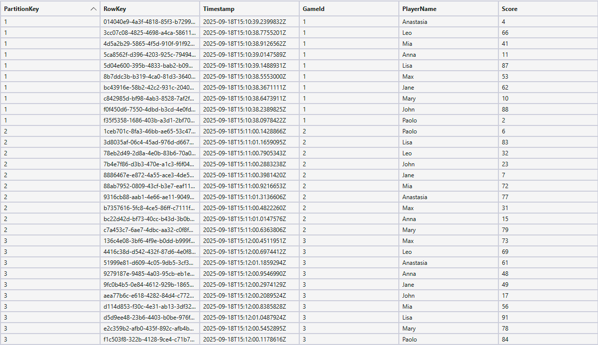
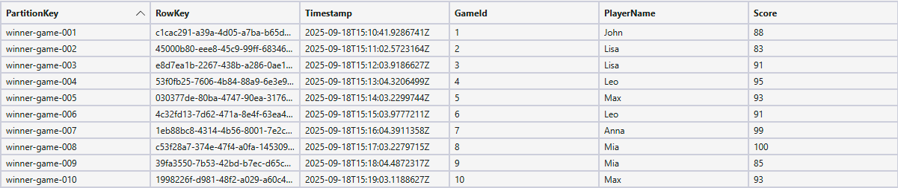

# Azure Functions Sample with LocalStack for Azure

This sample demonstrates a comprehensive gaming scoreboard system built with Python [Azure Functions](https://learn.microsoft.com/en-us/azure/azure-functions/functions-overview) running against [LocalStack for Azure](https://docs.localstack.cloud/azure/). The application showcases how Azure Functions can seamlessly interact with Azure Storage services (Queues, Blobs, and Tables) when both the Azure Function App and storage services are running in emulated fashion locally on your machine using LocalStack for Azure.

## Overview

The sample implements a complete gaming workflow that:

- **Manages game sessions** with player scoring and winner determination
- **Processes game events** through multiple Azure Storage services
- **Demonstrates hybrid storage architecture** using both Azure Storage services and in-memory data structures
- **Runs entirely locally** using LocalStack for Azure emulation
- **Showcases real-world Azure Functions patterns** with triggers, bindings, and best practices

## Architecture

The following diagram illustrates the architecture of the sample application, showing how Azure Functions interact with various Azure Storage services through LocalStack for Azure emulation:



The system uses a **hybrid storage approach** combining:

- **Azure Blob Storage**: for game file processing and data exchange
- **Azure Queue Storage**: for asynchronous event processing and workflow coordination  
- **Azure Table Storage**: for persistent winner records
- **In-memory Dictionary**: for fast access to active game data with thread-safe operations

The functions are written with the [Python v2 programming model](https://learn.microsoft.com/en-us/azure/azure-functions/functions-reference-python) and run on Python 3.13, on a Linux App Service plan of the Basic (B1) tier with Always On turned on, so that the timer, queue and blob triggers keep running, as in the [.NET version](../dotnet/README.md) of the sample. For monitoring, the sample adds:

- **Azure Application Insights**: Collects the invocations and the log records of the functions and of the Functions host, the exceptions the functions log, their `GameCreated` and `GameWinnerDetermined` custom events and their `games_completed` custom metric. See [Application Insights](#application-insights).
- **Azure Log Analytics Workspace**: Stores the telemetry of Application Insights, and the logs and metrics that the diagnostic settings of the function app, its App Service plan, the storage account and its blob, queue and table services, and the workspace itself send to it. See [Logs and metrics](#logs-and-metrics).

## Azure Functions Triggers and Bindings

### Triggers Used

| Trigger Type                                                                                                     | Function            | Description                                                                  |
| ---------------------------------------------------------------------------------------------------------------- | ------------------- | ---------------------------------------------------------------------------- |
| [HttpTrigger](https://learn.microsoft.com/en-us/azure/azure-functions/functions-bindings-http-webhook-trigger)   | `GetPlayerScore`    | GET endpoint to retrieve player scores: `/api/player/{gameId}/{name}/status` |
| [HttpTrigger](https://learn.microsoft.com/en-us/azure/azure-functions/functions-bindings-http-webhook-trigger)   | `CreateGameStatus`  | POST/PUT endpoint for game status requests: `/api/game/session`              |
| [BlobTrigger](https://learn.microsoft.com/en-us/azure/azure-functions/functions-bindings-storage-blob-trigger)   | `ProcessGameFile`   | Processes uploaded game files from input container                           |
| [QueueTrigger](https://learn.microsoft.com/en-us/azure/azure-functions/functions-bindings-storage-queue-trigger) | `HandleGameEvent`   | Processes game events from input queue                                       |
| [QueueTrigger](https://learn.microsoft.com/en-us/azure/azure-functions/functions-bindings-storage-queue-trigger) | `ProcessScoreboard` | Processes scoreboard data from trigger queue                                 |
| [TimerTrigger](https://learn.microsoft.com/en-us/azure/azure-functions/functions-bindings-timer)                 | `CreateGame`        | Runs every minute to generate new game rounds                                |

### Bindings Used

| Binding Type                                                                                                   | Usage               | Description                                       |
| -------------------------------------------------------------------------------------------------------------- | ------------------- | ------------------------------------------------- |
| [BlobOutput](https://learn.microsoft.com/en-us/azure/azure-functions/functions-bindings-storage-blob-output)   | `ProcessGameFile`   | Outputs processed game status to output container |
| [QueueOutput](https://learn.microsoft.com/en-us/azure/azure-functions/functions-bindings-storage-queue-output) | `HandleGameEvent`   | Sends processed events to output queue            |
| [TableInput](https://learn.microsoft.com/en-us/azure/azure-functions/functions-bindings-storage-table-input)   | `ProcessScoreboard` | Reads scoreboard entities by game ID              |
| [TableOutput](https://learn.microsoft.com/en-us/azure/azure-functions/functions-bindings-storage-table-output) | `ProcessScoreboard` | Writes winner records to winners table            |

## Function Details

This section describes individual functions used in the sample. For more information, see [Azure Functions Methods Documentation](./METHODS.md).

### 1. GetPlayerScore
- **Route**: `GET /api/player/{gameId}/{name}/status`
- **Purpose**: Retrieves individual player scores for a specific game
- **Input**: `gameId` and `name` parameters in the route
- **Response**: `PlayerScoreResponse` with player name, score, and timestamp

### 2. CreateGameStatus  
- **Route**: `POST|PUT /api/game/session`
- **Purpose**: Processes game status requests and returns comprehensive game information
- **Input**: `GameStatusRequest` with game ID
- **Response**: `GameStatusResponse` with winner, all players, and game details

### 3. ProcessGameFile
- **Trigger**: New blobs in the `input` container
- **Purpose**: Processes uploaded game status files
- **Workflow**: Receives blob from `input` container → Deserializes `GameStatusRequest` → Creates `GameStatusResponse` from in-memory data -> Outputs `GameStatusResponse` to `output` container


### 4. HandleGameEvent
- **Trigger**: Messages in the `input` queue
- **Purpose**: Processes game events asynchronously
- **Workflow**: Reads messages from the `input` queue → Processes `GameStatusRequest` → Outputs `GameStatusResponse` to the `output` queue

### 5. ProcessScoreboard
- **Trigger**: Messages in trigger queue
- **Purpose**: Determines game winners and records them permanently
- **Workflow**: Reads entities from the `scoreboards` table → Finds highest score → Creates winner record in `winners` table

### 6. CreateGame (Timer Function)
- **Schedule**: Every minute (`0 */1 * * * *`) + runs on startup
- **Purpose**: Generates new game rounds with random player data
- **Workflow**: 
  1. Creates `GameStatusRequest` with new game ID
  2. Uploads game file to `input` container (triggers `ProcessGameFile` function)
  3. Sends message to `input` queue (triggers `HandleGameEvent` function)
  4. Sends trigger message to `trigger` queue (triggers `ProcessScoreboard` function)
  5. Creates in-memory game data with random player scores
  6. Increments game ID for next round

## Game Data Model

The functions exchange JSON documents, the same ones as the .NET version of the sample: a game status request (`gameId`), a game status response (`date`, `gameId`, `winner` and the `players` with their `name` and `score`), a player score response (`date`, `gameId`, `name`, `score`), and the scoreboard and winner entities of Table Storage (`PartitionKey`, `RowKey`, `GameId`, `PlayerName`, `Score`). See [Data Models](./METHODS.md#data-models).

### Configuration

The sample uses the following configurable settings in `local.settings.json`:

```json
{
  "STORAGE_ACCOUNT_CONNECTION_STRING": "Storage account connection string",
  "INPUT_STORAGE_CONTAINER_NAME": "input", 
  "OUTPUT_STORAGE_CONTAINER_NAME": "output",
  "INPUT_QUEUE_NAME": "input",
  "OUTPUT_QUEUE_NAME": "output", 
  "TRIGGER_QUEUE_NAME": "trigger",
  "INPUT_TABLE_NAME": "scoreboards",
  "OUTPUT_TABLE_NAME": "winners",
  "PLAYER_NAMES": "Anastasia,Paolo,Leo,Mia,Bob"
}
```

## Prerequisites

- [lstk CLI](https://docs.localstack.cloud/aws/developer-tools/running-localstack/lstk/): LocalStack command-line interface.
- [LocalStack for Azure](https://docs.localstack.cloud/azure/) for Azure services emulation.
- [Visual Studio Code](https://code.visualstudio.com/) installed on one of the [supported platforms](https://code.visualstudio.com/docs/supporting/requirements#_platforms).
- [Azure Functions Core Tools](https://learn.microsoft.com/en-us/azure/azure-functions/functions-run-local) let you develop and test your functions on your local computer.
- [Bicep extension](https://marketplace.visualstudio.com/items?itemName=ms-azuretools.vscode-bicep), if you plan to install the sample via Bicep.
- [Terraform](https://developer.hashicorp.com/terraform/downloads), if you plan to install the sample via Terraform.
- [Python 3.13](https://www.python.org/downloads/), to run the functions locally with the Azure Functions Core Tools. The deployments don't need it: they upload the code, and a remote build installs the packages of `requirements.txt`.
- [Docker](https://docs.docker.com/get-docker/) necessary as container runtime for LocalStack.
- [Azure CLI](https://learn.microsoft.com/en-us/cli/azure/install-azure-cli) necessary to work with LocalStack.
- [lstk CLI](https://docs.localstack.cloud/aws/developer-tools/running-localstack/lstk/) is a high-performance command-line interface for LocalStack.
- [jq](https://jqlang.org/) is a JSON processor for scripting.
- [Azure Storage Explorer](https://learn.microsoft.com/en-us/azure/storage/storage-explorer/vs-azure-tools-storage-manage-with-storage-explorer) for viewing storage contents.

> [!IMPORTANT]
> **Macs with Apple silicon**: the function app runs natively on arm64, but the emulator builds each deployment with Microsoft's Oryx build image, which Microsoft publishes for amd64 only ([microsoft/Oryx#2133](https://github.com/microsoft/Oryx/issues/2133) asks for arm64).
> Docker Desktop runs that build under amd64 emulation: in Docker Desktop's settings, under **General**, select the **Apple Virtualization framework** as the Virtual Machine Manager and turn on **Use Rosetta for x86_64/amd64 emulation on Apple Silicon**.
> Under QEMU, which Docker Desktop uses otherwise (Rosetta off, or Docker VMM, which has no Rosetta), the build can crash, because Oryx is a .NET app and [.NET does not support QEMU](https://github.com/dotnet/core/blob/main/release-notes/8.0/supported-os.md).

## Deployment

1. You can set up the Azure emulator by utilizing LocalStack for Azure Docker image. Before starting, ensure you have a valid `LOCALSTACK_AUTH_TOKEN` to access the Azure emulator. Refer to the [Auth Token guide](https://docs.localstack.cloud/getting-started/auth-token/) to obtain your Auth Token and specify it in the `LOCALSTACK_AUTH_TOKEN` environment variable. The Azure Docker image is available on the [LocalStack Docker Hub](https://hub.docker.com/r/localstack/localstack-azure). To pull the Azure Docker image, execute the following command:

   ```bash
   docker pull localstack/localstack-azure
   ```

2. Start the LocalStack Azure emulator with the lstk CLI:

   ```bash
   export LOCALSTACK_AUTH_TOKEN=<your_auth_token>
   lstk start --type azure
   ```

3. Deploy the application to LocalStack for Azure using one of the following methods:

    - [Azure CLI Deployment](./scripts/README.md)
    - [Bicep Deployment](./bicep/README.md)
    - [Terraform Deployment](./terraform/README.md)

All deployment methods have been fully tested against Azure and the LocalStack for Azure local emulator.

> [!NOTE]
> The first time you run Azure Functions on LocalStack for Azure, the emulator downloads a ZIP archive of the selected version of the [Azure Functions Core Tools](https://github.com/Azure/azure-functions-core-tools/tags) to build the container image that hosts your functions. By default, version 4.15.1 is used (4.13.0 on an arm64 host). You can override this by setting the `LS_AZURE_FUNCTIONS_CORE_TOOLS_VERSION` environment variable on the emulator. The archive is large (over 500 MB), so the initial download may take several minutes. Subsequent runs will use the cached copy.

## Test

Use the [call-http-triggers.sh](./scripts/call-http-triggers.sh) script to quickly test the sample's HTTP-triggered Azure Functions and verify player status or game session details. The script below demonstrates three methods for calling HTTP-triggered functions:

1. **Via the default hostname**: Call the function app via the default hostname `<function-app-name>.azurewebsites.azure.localhost.localstack.cloud:4566`.
2. **Via localhost and host port mapped to the container's port**: Use `127.0.0.1` with the host port mapped to the container's port `80`.
3. **Via container IP address**: Use the app container's IP address on port `80`. This technique is only available when accessing the function app from the Docker host machine.

## Application Insights

The function app sends its telemetry to `<prefix>-insights-<suffix>`, a workspace-based [Application Insights](https://learn.microsoft.com/en-us/azure/azure-monitor/app/app-insights-overview) resource that stores it in the `<prefix>-log-analytics-<suffix>` [Log Analytics workspace](https://learn.microsoft.com/en-us/azure/azure-monitor/logs/log-analytics-workspace-overview). The `APPLICATIONINSIGHTS_CONNECTION_STRING` app setting holds the connection string of the resource: the Azure CLI script passes `--app-insights <prefix>-insights-<suffix>` to `az functionapp create`, which sets it, and the Bicep and Terraform modules set it themselves. The app uses [OpenTelemetry with Azure Functions](https://learn.microsoft.com/en-us/azure/azure-functions/opentelemetry-howto):

- `host.json` sets `"telemetryMode": "OpenTelemetry"`, so that the Functions host exports its own telemetry through OpenTelemetry.
- `requirements.txt` adds `azure-monitor-opentelemetry`, and the `PYTHON_APPLICATIONINSIGHTS_ENABLE_TELEMETRY` app setting, set to `true`, has the Python worker send the telemetry of the functions itself, instead of the host forwarding its log records.
- The `PYTHON_APPLICATIONINSIGHTS_LOGGER_NAME` app setting, set to `function_app`, has the worker send the records of the functions' logger only. Without it the worker sends the records of every logger, its own and the OpenTelemetry exporter's HTTP requests included.

The functions send a `GameCreated` [custom event](https://learn.microsoft.com/en-us/azure/azure-monitor/app/opentelemetry-add-modify#send-custom-events) for each game the timer creates and a `GameWinnerDetermined` custom event for each winner a function determines, with the game, the winner and the source of the request (`http`, `blob`, `queue` or `table`) in `game.id`, `game.winner` and `game.source`, and count the completed games in the `games_completed` [custom metric](https://learn.microsoft.com/en-us/azure/azure-monitor/app/opentelemetry-add-modify#add-custom-metrics), by `source`. The worker sends a log record that carries the `microsoft.custom_event.name` attribute as a custom event named after its value, with the other attributes as its custom dimensions:

```python
games_completed = metrics.get_meter("function_app").create_counter(
    "games_completed",
    unit="{game}",
    description="The number of games whose winner a function determined, by the source of the request.",
)

logger.info(
    f"GameWinnerDetermined: {game_id}",
    extra={
        "microsoft.custom_event.name": "GameWinnerDetermined",
        "game.id": game_id,
        "game.winner": winner,
        "game.source": source,
    },
)
games_completed.add(1, {"source": source})
```

The workspace keeps the telemetry in these tables:

| Table           | What the function app sends                                                                                                                                       |
| --------------- | ----------------------------------------------------------------------------------------------------------------------------------------------------------------- |
| `AppRequests`   | The invocations of the functions, such as those of the `CreateGame` timer function, which runs when the host starts and then every minute                         |
| `AppTraces`     | The log records of the functions and of the Functions host                                                                                                        |
| `AppEvents`     | The `GameCreated` and `GameWinnerDetermined` custom events, with the game, the winner and the source of the request in `game.id`, `game.winner` and `game.source` |
| `AppMetrics`    | The `games_completed` custom metric, with the source of the request in `source`                                                                                   |
| `AppExceptions` | The exceptions the functions log with their stack trace                                                                                                           |

The `az monitor log-analytics query` command of the `log-analytics` extension of the Azure CLI reads them, given the workspace id (`customerId`) of the workspace:

```bash
az extension add --name log-analytics

WORKSPACE_ID=$(az monitor log-analytics workspace show \
  --resource-group local-rg \
  --workspace-name local-log-analytics-test \
  --query customerId \
  --output tsv)

az monitor log-analytics query \
  --workspace "$WORKSPACE_ID" \
  --analytics-query "AppRequests | summarize Invocations = count(), Failed = countif(Success == false) by Name | order by Name asc" \
  --output table
```

[`scripts/query-telemetry.sh`](./scripts/query-telemetry.sh) reads these tables back, retrying until their records arrive: the timer keeps the function app busy by itself, so the script calls nothing. It shows the exceptions without waiting for them: a healthy run has none. It exits with a non-zero code when a query still lacks its records after `RETRY_COUNT` attempts (30 by default) made `SLEEP` seconds apart (10 by default).

## Logs and metrics

Each resource that offers [diagnostic settings](https://learn.microsoft.com/en-us/azure/azure-monitor/data-collection/diagnostic-settings) has one named `default` that sends its resource logs and its platform metrics to the same workspace:

| Resource                       | Log categories                                 | Tables in the workspace                                                   | What the function app leaves there                                                                                                                                                                                            |
| ------------------------------ | ---------------------------------------------- | ------------------------------------------------------------------------- | ----------------------------------------------------------------------------------------------------------------------------------------------------------------------------------------------------------------------------- |
| Function App                   | `FunctionAppLogs`                              | `FunctionAppLogs`                                                         | The records the Functions host writes when an invocation of a function starts and completes, whose category names the function (`Function.CreateGame`)                                                                        |
| App Service plan               | None: metrics only                             | `AzureMetrics`                                                            | The CPU and memory use of its instances                                                                                                                                                                                       |
| Storage account                | None: metrics only                             | `AzureMetrics`                                                            | The transactions of the account                                                                                                                                                                                               |
| Blob, queue and table services | `StorageRead`, `StorageWrite`, `StorageDelete` | `StorageBlobLogs`, `StorageQueueLogs`, `StorageTableLogs`, `AzureMetrics` | Each request to the blobs, the queues and the tables: the timer writes the games and the functions and their bindings read them, all with the account key (`AccountKey`), and the Functions host keeps its own data there too |
| Log Analytics workspace        | `Audit`                                        | `LAQueryLogs`, `AzureMetrics`                                             | The queries run on the workspace, such as the ones of the scripts below                                                                                                                                                       |

The Application Insights resource has no diagnostic setting: its telemetry is already in the workspace it's based on, and a diagnostic setting of a workspace-based Application Insights resource [can't send to that workspace](https://learn.microsoft.com/en-us/azure/azure-monitor/app/export-telemetry#diagnostic-settings-based-export).

The platform metrics of the function app land in the `AzureMetrics` table too. On Azure these are its memory, I/O and HTTP metrics, such as `MemoryWorkingSet`, but not the executions of its functions (`FunctionExecutionCount`), which only the metrics API serves (observed on Azure on 2026-11-16). A few queries to try:

```kusto
// The records of the invocations of the timer function
FunctionAppLogs
| where Category == "Function.CreateGame"
| project TimeGenerated, EventName, Level, Message

// The records of the invocations, counted per function
FunctionAppLogs
| where Category startswith "Function."
| summarize Records = count() by FunctionName

// The requests to the queues, counted per operation and queue
StorageQueueLogs
| summarize Requests = count() by OperationName, ObjectKey

// The memory the function app uses, minute by minute
AzureMetrics
| where MetricName == "MemoryWorkingSet"
| project TimeGenerated, Average
```

The platform metrics need no diagnostic setting: the Azure Monitor metrics API serves them directly, for example with `az monitor metrics list --resource <function-app-id> --metrics FunctionExecutionCount --aggregation Total`.

[`scripts/query-logs-and-metrics.sh`](./scripts/query-logs-and-metrics.sh) does all of this in one go: it lists the diagnostic settings of every resource, reads the invocation records, the requests to the blobs, the queues and the tables, the exported platform metrics and the audit records of the queries until their records arrive, and prints the executions of the function app and the transactions of the storage account from the metrics API. It exits with a non-zero code when a query still lacks its records after `RETRY_COUNT` attempts. On Azure an execution can be counted in the minute after the one in which it ran.

### Delivery times

On the emulator the records are queryable within seconds, and the platform metrics (`AzureMetrics`) once their one-minute window is over. On Azure the telemetry of Application Insights takes a few minutes, and the first records of a new diagnostic setting can take [up to 90 minutes](https://learn.microsoft.com/en-us/azure/azure-monitor/data-collection/diagnostic-settings#expected-latency-after-creating-a-diagnostic-setting): run the queries again later, or raise `RETRY_COUNT` for the scripts. The exported platform metrics (`AzureMetrics`) are the exception: Azure exports them late and irregularly, so on Azure `query-logs-and-metrics.sh` reads them once, shows those that arrived and notes how many are still missing, without failing. On Azure the records of what the app did while it started can be missing for good when its diagnostic setting was created shortly before: the scripts read the latest records, which their own calls produced.

## Storage Contents

You can use [Azure Storage Explorer](https://learn.microsoft.com/en-us/azure/storage/storage-explorer/vs-azure-tools-storage-manage-with-storage-explorer) to confirm that your Azure Function app creates the expected storage entities in the emulated storage account. To do this:

- Expand **Emulator & Attached**.
- Right-click **Storage Accounts**.
- Select **Connect to Azure Storage...**.
- In the dialog that appears, enter the name of the emulated storage account and specify the published ports, as shown in the following picture:



> [!TIP]
> When sending commands to an emulated storage account, make sure to use the primary key generated by the emulator itself. For convenience, if you're connecting to the storage account directly with Azure Storage Explorer, you can use the default Azurite password. For more details, see [Connect to Azurite with SDKs and tools](https://learn.microsoft.com/en-us/azure/storage/common/storage-connect-azurite).

You can expand the storage account to view the **Blob Containers**, **Queues**, and **Tables** created and used by this sample, as illustrated below:



To verify that the sample is producing the expected data, follow these steps:

- Open the `output` container to inspect processed game status responses:

  

- Open the `output` queue to review processed game events:

  

- Open the `scoreboards` table to examine player scores:

  

- Open the `winners` table to see the recorded winning players:

  

## References

Explore the following resources to deepen your understanding of Azure Functions, LocalStack for Azure, and the related storage services featured in this sample:

### Azure Documentation

- [Azure Functions Documentation](https://docs.microsoft.com/en-us/azure/azure-functions/)
- [Azure Functions Python developer guide](https://learn.microsoft.com/en-us/azure/azure-functions/functions-reference-python)
- [Azure Functions Triggers and Bindings](https://docs.microsoft.com/en-us/azure/azure-functions/functions-triggers-bindings)
- [Azure Blob Storage](https://docs.microsoft.com/en-us/azure/storage/blobs/)
- [Azure Queue Storage](https://docs.microsoft.com/en-us/azure/storage/queues/)
- [Azure Table Storage](https://docs.microsoft.com/en-us/azure/storage/tables/)
- [Application Insights overview](https://learn.microsoft.com/en-us/azure/azure-monitor/app/app-insights-overview)
- [Monitor executions in Azure Functions](https://learn.microsoft.com/en-us/azure/azure-functions/functions-monitoring)
- [Diagnostic settings in Azure Monitor](https://learn.microsoft.com/en-us/azure/azure-monitor/data-collection/diagnostic-settings)
- [Log Analytics workspace overview](https://learn.microsoft.com/en-us/azure/azure-monitor/logs/log-analytics-workspace-overview)

### LocalStack for Azure

- [LocalStack for Azure - Introduction](https://azure.localstack.cloud/introduction/)
- [LocalStack for Azure - Getting Started](https://azure.localstack.cloud/getting-started/)
- [LocalStack for Azure - Azure Functions](https://azure.localstack.cloud/user-guide/azure-functions/)
- [LocalStack for Azure - Storage Services](https://azure.localstack.cloud/user-guide/storage/)
- [lstk CLI](https://docs.localstack.cloud/aws/developer-tools/running-localstack/lstk/)
- [lstk GitHub repository](https://github.com/localstack/lstk)
