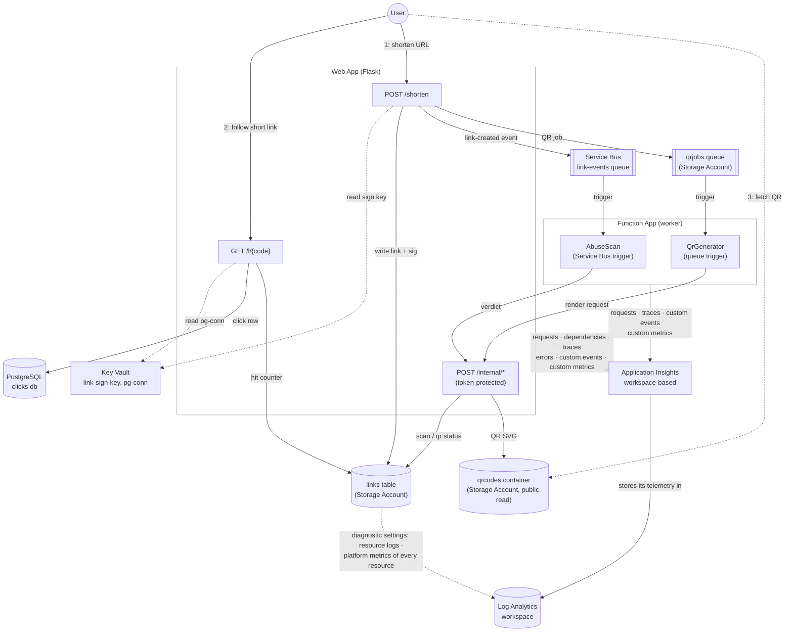

# URL Shortener: Web App, Functions, Storage, Key Vault, Service Bus and PostgreSQL

This sample demonstrates *Linklet*, a Python Flask URL shortener hosted on an [Azure Web App](https://learn.microsoft.com/en-us/azure/app-service/overview) with an event-driven worker on [Azure Functions](https://learn.microsoft.com/en-us/azure/azure-functions/functions-overview). Unlike the sibling samples, which each exercise one or two services, this sample composes six Azure services into a single causal chain: every shortened link fans out through [Azure Service Bus](https://learn.microsoft.com/en-us/azure/service-bus-messaging/service-bus-messaging-overview) and [Azure Queue Storage](https://learn.microsoft.com/en-us/azure/storage/queues/storage-queues-introduction) to background workers, and every redirect is logged to an [Azure Database for PostgreSQL flexible server](https://learn.microsoft.com/en-us/azure/postgresql/flexible-server/overview). It is intended as a realistic end-to-end workout for the LocalStack Azure emulator: a regression in any one service breaks an observable user outcome.

## Architecture

The solution is composed of the following Azure resources:

1. [Azure Resource Group](https://learn.microsoft.com/en-us/azure/azure-resource-manager/management/manage-resource-groups-cli): A logical container scoping all resources in this sample.
2. [Azure User-Assigned Managed Identity](https://learn.microsoft.com/en-us/entra/identity/managed-identities-azure-resources/overview): Shared by the web app and the worker; all Storage and Key Vault data-plane calls are credential-free through it.
3. [Azure Storage Account](https://learn.microsoft.com/en-us/azure/storage/common/storage-account-overview) with three data planes:
   - *links* [Table](https://learn.microsoft.com/en-us/azure/storage/tables/table-storage-overview): The link store (code, target URL, hit counter, signature, scan verdict, QR status).
   - *qrjobs* [Queue](https://learn.microsoft.com/en-us/azure/storage/queues/storage-queues-introduction): QR-render jobs consumed by the worker's queue trigger.
   - *qrcodes* [Blob container](https://learn.microsoft.com/en-us/azure/storage/blobs/storage-blobs-introduction) (public read): The rendered QR SVGs.
4. [Azure Key Vault](https://learn.microsoft.com/en-us/azure/key-vault/general/overview) (RBAC mode): Holds the HMAC key that signs every short code and the PostgreSQL connection string; the app reads both at runtime through the managed identity.
5. [Azure Database for PostgreSQL flexible server](https://learn.microsoft.com/en-us/azure/postgresql/flexible-server/overview): The `clicks` database receives one row per redirect (burstable `Standard_B1ms`, version 16).
6. [Azure Service Bus](https://learn.microsoft.com/en-us/azure/service-bus-messaging/service-bus-messaging-overview) (Standard): The *link-events* queue carries link-created events to the abuse-scan worker.
7. [Azure Log Analytics Workspace](https://learn.microsoft.com/en-us/azure/azure-monitor/logs/log-analytics-overview): Stores the telemetry of Application Insights, and the resource logs and platform metrics that the [diagnostic settings](https://learn.microsoft.com/en-us/azure/azure-monitor/data-collection/diagnostic-settings) of every resource that offers them send to it: the storage account and its blob, queue and table services, the key vault, the PostgreSQL server, the Service Bus namespace, the plan, the two apps and the workspace itself.
8. [Azure App Service Plan](https://learn.microsoft.com/en-us/azure/app-service/overview-hosting-plans) (Linux, B1): Hosts both compute components.
9. [Azure Web App](https://learn.microsoft.com/en-us/azure/app-service/overview): The Flask UI/API. `POST /shorten` writes the link, signs the code with the Key Vault key, sends a Service Bus event and enqueues a QR job; `GET /l/<code>` bumps the hit counter, logs the click to PostgreSQL and redirects.
10. [Azure Function App](https://learn.microsoft.com/en-us/azure/azure-functions/functions-overview) (Python v2 model): Two event-driven workers that call back into the web app's token-protected internal API:
    - *AbuseScan* ([Service Bus trigger](https://learn.microsoft.com/en-us/azure/azure-functions/functions-bindings-service-bus-trigger), identity-based connection): Applies a keyword heuristic and reports a `clean`/`flagged` verdict.
    - *QrGenerator* ([Queue Storage trigger](https://learn.microsoft.com/en-us/azure/azure-functions/functions-bindings-storage-queue-trigger)): Requests the QR SVG render for the short link.
11. [Azure Application Insights](https://learn.microsoft.com/en-us/azure/azure-monitor/app/app-insights-overview): A workspace-based resource that both apps send their telemetry to: the web app through the Microsoft OpenTelemetry Distro, the function app through OpenTelemetry. See [Application Insights](#application-insights).



The flow of a single link: `POST /shorten` → Table Storage + Key Vault + Service Bus + Queue Storage → workers → internal API → Table Storage + Blob Storage → `GET /l/<code>` → PostgreSQL + 302 redirect. The home page renders the link table with hit counts, signatures, scan verdicts and QR links.

## Prerequisites

- [Docker](https://docs.docker.com/get-docker/)
- [Azure CLI](https://learn.microsoft.com/en-us/cli/azure/install-azure-cli)
- [lstk CLI](https://docs.localstack.cloud/aws/developer-tools/running-localstack/lstk/)
- [jq](https://jqlang.org/) and `zip`
- [psql](https://www.postgresql.org/docs/current/app-psql.html) (PostgreSQL client, used by the validation script)
- [Terraform](https://developer.hashicorp.com/terraform/downloads) (for the Terraform deployment)
- [Bicep](https://learn.microsoft.com/en-us/azure/azure-resource-manager/bicep/install) (for the Bicep deployment)
- A LocalStack account with a valid `LOCALSTACK_AUTH_TOKEN` (see the [Auth Token guide](https://docs.localstack.cloud/getting-started/auth-token/))

> [!IMPORTANT]
> **Macs with Apple silicon**: this sample's web app is deployed from code. The emulator builds it with Microsoft's Oryx build image and runs it on an Oryx runtime image, and Microsoft publishes both for amd64 only ([microsoft/Oryx#2133](https://github.com/microsoft/Oryx/issues/2133) asks for arm64).
> On a Mac with Apple silicon they run only under Docker Desktop's amd64 emulation: in Docker Desktop's settings, under **General**, select the **Apple Virtualization framework** as the Virtual Machine Manager and turn on **Use Rosetta for x86_64/amd64 emulation on Apple Silicon**.
> Under QEMU, which Docker Desktop uses otherwise (Rosetta off, or Docker VMM, which has no Rosetta), the sample is not expected to work: Oryx is a .NET app, and [.NET does not support QEMU](https://github.com/dotnet/core/blob/main/release-notes/8.0/supported-os.md).
> The sample does not run on an arm64 Linux host without amd64 emulation.

## Setup

Start the LocalStack Azure emulator and route the Azure CLI to it:

```bash
export LOCALSTACK_AUTH_TOKEN=<your_auth_token>
lstk start --type azure
lstk az start-interception
az login --service-principal -u any-app -p any-pass --tenant any-tenant
```

## Deployment

### Azure CLI scripts

```bash
bash scripts/deploy.sh
```

The script provisions all resources idempotently, deploys both applications from zip packages and persists the generated PostgreSQL credentials to `scripts/.last_deploy.<prefix>.env` (`.last_deploy.local.env` for the default prefix) for the validation script.

### Terraform

```bash
cd terraform
bash deploy.sh
```

The Terraform variant provisions the same resources declaratively and then performs the two zip deployments with the Azure CLI. It also persists the generated PostgreSQL credentials to `scripts/.last_deploy.<prefix>.env` (`.last_deploy.local.env` for the default prefix) for the validation script.

### Bicep

```bash
cd bicep
bash deploy.sh
```

The Bicep variant validates and deploys `main.bicep` into the resource group and then performs the two zip deployments with the Azure CLI. It also persists the generated PostgreSQL credentials and the other deployment secrets to `scripts/.last_deploy.<prefix>.env` (`.last_deploy.local.env` for the default prefix), for the validation script and for its next run, which reuses them.

## Testing

```bash
bash scripts/validate.sh
bash scripts/call-web-app.sh
```

`validate.sh` walks the full causal chain: web app health (Table Storage + Key Vault + PostgreSQL through the managed identity), shortening a benign and a suspicious URL, the AbuseScan verdicts arriving via the Service Bus trigger, the QR SVG rendered via the queue trigger and served from the public blob container, redirects logging click rows into PostgreSQL, hit counting in Table Storage, and the Log Analytics wiring. `call-web-app.sh` performs a quick user-level smoke test (home page, shorten, redirect).

You can also open the web app in a browser — the URL is printed at the end of the deploy script.

## Application Insights

The two apps send their telemetry to `<prefix>-urlshort-insights-<suffix>`, a workspace-based [Application Insights](https://learn.microsoft.com/en-us/azure/azure-monitor/app/app-insights-overview) resource that stores it in the `<prefix>-urlshort-log-analytics-<suffix>` workspace; the `AppRoleName` column of each record names the app that sent it. The three deployment methods set the `APPLICATIONINSIGHTS_CONNECTION_STRING` app setting of both apps to the connection string of the resource:

- The web app turns on the [Microsoft OpenTelemetry Distro](https://learn.microsoft.com/en-us/azure/azure-monitor/app/opentelemetry-enable?tabs=python) when the setting is present, before it imports Flask and psycopg2: its instrumentations trace the requests the app serves, its calls to Table Storage, Key Vault, Service Bus, Queue and Blob Storage (the Azure SDK) and its queries to PostgreSQL, and it collects the records of the `webapp` logger. The app sends a `LinkCreated` and a `LinkFollowed` [custom event](https://learn.microsoft.com/en-us/azure/azure-monitor/app/opentelemetry-add-modify#send-custom-events) and counts both in the `links` [custom metric](https://learn.microsoft.com/en-us/azure/azure-monitor/app/opentelemetry-add-modify#add-custom-metrics), by operation (`create`, `follow`). A click that PostgreSQL fails to record is logged with its exception.
- The function app uses [OpenTelemetry with Azure Functions](https://learn.microsoft.com/en-us/azure/azure-functions/opentelemetry-howto): `host.json` sets `"telemetryMode": "OpenTelemetry"`, `requirements.txt` adds `azure-monitor-opentelemetry`, and the `PYTHON_APPLICATIONINSIGHTS_ENABLE_TELEMETRY` and `PYTHON_APPLICATIONINSIGHTS_LOGGER_NAME` app settings have the Python worker send the records of the `function_app` logger. The `AbuseScan` function sends a `LinkScanned` custom event and counts the links in the `link_scans` custom metric, by verdict, and logs a warning for a flagged link.

The workspace keeps the telemetry in these tables:

| Table             | What the two apps send                                                                                                          |
| ----------------- | ------------------------------------------------------------------------------------------------------------------------------- |
| `AppRequests`     | The requests the web app serves, and the invocations of the `AbuseScan` and `QrGenerator` functions                             |
| `AppDependencies` | The web app's calls to Table Storage, Key Vault, Service Bus, Queue and Blob Storage and PostgreSQL                             |
| `AppTraces`       | The records of the `webapp` and `function_app` loggers                                                                          |
| `AppEvents`       | The `LinkCreated`, `LinkFollowed` and `LinkScanned` custom events, with the code of the link in `link.code`                     |
| `AppMetrics`      | The `links` custom metric, with the operation in `operation`, and the `link_scans` custom metric, with the verdict in `verdict` |
| `AppExceptions`   | The exceptions the apps log with their stack trace, when a call fails                                                           |

[`scripts/query-telemetry.sh`](./scripts/query-telemetry.sh) shortens a link, follows it, waits until the workers scanned it and rendered its QR code, and reads the tables back, retrying until their records arrive. It shows the exceptions without waiting for them: a healthy run has none. On Azure the telemetry takes a few minutes: raise `RETRY_COUNT` there.

### Query the telemetry on the Logs page

Besides the custom events, the web app logs a trace at the end of each operation on a link: `Links read: <count>` when it reads the list, `Link created: <code> (<url>)`, `Link read: <code>`, `Link followed: <code> (<url>, <hits> hits)`, `Link scan updated: <code> (<verdict>)` and `Link QR code created: <code>`. An unknown code logs the warning `Link not found: <code>`, and an unavailable dependency of the health check logs a warning too. The functions log `AbuseScan: <code> -> <verdict>` and `QrGenerator: <code>` for each link they process. [`scripts/query-telemetry.sh`](./scripts/query-telemetry.sh) waits for the `Link created` trace of the link it shortens.

To query the telemetry yourself, open the `<prefix>-urlshort-insights-<suffix>` Application Insights resource and select **Logs** under **Monitoring**:

- On Azure, open the resource in the [Azure portal](https://portal.azure.com).
- On the emulator, open the emulated Azure portal at `http://localhost:4566/_localstack/portal/` (see [Azure Portal Emulator](https://docs.localstack.cloud/azure/developer-tools/portal/)) and select **Sign in**: the sign-in is a mock and asks for no credentials. Then select **Resource groups**, `local-rg`, the `local-urlshort-insights-test` resource and **Logs**.

Type a query in the [Kusto Query Language](https://docs.localstack.cloud/azure/developer-tools/kusto-query-language/) (KQL) and select **Run**: the **Results** tab lists the records, and the **Chart** tab draws the chart of a query that ends with `render`. The Logs page of an Application Insights resource reads the classic Application Insights tables, which hold the same records as the tables of the Log Analytics workspace under other names:

| Application Insights | Log Analytics workspace | Records                                                          |
| -------------------- | ----------------------- | ---------------------------------------------------------------- |
| `requests`           | `AppRequests`           | The requests of the web app and the invocations of the functions |
| `dependencies`       | `AppDependencies`       | The calls to other services                                      |
| `traces`             | `AppTraces`             | The records of the loggers                                       |
| `exceptions`         | `AppExceptions`         | The exceptions logged, with their stack trace                    |
| `customEvents`       | `AppEvents`             | The custom events                                                |
| `customMetrics`      | `AppMetrics`            | The custom metrics                                               |

Their columns are renamed too, for example `timestamp` (`TimeGenerated`), `name` (`Name`), `success` (`Success`), `duration` (`DurationMs`), `resultCode` (`ResultCode`), `operation_Id` (`OperationId`), `operation_Name` (`OperationName`), `cloud_RoleName` (`AppRoleName`), `severityLevel` (`SeverityLevel`), `message` (`Message`), `type` (`ExceptionType`), `valueSum` (`Sum`) and `customDimensions` (`Properties`). To run the queries below on the workspace, with its **Logs** page or `az monitor log-analytics query`, use the names in parentheses.

The `customDimensions` column holds the custom properties of each record: the `LinkCreated` and `LinkFollowed` events carry the code in `link.code`, the `LinkScanned` events add the verdict in `scan.verdict`, the `links` metric carries the operation in `operation` and the `link_scans` metric the verdict in `verdict`. Each record also names the app that sent it in `cloud_RoleName`. Read a property with `tostring(customDimensions["<name>"])`, for example in the latest `LinkCreated` events:

```kusto
customEvents
| where timestamp > ago(1h) and name == "LinkCreated"
| project timestamp, Code = tostring(customDimensions["link.code"])
| order by timestamp desc
```

These queries read the telemetry and draw charts of it:

- **Requests and failures over time.** The requests and the failed requests (`success == false`) in 5-second buckets, to spot traffic spikes and error regressions:

  ```kusto
  requests
  | where timestamp > ago(6h)
  | summarize
      TotalRequests = count(),
      FailedRequests = countif(success == false)
      by bin(timestamp, 5s)
  | render timechart
  ```

- **Latency percentiles per endpoint.** The 50th, 95th and 99th percentiles of the duration of each endpoint, which show the slow requests that an average hides:

  ```kusto
  requests
  | where timestamp > ago(24h)
  | summarize
      RequestCount = count(),
      P50_ms = percentile(duration, 50),
      P95_ms = percentile(duration, 95),
      P99_ms = percentile(duration, 99)
      by name
  | where RequestCount > 1
  | top 10 by P95_ms desc
  | project name, P50_ms, P95_ms, P99_ms
  | render columnchart
  ```

- **Status codes over time.** The `2xx`, `4xx` and `5xx` responses over time, to tell client errors from server faults:

  ```kusto
  requests
  | where timestamp > ago(12h)
  | extend StatusBucket = strcat(substring(resultCode, 0, 1), "xx")
  | summarize Count = count() by bin(timestamp, 15m), StatusBucket
  | render columnchart with (kind=stacked)
  ```

- **Top exceptions.** The exceptions by type and by the operation that raised them, to find the most frequent failures:

  ```kusto
  exceptions
  | where timestamp > ago(24h)
  | summarize ExceptionCount = count() by type, operation_Name
  | top 10 by ExceptionCount desc
  | render barchart
  ```

- **Traces by severity.** The records of the loggers by severity level (`0` Verbose, `1` Information, `2` Warning, `3` Error, `4` Critical), to catch a storm of warnings before requests start failing:

  ```kusto
  traces
  | where timestamp > ago(6h)
  | extend Severity = case(
      severityLevel == 0, "Verbose",
      severityLevel == 1, "Information",
      severityLevel == 2, "Warning",
      severityLevel == 3, "Error",
      severityLevel == 4, "Critical",
      "Unknown")
  | summarize LogCount = count() by bin(timestamp, 5m), Severity
  | render areachart with (kind=stacked)
  ```

- **The links followed.** The requests that follow a short link:

  ```kusto
  requests
  | where name startswith "GET /l/"
  | project timestamp, name, resultCode
  ```

- **Traces that start with a text.** The traces of the last 30 minutes whose message starts with a given text, here the confirmations of the links created:

  ```kusto
  let text = "Link created";
  traces
  | where timestamp > ago(30m) and message startswith text
  | project timestamp, message
  ```

- **Requests by name.** The number of requests of each name:

  ```kusto
  requests
  | summarize Count = count() by Name = name
  | render scatterchart
  ```

- **Custom events per minute.** The custom events per minute, by name:

  ```kusto
  customEvents
  | summarize Count = count() by bin(timestamp, 1m), Name = name
  | render timechart
  ```

- **Custom metric.** The `links` custom metric per minute, by operation (`create`, `follow`):

  ```kusto
  customMetrics
  | where timestamp > ago(6h) and name == "links"
  | summarize Total = sum(valueSum) by bin(timestamp, 1m), Operation = tostring(customDimensions["operation"])
  | render columnchart with (kind=stacked)
  ```

## Logs and metrics

Each resource that offers diagnostic settings has one that sends its resource logs, its platform metrics or both to the workspace:

| Resource                       | Log categories                                                                         | Tables in the workspace                                                   | What the sample leaves there                                                                                                                          |
| ------------------------------ | -------------------------------------------------------------------------------------- | ------------------------------------------------------------------------- | ----------------------------------------------------------------------------------------------------------------------------------------------------- |
| Web App                        | `AppServiceHTTPLogs`, `AppServiceConsoleLogs`, `AppServicePlatformLogs` and the others | One table per category, named after it                                    | The requests it serves, its console output and the start of its container                                                                             |
| Function App                   | `FunctionAppLogs`                                                                      | `FunctionAppLogs`                                                         | The records the Functions host writes when an invocation of a function starts and completes                                                           |
| App Service plan               | None: metrics only                                                                     | `AzureMetrics`                                                            | The CPU and memory use of its instances                                                                                                               |
| Storage account                | None: metrics only                                                                     | `AzureMetrics`                                                            | The transactions of the account                                                                                                                       |
| Blob, queue and table services | `StorageRead`, `StorageWrite`, `StorageDelete`                                         | `StorageBlobLogs`, `StorageQueueLogs`, `StorageTableLogs`, `AzureMetrics` | The links the web app reads and writes and the QR jobs it sends, with its managed identity (`OAuth`), and the QR jobs the worker reads (`AccountKey`) |
| Key Vault                      | `AuditEvent`, `AzurePolicyEvaluationDetails`                                           | `AZKVAuditLogs`, `AZKVPolicyEvaluationDetailsLogs`                        | The `SecretGet` of the link-signing key and of the PostgreSQL connection string                                                                       |
| PostgreSQL flexible server     | `PostgreSQLLogs`                                                                       | `PGSQLServerLogs`                                                         | The connections of the web app that record the clicks                                                                                                 |
| Service Bus namespace          | `OperationalLogs` and the others                                                       | `AZMSOperationalLogs`, `AzureMetrics`                                     | The management operations on the namespace and its messaging metrics                                                                                  |
| Log Analytics workspace        | `Audit`                                                                                | `LAQueryLogs`, `AzureMetrics`                                             | The queries run on the workspace                                                                                                                      |

The settings of the key vault, of the PostgreSQL server and of the Service Bus namespace write to the resource-specific tables, which Microsoft recommends over the shared `AzureDiagnostics` table. The setting of the namespace leaves out the runtime audit logs, which Service Bus writes [only in the Premium tier](https://learn.microsoft.com/en-us/azure/azure-monitor/reference/tables/azmsruntimeauditlogs). The Application Insights resource has no diagnostic setting: its telemetry is already in the workspace it's based on.

[`scripts/query-logs-and-metrics.sh`](./scripts/query-logs-and-metrics.sh) shows the diagnostic settings, calls the web app and reads these tables back, retrying until their records arrive, then reads platform metrics from the Azure Monitor metrics API. On Azure the first records of a new diagnostic setting can take [up to 90 minutes](https://learn.microsoft.com/en-us/azure/azure-monitor/data-collection/diagnostic-settings#expected-latency-after-creating-a-diagnostic-setting): raise `RETRY_COUNT` there. On Azure the script reads the exported platform metrics (`AzureMetrics`) only once: Azure exports them late and irregularly, so the script shows those that arrived and notes how many are still missing, without failing. To query the workspace yourself, add the `log-analytics` extension of the Azure CLI (`az extension add --name log-analytics`) and pass the workspace id (`customerId`):

```bash
WORKSPACE_ID=$(az monitor log-analytics workspace show \
  --resource-group local-rg \
  --workspace-name local-urlshort-log-analytics-test \
  --query customerId \
  --output tsv)

az monitor log-analytics query \
  --workspace "$WORKSPACE_ID" \
  --analytics-query "AppEvents | summarize Events = count() by AppRoleName, Name" \
  --output table
```

## Cleanup

```bash
az group delete --name local-rg --yes
```

## LocalStack notes

- The web app talks to Service Bus through the namespace connection string rather than a managed-identity connection: the Python Service Bus SDK enforces TLS verification and the emulator's certificate does not cover `*.servicebus.windows.net`. The connection string's endpoint is certificate-valid on both the emulator and real Azure.
- The worker's queue trigger uses a dedicated connection string with explicit `BlobEndpoint`/`QueueEndpoint`/`TableEndpoint` entries because strict .NET storage clients cannot parse an `EndpointSuffix` that carries the emulator's port.
- The PostgreSQL flexible-server emulator embeds its TCP-proxy port in the server's `fullyQualifiedDomainName`; both deployment variants split host and port so the same configuration works against real Azure (bare host, port 5432).
- The worker calls the web app's internal API over plain `http://` (`WEB_BASE_URL`), and the apps are deployed without HTTPS-only: the emulator serves `*.azurewebsites.net` with a certificate that does not cover that domain, so an `https://` call from the worker would fail TLS verification. On real Azure, switch `WEB_BASE_URL` to `https://` and enable HTTPS-only on both apps so the internal token never crosses the wire unencrypted.
- On real Azure, additionally enable *Always On* for the function app (dedicated plans idle otherwise and non-HTTP triggers stop firing), deploy the function app through a build-enabled path (Oryx remote build or a vendored `.python_packages` layout), and tighten the sample's allow-all PostgreSQL firewall rule to your own address ranges.

## References

- [Azure Web Apps Documentation](https://learn.microsoft.com/en-us/azure/app-service/)
- [Azure Functions Documentation](https://learn.microsoft.com/en-us/azure/azure-functions/)
- [Azure Service Bus Documentation](https://learn.microsoft.com/en-us/azure/service-bus-messaging/)
- [Azure Storage Documentation](https://learn.microsoft.com/en-us/azure/storage/)
- [Azure Key Vault Documentation](https://learn.microsoft.com/en-us/azure/key-vault/)
- [Azure Database for PostgreSQL — flexible server](https://learn.microsoft.com/en-us/azure/postgresql/flexible-server/)
- [LocalStack for Azure](https://docs.localstack.cloud/azure/)
- [lstk CLI](https://docs.localstack.cloud/aws/developer-tools/running-localstack/lstk/)
