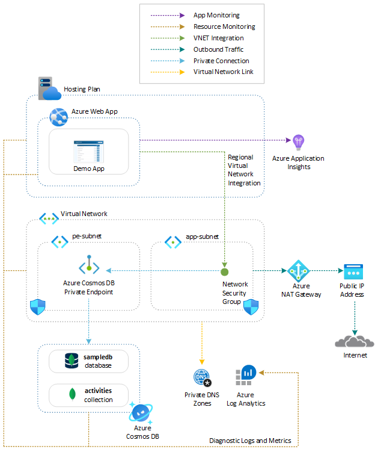

# Azure Web App with Azure CosmosDB for MongoDB

This sample demonstrates a Python Flask single-page web application called *Vacation Planner* hosted on an [Azure Web App](https://learn.microsoft.com/en-us/azure/app-service/overview). The app runs on an Azure App Service Plan and stores activity data in the `activities` collection of the `sampledb` MongoDB database on an [Azure CosmosDB for MongoDB](https://learn.microsoft.com/en-us/azure/cosmos-db/mongodb/introduction) account.

## Architecture

The following diagram illustrates the architecture of the solution:



The web app enables users to plan and manage vacation activities, with all data persisted in a CosmosDB-backed MongoDB collection. The solution is composed of the following Azure resources:

1. [Azure Resource Group](https://learn.microsoft.com/en-us/azure/azure-resource-manager/management/manage-resource-groups-cli): A logical container scoping all resources in this sample.
2. [Azure Virtual Network](https://learn.microsoft.com/azure/virtual-network/virtual-networks-overview): Hosts two subnets:
	- *app-subnet*: Dedicated to [regional VNet integration](https://learn.microsoft.com/azure/azure-functions/functions-networking-options?tabs=azure-portal#outbound-networking-features) with the Function App.
	- *pe-subnet*: Used for hosting Azure Private Endpoints.
3. [Azure Private DNS Zone](https://learn.microsoft.com/azure/dns/private-dns-privatednszone): Handles DNS resolution for the CosmosDB for MongoDB Private Endpoint within the virtual network.
4. [Azure Private Endpoint](https://learn.microsoft.com/azure/private-link/private-endpoint-overview): Secures network access to the CosmosDB for MongoDB account via a private IP within the VNet.
5. [Azure NAT Gateway](https://learn.microsoft.com/azure/nat-gateway/nat-overview): Provides deterministic outbound connectivity for the Web App. Included for completeness; the sample app does not call any external services.
6. [Azure Network Security Group](https://learn.microsoft.com/en-us/azure/virtual-network/network-security-groups-overview): Enforces inbound and outbound traffic rules across the virtual network's subnets.
7. [Azure Log Analytics Workspace](https://learn.microsoft.com/azure/azure-monitor/logs/log-analytics-overview): Centralizes the diagnostic logs and metrics of every resource, the telemetry of Application Insights, and the audit records of the queries run on it.
8. [Azure Application Insights](https://learn.microsoft.com/en-us/azure/azure-monitor/app/app-insights-overview) `<prefix>-insights-<suffix>`: A workspace-based resource that collects the requests, the commands to Azure Cosmos DB for MongoDB, the log records, the exceptions, the custom events and the custom metric of the web app, which the Microsoft OpenTelemetry Distro sends to the connection string of the `APPLICATIONINSIGHTS_CONNECTION_STRING` app setting. See [Application Insights](#application-insights).
9. [Azure Cosmos DB for MongoDB](https://learn.microsoft.com/en-us/azure/cosmos-db/mongodb/introduction): A globally distributed database account optimized for MongoDB workloads, with multi-region failover enabled.
10. [MongoDB Database](https://learn.microsoft.com/en-us/azure/cosmos-db/mongodb/overview): The `sampledb` database that holds all application data.
11. [MongoDB Collection](https://learn.microsoft.com/en-us/azure/cosmos-db/mongodb/overview): The `activities` collection within `sampledb`, used to store vacation activity records.
12. [Azure App Service Plan](https://learn.microsoft.com/en-us/azure/app-service/overview-hosting-plans): The underlying compute tier that hosts the web application.
13. [Azure Web App](https://learn.microsoft.com/en-us/azure/app-service/overview): Runs the Python Flask single-page application (*Vacation Planner*), connected to CosmosDB for MongoDB via VNet integration.
14. [App Service Source Control](https://learn.microsoft.com/en-us/rest/api/appservice/web-apps/create-or-update-source-control?view=rest-appservice-2024-11-01): *(Optional)* Configures continuous deployment from a public GitHub repository.

## Prerequisites

- [lstk CLI](https://docs.localstack.cloud/aws/developer-tools/running-localstack/lstk/)
- [Azure Subscription](https://azure.microsoft.com/free/)
- [Azure CLI](https://learn.microsoft.com/en-us/cli/azure/install-azure-cli)
- [Python 3.11+](https://www.python.org/downloads/)
- [Flask](https://flask.palletsprojects.com/)
- [pymongo](https://pymongo.readthedocs.io/en/stable/)
- [Bicep extension](https://marketplace.visualstudio.com/items?itemName=ms-azuretools.vscode-bicep), if you plan to install the sample via Bicep.
- [Terraform](https://developer.hashicorp.com/terraform/downloads), if you plan to install the sample via Terraform.

> [!IMPORTANT]
> **Macs with Apple silicon**: this sample deploys a web app from code. The emulator builds it with Microsoft's Oryx build image and runs it on an Oryx runtime image, and Microsoft publishes both for amd64 only ([microsoft/Oryx#2133](https://github.com/microsoft/Oryx/issues/2133) asks for arm64).
> On a Mac with Apple silicon they run only under Docker Desktop's amd64 emulation: in Docker Desktop's settings, under **General**, select the **Apple Virtualization framework** as the Virtual Machine Manager and turn on **Use Rosetta for x86_64/amd64 emulation on Apple Silicon**.
> Under QEMU, which Docker Desktop uses otherwise (Rosetta off, or Docker VMM, which has no Rosetta), the sample is not expected to work: Oryx is a .NET app, and [.NET does not support QEMU](https://github.com/dotnet/core/blob/main/release-notes/8.0/supported-os.md).
> The sample does not run on an arm64 Linux host without amd64 emulation.

## Deployment

Set up the Azure emulator using the LocalStack for Azure Docker image. Before starting, ensure you have a valid `LOCALSTACK_AUTH_TOKEN` to access the Azure emulator. Refer to the [Auth Token guide](https://docs.localstack.cloud/getting-started/auth-token/) to obtain your Auth Token and set it in the `LOCALSTACK_AUTH_TOKEN` environment variable. The Azure Docker image is available on the [LocalStack Docker Hub](https://hub.docker.com/r/localstack/localstack-azure). To pull the image, execute:

```bash
docker pull localstack/localstack-azure
```

Start the LocalStack Azure emulator by running:

```bash
# Set the authentication token
export LOCALSTACK_AUTH_TOKEN=<your_auth_token>

# Start the LocalStack Azure emulator
lstk start --type azure

# Route all Azure CLI calls to the LocalStack Azure emulator
lstk az start-interception
```

Deploy the application to LocalStack for Azure using one of these methods:

- [Azure CLI Deployment](./scripts/README.md)
- [Bicep Deployment](./bicep/README.md)
- [Terraform Deployment](./terraform/README.md)

All deployment methods have been fully tested against Azure and the LocalStack for Azure local emulator.

> [!NOTE]
> When you deploy the application to LocalStack for Azure for the first time, the initialization process involves downloading and building Docker images. This is a one-time operation—subsequent deployments will be significantly faster. Depending on your internet connection and system resources, this initial setup may take several minutes.

## Test

1. Retrieve the host port Docker maps to the port the Web App listens on in its container, for example with `docker port <container-name>` (the container's name starts with `ls-<web-app-name>`). Do not assume port 80: the app listens on the port its `WEBSITES_PORT` app setting names, when it has one.
2. Open a web browser and navigate to `http://localhost:<published-port>`.
3. If the deployment was successful, you will see the following user interface for adding and removing activities:


You can use the `call-web-app.sh` Bash script below to call the web app. The script demonstrates three methods for calling web apps:

1. **Through the LocalStack for Azure emulator**: Call the web app via the emulator using its default host name. The emulator acts as a proxy to the web app.
2. **Via localhost and host port mapped to the container's port**: Use `127.0.0.1` with the host port mapped to the container's port `80`.
3. **Via container IP address**: Use the app container's IP address on port `80`. This technique is only available when accessing the web app from the Docker host machine.
4. **Via the default hostname**: Call the web app via the default hostname `<web-app-name>.azurewebsites.azure.localhost.localstack.cloud:4566`.

## Application Insights

The web app sends its telemetry to `<prefix>-insights-<suffix>`, a workspace-based [Application Insights](https://learn.microsoft.com/en-us/azure/azure-monitor/app/app-insights-overview) resource that stores it in the `<prefix>-log-analytics-<suffix>` workspace. The three deployment methods set the `APPLICATIONINSIGHTS_CONNECTION_STRING` app setting to the connection string of the resource, and the application turns on the [Microsoft OpenTelemetry Distro](https://learn.microsoft.com/en-us/azure/azure-monitor/app/opentelemetry-enable?tabs=python) when the setting is present. The application also sends a [custom event](https://learn.microsoft.com/en-us/azure/azure-monitor/app/opentelemetry-add-modify#send-custom-events) for each activity it adds, updates or deletes, counts these operations in the `activities` [custom metric](https://learn.microsoft.com/en-us/azure/azure-monitor/app/opentelemetry-add-modify#add-custom-metrics), and logs the exceptions it catches:

```python
from microsoft.opentelemetry import use_microsoft_opentelemetry
from opentelemetry.instrumentation.pymongo import PymongoInstrumentor

# The logger of the application
LOGGER_NAME = "webapp"

if os.environ.get("APPLICATIONINSIGHTS_CONNECTION_STRING"):
    use_microsoft_opentelemetry(enable_azure_monitor=True, logger_name=LOGGER_NAME)
    PymongoInstrumentor().instrument()

from flask import Flask
from opentelemetry import metrics

activity_counter = metrics.get_meter(LOGGER_NAME).create_counter(
    "activities", unit="{activity}", description="The number of activities added, updated and deleted."
)


def track_activity_event(event_name: str, operation: str, activity_id: str) -> None:
    logger.info(
        f"{event_name}: {activity_id}",
        extra={"microsoft.custom_event.name": event_name, "activity.id": activity_id},
    )
    activity_counter.add(1, {"operation": operation})
```

The distro doesn't instrument PyMongo, so the application also turns on the OpenTelemetry instrumentation of PyMongo (`opentelemetry-instrumentation-pymongo`). Both start before the application imports Flask and PyMongo, so that their instrumentations wrap them, and the distro collects the records of the `webapp` logger and of its child `webapp.mongodb`.

The workspace keeps the telemetry in these tables:

| Table             | What the web app sends                                                                                                   |
| ----------------- | ------------------------------------------------------------------------------------------------------------------------ |
| `AppRequests`     | The requests it serves, such as `GET /`                                                                                  |
| `AppDependencies` | Its commands to Azure Cosmos DB for MongoDB                                                                              |
| `AppTraces`       | The records of its loggers                                                                                               |
| `AppEvents`       | The `ActivityAdded`, `ActivityUpdated` and `ActivityDeleted` custom events, with the id of the activity in `activity.id` |
| `AppMetrics`      | The `activities` custom metric, with the operation (`add`, `update` or `delete`) in `operation`                          |
| `AppExceptions`   | The exceptions it logs, with their stack trace, when a command to Azure Cosmos DB for MongoDB fails                      |

[`scripts/query-telemetry.sh`](./scripts/query-telemetry.sh) calls the web app, adds an activity, and reads the tables back, retrying until their records arrive. It shows the exceptions without waiting for them: a healthy run has none.

## Logs and metrics

The web app, its App Service plan, the Azure Cosmos DB account, the VNet, the two NSGs, the NAT Gateway and its public IP each have a diagnostic setting that sends their resource logs, their platform metrics or both to the `<prefix>-log-analytics-<suffix>` Log Analytics workspace, and the workspace has one that sends the audit records of the queries run on it (`Audit`, table `LAQueryLogs`) to itself. The Application Insights resource has none: its telemetry is already in the workspace it's based on, and a diagnostic setting of a workspace-based Application Insights resource [can't send to that workspace](https://learn.microsoft.com/en-us/azure/azure-monitor/app/export-telemetry#diagnostic-settings-based-export). The private endpoint and the private DNS zone offer no diagnostic settings. Two of the resources record what the application does:

| Resource                            | Log categories                                                                                                                                                                  | Tables in the workspace                    | What the application leaves there                                         |
| ----------------------------------- | ------------------------------------------------------------------------------------------------------------------------------------------------------------------------------- | ------------------------------------------ | ------------------------------------------------------------------------- |
| Web App                             | `AppServiceHTTPLogs`, `AppServiceConsoleLogs`, `AppServicePlatformLogs`, `AppServiceAppLogs`, `AppServiceAuditLogs`, `AppServiceIPSecAuditLogs`, `AppServiceAuthenticationLogs` | One table per category, named after it     | The requests it serves, its console output and the start of its container |
| Azure Cosmos DB for MongoDB account | `DataPlaneRequests`, `MongoRequests`                                                                                                                                            | `CDBDataPlaneRequests`, `CDBMongoRequests` | The MongoDB commands of the application, in `CDBMongoRequests`            |

Their platform metrics land in the `AzureMetrics` table. The setting of the Azure Cosmos DB account writes to the resource-specific tables, which Microsoft recommends over the shared `AzureDiagnostics` table: the Azure CLI script passes `--export-to-resource-specific true`, the Bicep module sets `logAnalyticsDestinationType: 'Dedicated'` and the Terraform module `log_analytics_destination_type = "Dedicated"`. App Service writes to resource-specific tables only. The VNet and the two NSGs send their network logs; on the emulator these categories stay empty, because no traffic crosses an emulated network security group. Azure exports none of the account's platform metrics through a diagnostic setting (the DS Export column of its [supported metrics](https://learn.microsoft.com/en-us/azure/azure-monitor/reference/supported-metrics/microsoft-documentdb-databaseaccounts-metrics)), so the script reads its `TotalRequests` from the metrics API only. The LocalStack emulator doesn't record the requests of a MongoDB account, so `CDBMongoRequests` stays empty there.

[`scripts/query-logs-and-metrics.sh`](./scripts/query-logs-and-metrics.sh) shows the diagnostic settings, calls the web app and reads these tables back, retrying until their records arrive, then reads the same platform metrics from the Azure Monitor metrics API. On Azure the first records of a new diagnostic setting can take up to 90 minutes: raise `RETRY_COUNT` there. On Azure the script reads the exported platform metrics (`AzureMetrics`) only once: Azure exports them late and irregularly, so the script shows those that arrived and notes how many are still missing, without failing. To query the workspace yourself, add the `log-analytics` extension of the Azure CLI (`az extension add --name log-analytics`); the query API identifies a workspace by its workspace id (`customerId`):

```bash
WORKSPACE_ID=$(az monitor log-analytics workspace show \
  --resource-group local-rg \
  --workspace-name local-log-analytics-test \
  --query customerId \
  --output tsv)

az monitor log-analytics query \
  --workspace "$WORKSPACE_ID" \
  --analytics-query "AppServiceHTTPLogs | project TimeGenerated, CsMethod, CsUriStem, ScStatus, TimeTaken | order by TimeGenerated desc | take 5" \
  --output table
```

## MongoDB Tooling

You can utilize [MongoDB Compass](https://www.mongodb.com/try/download/compass) to explore and manage your MongoDB databases and collections. Ensure you connect using `mongodb://localhost:port` connection string, where `port` corresponds to the port published by the MongoDB container on the host and mapped to the internal MongoDB port `27017`.

Alternatively, you can use the [MongoDB Shell](https://www.mongodb.com/docs/mongodb-shell/) to interact with and administer your MongoDB instance, as shown in the following table:

```bash
~$ mongosh mongodb://localhost:32770
Current Mongosh Log ID: 6914588406320f60899dc29c
Connecting to:          mongodb://localhost:32770/?directConnection=true&serverSelectionTimeoutMS=2000&appName=mongosh+2.5.9
Using MongoDB:          8.0.15
Using Mongosh:          2.5.9

For mongosh info see: https://www.mongodb.com/docs/mongodb-shell/

------
   The server generated these startup warnings when booting
   2025-11-12T09:28:07.726+00:00: Using the XFS filesystem is strongly recommended with the WiredTiger storage engine. See http://dochub.mongodb.org/core/prodnotes-filesystem
   2025-11-12T09:28:07.892+00:00: Access control is not enabled for the database. Read and write access to data and configuration is unrestricted
   2025-11-12T09:28:07.892+00:00: For customers running the current memory allocator, we suggest changing the contents of the following sysfsFile
   2025-11-12T09:28:07.892+00:00: We suggest setting the contents of sysfsFile to 0.
   2025-11-12T09:28:07.892+00:00: vm.max_map_count is too low
   2025-11-12T09:28:07.892+00:00: We suggest setting swappiness to 0 or 1, as swapping can cause performance problems.
------

test> show dbs
admin     100.00 KiB
config    108.00 KiB
local      40.00 KiB
sampledb  180.00 KiB
test> use sampledb
switched to db sampledb
sampledb> show collections
activities
sampledb> db.activities.find().pretty()
[
  {
    _id: '39ab62c2aaa0015ed5309876053e4146',
    username: 'Paolo',
    activity: 'Go to Paris',
    timestamp: '2025-11-12T09:31:43.338268'
  },
  {
    _id: '4fb8f53442d3ebe9167245f9555bac51',
    username: 'Paolo',
    activity: 'Go to Madrid',
    timestamp: '2025-11-12T09:31:50.109456'
  },
  {
    _id: '84646160cb1db21a7083b4c5b6e2d9d0',
    username: 'Paolo',
    activity: 'Go to Rome',
    timestamp: '2025-11-12T09:32:21.781936'
  }
]
```

## References

- [Azure Web Apps Documentation](https://learn.microsoft.com/en-us/azure/app-service/)
- [Azure CosmosDB for MongoDB API](https://learn.microsoft.com/en-us/azure/cosmos-db/mongodb/introduction)
- [Quickstart: Python Flask on Azure](https://learn.microsoft.com/en-us/azure/app-service/quickstart-python?tabs=flask%2Cbrowser)
- [Quickstart: CosmosDB for MongoDB](https://learn.microsoft.com/en-us/azure/cosmos-db/mongodb/quickstart-python)
- [Azure Identity Client Library for Python](https://learn.microsoft.com/en-us/python/api/overview/azure/identity-readme?view=azure-python)
- [LocalStack for Azure](https://docs.localstack.cloud/azure/)
- [lstk CLI](https://docs.localstack.cloud/aws/developer-tools/running-localstack/lstk/)
- [lstk GitHub repository](https://github.com/localstack/lstk)
