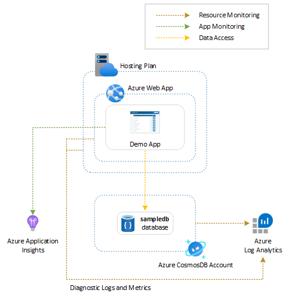
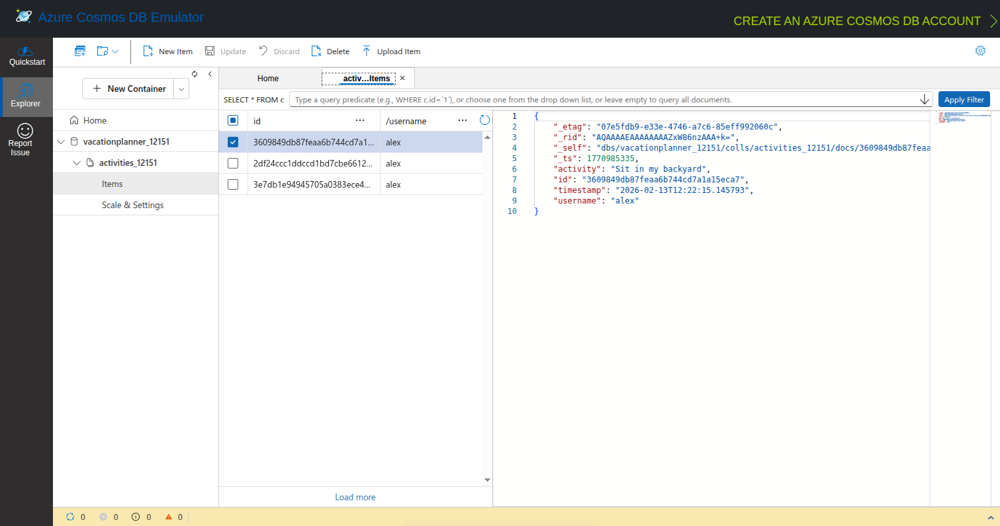

# Azure Web App with Azure CosmosDB for NoSQL API

This sample demonstrates a ASP.NET Core Razor Pages single-page web application called *Vacation Planner* hosted on an [Azure Web App](https://learn.microsoft.com/en-us/azure/app-service/overview). The app runs on an Azure App Service Plan and stores activity data in a container of a NoSQL database, which the deploy script names `activities_<n>` and `vacationplanner_<n>`, on an [Azure CosmosDB for NoSQL](https://learn.microsoft.com/en-us/azure/cosmos-db/distributed-nosql) account.

## Architecture

The following diagram illustrates the architecture of the solution:



- **Azure Web App**: Hosts the ASP.NET Core application
- **Azure App Service Plan**: Provides compute resources for the web app
- **Azure CosmosDB for NoSQL API**: Stores activity data in a CosmosDB container
- **Azure Log Analytics workspace**: Centralizes the diagnostic logs and metrics of the web app, its plan and the CosmosDB account, the telemetry of Application Insights, and the audit records of the queries run on it
- **Azure Application Insights**: A workspace-based resource that collects the requests, the calls to Azure Cosmos DB, the log records, the exceptions, the custom events and the custom metric of the web app, which the Microsoft OpenTelemetry Distro sends to the connection string of the `APPLICATIONINSIGHTS_CONNECTION_STRING` app setting. See [Application Insights](#application-insights)

## Prerequisites

- [lstk CLI](https://docs.localstack.cloud/aws/developer-tools/running-localstack/lstk/)
- [Azure Subscription](https://azure.microsoft.com/free/)
- [Azure CLI](https://learn.microsoft.com/en-us/cli/azure/install-azure-cli)
- [.NET SDK 10.0](https://dotnet.microsoft.com/en-us/download/dotnet/10.0)
- [ASP.NET Core](https://learn.microsoft.com/en-us/aspnet/core/)

> [!IMPORTANT]
> **Macs with Apple silicon**: this sample deploys a web app from code. The emulator builds it with Microsoft's Oryx build image and runs it on an Oryx runtime image, and Microsoft publishes both for amd64 only ([microsoft/Oryx#2133](https://github.com/microsoft/Oryx/issues/2133) asks for arm64).
> On a Mac with Apple silicon they run only under Docker Desktop's amd64 emulation: in Docker Desktop's settings, under **General**, select the **Apple Virtualization framework** as the Virtual Machine Manager and turn on **Use Rosetta for x86_64/amd64 emulation on Apple Silicon**.
> Under QEMU, which Docker Desktop uses otherwise (Rosetta off, or Docker VMM, which has no Rosetta), the sample is not expected to work: Oryx is a .NET app, and [.NET does not support QEMU](https://github.com/dotnet/core/blob/main/release-notes/8.0/supported-os.md).
> The sample does not run on an arm64 Linux host without amd64 emulation.

## Deployment

Set up the Azure emulator using the LocalStack for Azure Docker image. Before starting, ensure you have a valid `LOCALSTACK_AUTH_TOKEN` to access the Azure emulator. Refer to the [Auth Token guide](https://docs.localstack.cloud/getting-started/auth-token/) to obtain your Auth Token and set it in the `LOCALSTACK_AUTH_TOKEN` environment variable. The Azure Docker image is available on the [LocalStack Docker Hub](https://hub.docker.com/r/localstack/localstack-azure). To pull the image, execute:

```bash
docker pull localstack/localstack-azure
```

Start the LocalStack Azure emulator by running:

```bash
# Set the authentication token
export LOCALSTACK_AUTH_TOKEN=<your_auth_token>

# Start the LocalStack Azure emulator
lstk start --type azure

# Route all Azure CLI calls to the LocalStack Azure emulator
lstk az start-interception
```

Deploy the application to LocalStack for Azure using:

- [Azure CLI Deployment](./scripts/README.md)

> [!NOTE]
> When you deploy the application to LocalStack for Azure for the first time, the initialization process involves downloading and building Docker images. This is a one-time operation—subsequent deployments will be significantly faster. Depending on your internet connection and system resources, this initial setup may take several minutes.

## Test

1. Retrieve the host port Docker maps to the port the Web App listens on in its container, for example with `docker port <container-name>` (the container's name starts with `ls-<web-app-name>`). Do not assume port 80: the app listens on the port its `WEBSITES_PORT` app setting names, when it has one.
2. Open a web browser and navigate to `http://localhost:<published-port>`.
3. If the deployment was successful, you will see the following user interface for adding and removing activities:


You can use the `call-web-app.sh` Bash script below to call the web app. The script demonstrates three methods for calling web apps:

1. **Through the LocalStack for Azure emulator**: Call the web app via the emulator using its default host name. The emulator acts as a proxy to the web app.
2. **Via localhost and host port mapped to the container's port**: Use `127.0.0.1` with the host port mapped to the container's port `80`.
3. **Via container IP address**: Use the app container's IP address on port `80`. This technique is only available when accessing the web app from the Docker host machine.
4. **Via the default hostname**: Call the web app via the default hostname `<web-app-name>.azurewebsites.azure.localhost.localstack.cloud:4566`.

On Azure, where the web app runs in no container on your machine, the script calls its default host name over HTTPS instead, and retries while the web app starts.

## Application Insights

The web app sends its telemetry to `<prefix>-insights-<suffix>`, a workspace-based [Application Insights](https://learn.microsoft.com/en-us/azure/azure-monitor/app/app-insights-overview) resource that stores it in the `<prefix>-log-analytics-<suffix>` workspace. The deploy script sets the `APPLICATIONINSIGHTS_CONNECTION_STRING` app setting to the connection string of the resource, and the application turns on the [Microsoft OpenTelemetry Distro](https://learn.microsoft.com/en-us/azure/azure-monitor/app/opentelemetry-enable?tabs=aspnetcore) when the setting is present. The application also sends a [custom event](https://learn.microsoft.com/en-us/azure/azure-monitor/app/opentelemetry-add-modify#send-custom-events) for each activity it adds, updates or deletes, counts these operations in the `activities` [custom metric](https://learn.microsoft.com/en-us/azure/azure-monitor/app/opentelemetry-add-modify#add-custom-metrics), and logs the exceptions it catches:

```csharp
if (!string.IsNullOrEmpty(builder.Configuration["APPLICATIONINSIGHTS_CONNECTION_STRING"]))
{
    builder.Services.ConfigureOpenTelemetryMeterProvider(
        (_, meterProvider) => meterProvider.AddMeter(ActivityTelemetry.MeterName));
    builder.UseMicrosoftOpenTelemetry(options =>
    {
        options.Exporters = ExportTarget.AzureMonitor;
    });
}

// Services/CosmosActivityStore.cs
_client = new CosmosClient(options.Endpoint, options.Key, new CosmosClientOptions
{
    ConnectionMode = ConnectionMode.Gateway,
    LimitToEndpoint = true,
    CosmosClientTelemetryOptions = new CosmosClientTelemetryOptions { DisableDistributedTracing = false },
});

// Services/ActivityTelemetry.cs
public static void Track(ILogger logger, string eventName, string operation, string activityId)
{
    logger.LogInformation("{microsoft.custom_event.name} {activity.id}", eventName, activityId);
    Activities.Add(1, new KeyValuePair<string, object?>("operation", operation));
}
```

The GA Azure Cosmos DB SDK turns its distributed tracing off by default ([Azure Cosmos DB SDK observability](https://learn.microsoft.com/en-us/azure/cosmos-db/sdk-observability)): the store turns it on, and the distro, which listens to the activity sources of the Azure SDKs, exports each operation as a dependency.

The workspace keeps the telemetry in these tables:

| Table             | What the web app sends                                                                                                   |
| ----------------- | ------------------------------------------------------------------------------------------------------------------------ |
| `AppRequests`     | The requests it serves, such as `GET /`                                                                                  |
| `AppDependencies` | Its calls to Azure Cosmos DB                                                                                             |
| `AppTraces`       | The records of its loggers                                                                                               |
| `AppEvents`       | The `ActivityAdded`, `ActivityUpdated` and `ActivityDeleted` custom events, with the id of the activity in `activity.id` |
| `AppMetrics`      | The `activities` custom metric, with the operation (`add`, `update` or `delete`) in `operation`                          |
| `AppExceptions`   | The exceptions it logs, with their stack trace, when a call to Azure Cosmos DB fails                                     |

[`scripts/query-telemetry.sh`](./scripts/query-telemetry.sh) calls the web app, adds an activity, and reads the tables back, retrying until their records arrive. It shows the exceptions without waiting for them: a healthy run has none.

### Query the telemetry on the Logs page

Besides the custom events, the web app logs a trace at the end of each operation on the activities, with the id of the activity: `Activities read: <count>` when it reads the list, `Activity added: <id> (<text>)`, `Activity updated: <id> (<text>)` and `Activity deleted: <id>`. An update or a delete that finds no activity logs the warning `Activity not found: <id>`, and a failure logs the exception with its stack trace. The traces use message templates, so the values in braces, such as `ActivityId`, `Activity` and `Count`, also reach the `customDimensions` column. [`scripts/query-telemetry.sh`](./scripts/query-telemetry.sh) waits for the `Activity added` trace of the activity it adds.

To query the telemetry yourself, open the `<prefix>-insights-<suffix>` Application Insights resource and select **Logs** under **Monitoring**:

- On Azure, open the resource in the [Azure portal](https://portal.azure.com).
- On the emulator, open the emulated Azure portal at `http://localhost:4566/_localstack/portal/` (see [Azure Portal Emulator](https://docs.localstack.cloud/azure/developer-tools/portal/)) and select **Sign in**: the sign-in is a mock and asks for no credentials. Then select **Resource groups**, `local-rg`, the `local-insights-test` resource and **Logs**.

Type a query in the [Kusto Query Language](https://docs.localstack.cloud/azure/developer-tools/kusto-query-language/) (KQL) and select **Run**: the **Results** tab lists the records, and the **Chart** tab draws the chart of a query that ends with `render`. The Logs page of an Application Insights resource reads the classic Application Insights tables, which hold the same records as the tables of the Log Analytics workspace under other names:

| Application Insights | Log Analytics workspace | Records                                       |
| -------------------- | ----------------------- | --------------------------------------------- |
| `requests`           | `AppRequests`           | The requests the web app serves               |
| `dependencies`       | `AppDependencies`       | The calls to other services                   |
| `traces`             | `AppTraces`             | The records of the loggers                    |
| `exceptions`         | `AppExceptions`         | The exceptions logged, with their stack trace |
| `customEvents`       | `AppEvents`             | The custom events                             |
| `customMetrics`      | `AppMetrics`            | The custom metrics                            |

Their columns are renamed too, for example `timestamp` (`TimeGenerated`), `name` (`Name`), `success` (`Success`), `duration` (`DurationMs`), `resultCode` (`ResultCode`), `operation_Id` (`OperationId`), `operation_Name` (`OperationName`), `cloud_RoleName` (`AppRoleName`), `severityLevel` (`SeverityLevel`), `message` (`Message`), `type` (`ExceptionType`), `valueSum` (`Sum`) and `customDimensions` (`Properties`). To run the queries below on the workspace, with its **Logs** page or `az monitor log-analytics query`, use the names in parentheses.

The `customDimensions` column holds the custom properties of each record: the `ActivityAdded`, `ActivityUpdated` and `ActivityDeleted` events carry the id of the activity in `activity.id`, and the `activities` metric carries the operation in `operation`. Read a property with `tostring(customDimensions["<name>"])`, for example in the latest `ActivityAdded` events:

```kusto
customEvents
| where timestamp > ago(1h) and name == "ActivityAdded"
| project timestamp, ActivityId = tostring(customDimensions["activity.id"])
| order by timestamp desc
```

These queries read the telemetry and draw charts of it:

- **Requests and failures over time.** The requests and the failed requests (`success == false`) in 5-second buckets, to spot traffic spikes and error regressions:

  ```kusto
  requests
  | where timestamp > ago(6h)
  | summarize
      TotalRequests = count(),
      FailedRequests = countif(success == false)
      by bin(timestamp, 5s)
  | render timechart
  ```

- **Latency percentiles per endpoint.** The 50th, 95th and 99th percentiles of the duration of each endpoint, which show the slow requests that an average hides:

  ```kusto
  requests
  | where timestamp > ago(24h)
  | summarize
      RequestCount = count(),
      P50_ms = percentile(duration, 50),
      P95_ms = percentile(duration, 95),
      P99_ms = percentile(duration, 99)
      by name
  | where RequestCount > 1
  | top 10 by P95_ms desc
  | project name, P50_ms, P95_ms, P99_ms
  | render columnchart
  ```

- **Status codes over time.** The `2xx`, `4xx` and `5xx` responses over time, to tell client errors from server faults:

  ```kusto
  requests
  | where timestamp > ago(12h)
  | extend StatusBucket = strcat(substring(resultCode, 0, 1), "xx")
  | summarize Count = count() by bin(timestamp, 15m), StatusBucket
  | render columnchart with (kind=stacked)
  ```

- **Top exceptions.** The exceptions by type and by the operation that raised them, to find the most frequent failures:

  ```kusto
  exceptions
  | where timestamp > ago(24h)
  | summarize ExceptionCount = count() by type, operation_Name
  | top 10 by ExceptionCount desc
  | render barchart
  ```

- **Traces by severity.** The records of the loggers by severity level (`0` Verbose, `1` Information, `2` Warning, `3` Error, `4` Critical), to catch a storm of warnings before requests start failing:

  ```kusto
  traces
  | where timestamp > ago(6h)
  | extend Severity = case(
      severityLevel == 0, "Verbose",
      severityLevel == 1, "Information",
      severityLevel == 2, "Warning",
      severityLevel == 3, "Error",
      severityLevel == 4, "Critical",
      "Unknown")
  | summarize LogCount = count() by bin(timestamp, 5m), Severity
  | render areachart with (kind=stacked)
  ```

- **The deletes.** The delete requests:

  ```kusto
  requests
  | where name startswith "POST /delete"
  | project timestamp, name
  ```

- **Traces that start with a text.** The traces of the last 30 minutes whose message starts with a given text, here the confirmations of the activities added:

  ```kusto
  let text = "Activity added";
  traces
  | where timestamp > ago(30m) and message startswith text
  | project timestamp, message
  ```

- **Requests by name.** The number of requests of each name:

  ```kusto
  requests
  | summarize Count = count() by Name = name
  | render scatterchart
  ```

- **Custom events per minute.** The custom events per minute, by name:

  ```kusto
  customEvents
  | summarize Count = count() by bin(timestamp, 1m), Name = name
  | render timechart
  ```

- **Custom metric.** The `activities` custom metric per minute, by operation (`add`, `update`, `delete`):

  ```kusto
  customMetrics
  | where timestamp > ago(6h) and name == "activities"
  | summarize Total = sum(valueSum) by bin(timestamp, 1m), Operation = tostring(customDimensions["operation"])
  | render columnchart with (kind=stacked)
  ```

## Logs and metrics

The web app, its App Service plan and the Azure Cosmos DB account each have a diagnostic setting that sends their resource logs, their platform metrics or both to the `<prefix>-log-analytics-<suffix>` Log Analytics workspace, and the workspace has one that sends the audit records of the queries run on it (`Audit`, table `LAQueryLogs`) to itself. The Application Insights resource has none: its telemetry is already in the workspace it's based on, and a diagnostic setting of a workspace-based Application Insights resource [can't send to that workspace](https://learn.microsoft.com/en-us/azure/azure-monitor/app/export-telemetry#diagnostic-settings-based-export). Two of the resources record what the application does:

| Resource                | Log categories                                                                                                                                                                  | Tables in the workspace                           | What the application leaves there                                                                                                               |
| ----------------------- | ------------------------------------------------------------------------------------------------------------------------------------------------------------------------------- | ------------------------------------------------- | ----------------------------------------------------------------------------------------------------------------------------------------------- |
| Web App                 | `AppServiceHTTPLogs`, `AppServiceConsoleLogs`, `AppServicePlatformLogs`, `AppServiceAppLogs`, `AppServiceAuditLogs`, `AppServiceIPSecAuditLogs`, `AppServiceAuthenticationLogs` | One table per category, named after it            | The requests it serves, its console output and the start of its container                                                                       |
| Azure Cosmos DB account | `DataPlaneRequests`, `ControlPlaneRequests`                                                                                                                                     | `CDBDataPlaneRequests`, `CDBControlPlaneRequests` | The requests of the application, and the creation of the database and the container by the deploy script, which creates the setting before them |

Their platform metrics land in the `AzureMetrics` table, except the account's: Azure exports none of them through a diagnostic setting (the DS Export column of its [supported metrics](https://learn.microsoft.com/en-us/azure/azure-monitor/reference/supported-metrics/microsoft-documentdb-databaseaccounts-metrics)), so the script reads its `TotalRequests` from the metrics API only. The setting of the account writes to the resource-specific tables, which Microsoft recommends over the shared `AzureDiagnostics` table: the deploy script passes `--export-to-resource-specific true`. The LocalStack emulator records the requests of the application in `CDBDataPlaneRequests` only when it runs with `LS_AZURE_COSMOS_DB_REQUEST_LOGS=1`.

[`scripts/query-logs-and-metrics.sh`](./scripts/query-logs-and-metrics.sh) shows the diagnostic settings, calls the web app and reads these tables back, retrying until their records arrive, then reads the same platform metrics from the Azure Monitor metrics API. On Azure the first records of a new diagnostic setting can take up to 90 minutes: raise `RETRY_COUNT` there. On Azure the script reads the exported platform metrics (`AzureMetrics`) only once: Azure exports them late and irregularly, so the script shows those that arrived and notes how many are still missing, without failing.

## CosmosDB Tooling

You can utilize **CosmosDB Data Explorer** to explore and manage your CosmosDB databases and containers. Ensure you connect using `http://localhost:port` connection string, where `port` corresponds to the port published by the CosmosDB container on the host and mapped to the internal CosmosDB port `1234`.



## References

- [Azure Web Apps Documentation](https://learn.microsoft.com/en-us/azure/app-service/)
- [Azure CosmosDB Documentation](https://learn.microsoft.com/en-us/azure/cosmos-db/)
- [Quickstart: Deploy an ASP.NET web app to Azure App Service](https://learn.microsoft.com/en-us/azure/app-service/quickstart-dotnetcore?pivots=development-environment-cli)
- [Azure Identity client library for .NET](https://learn.microsoft.com/en-us/dotnet/api/overview/azure/identity-readme)
- [LocalStack for Azure](https://docs.localstack.cloud/azure/)
- [lstk CLI](https://docs.localstack.cloud/aws/developer-tools/running-localstack/lstk/)
- [lstk GitHub repository](https://github.com/localstack/lstk)
