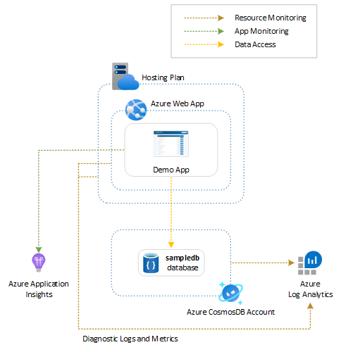
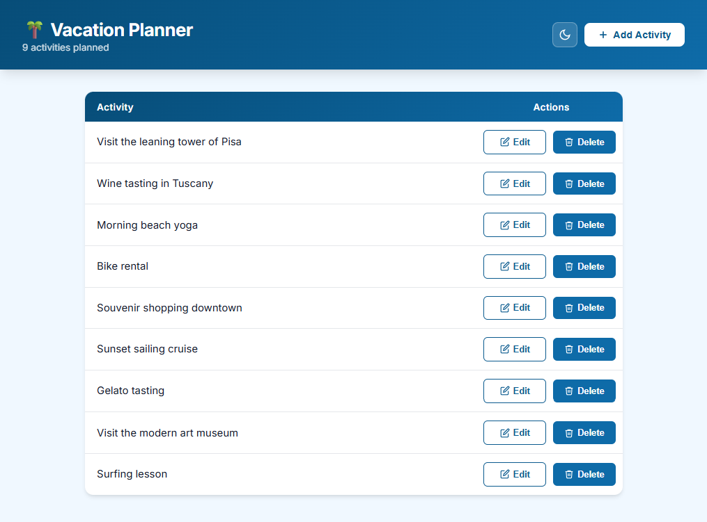
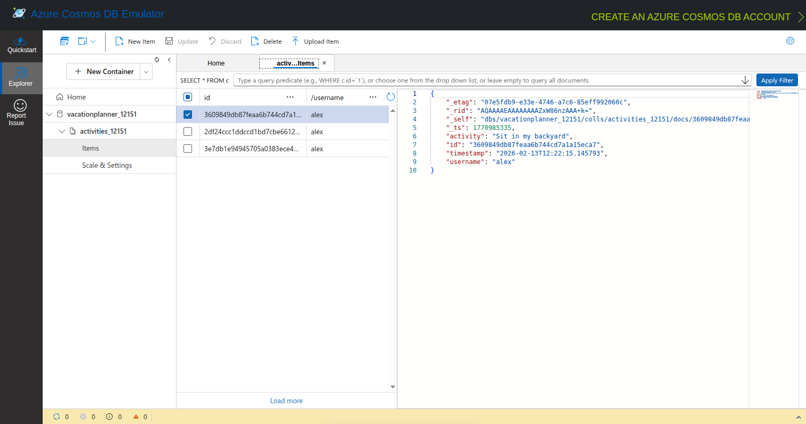

# Azure Web App with Azure CosmosDB for NoSQL API

This sample demonstrates a Python Flask single-page web application called *Vacation Planner* hosted on an [Azure Web App](https://learn.microsoft.com/en-us/azure/app-service/overview). The app runs on an Azure App Service Plan and stores activity data in a container of a NoSQL database, which the deploy script names `activities_<n>` and `vacationplanner_<n>`, on an [Azure CosmosDB for NoSQL](https://learn.microsoft.com/en-us/azure/cosmos-db/distributed-nosql) account.

## Architecture

The following diagram illustrates the architecture of the solution:



- **Azure Web App**: Hosts the Python Flask application
- **Azure App Service Plan**: Provides compute resources for the web app
- **Azure CosmosDB for NoSQL API**: Stores activity data in a CosmosDB container
- **Azure Log Analytics workspace**: Centralizes the diagnostic logs and metrics of the web app, its plan and the CosmosDB account, the telemetry of Application Insights, and the audit records of the queries run on it
- **Azure Application Insights**: A workspace-based resource that collects the requests, the calls to Azure Cosmos DB, the log records, the exceptions, the custom events and the custom metric of the web app, which the Microsoft OpenTelemetry Distro sends to the connection string of the `APPLICATIONINSIGHTS_CONNECTION_STRING` app setting. See [Application Insights](#application-insights)

## Prerequisites

- [lstk CLI](https://docs.localstack.cloud/aws/developer-tools/running-localstack/lstk/)
- [Azure Subscription](https://azure.microsoft.com/free/)
- [Azure CLI](https://learn.microsoft.com/en-us/cli/azure/install-azure-cli)
- [Python 3.11+](https://www.python.org/downloads/)
- [Flask](https://flask.palletsprojects.com/)

> [!IMPORTANT]
> **Macs with Apple silicon**: this sample deploys a web app from code. The emulator builds it with Microsoft's Oryx build image and runs it on an Oryx runtime image, and Microsoft publishes both for amd64 only ([microsoft/Oryx#2133](https://github.com/microsoft/Oryx/issues/2133) asks for arm64).
> On a Mac with Apple silicon they run only under Docker Desktop's amd64 emulation: in Docker Desktop's settings, under **General**, select the **Apple Virtualization framework** as the Virtual Machine Manager and turn on **Use Rosetta for x86_64/amd64 emulation on Apple Silicon**.
> Under QEMU, which Docker Desktop uses otherwise (Rosetta off, or Docker VMM, which has no Rosetta), the sample is not expected to work: Oryx is a .NET app, and [.NET does not support QEMU](https://github.com/dotnet/core/blob/main/release-notes/8.0/supported-os.md).
> The sample does not run on an arm64 Linux host without amd64 emulation.

## Deployment

Set up the Azure emulator using the LocalStack for Azure Docker image. Before starting, ensure you have a valid `LOCALSTACK_AUTH_TOKEN` to access the Azure emulator. Refer to the [Auth Token guide](https://docs.localstack.cloud/getting-started/auth-token/) to obtain your Auth Token and set it in the `LOCALSTACK_AUTH_TOKEN` environment variable. The Azure Docker image is available on the [LocalStack Docker Hub](https://hub.docker.com/r/localstack/localstack-azure). To pull the image, execute:

```bash
docker pull localstack/localstack-azure
```

Start the LocalStack Azure emulator by running:

```bash
# Set the authentication token
export LOCALSTACK_AUTH_TOKEN=<your_auth_token>

# Start the LocalStack Azure emulator
lstk start --type azure

# Route all Azure CLI calls to the LocalStack Azure emulator
lstk az start-interception
```

Deploy the application to LocalStack for Azure using:

- [Azure CLI Deployment](./scripts/README.md)

> [!NOTE]
> When you deploy the application to LocalStack for Azure for the first time, the initialization process involves downloading and building Docker images. This is a one-time operation—subsequent deployments will be significantly faster. Depending on your internet connection and system resources, this initial setup may take several minutes.

## Test

1. Retrieve the host port Docker maps to the port the Web App listens on in its container, for example with `docker port <container-name>` (the container's name starts with `ls-<web-app-name>`). Do not assume port 80: the app listens on the port its `WEBSITES_PORT` app setting names, when it has one.
2. Open a web browser and navigate to `http://localhost:<published-port>`.
3. If the deployment was successful, you will see the following user interface for adding and removing activities:



You can use the `call-web-app.sh` Bash script below to call the web app. The script demonstrates three methods for calling web apps:

1. **Through the LocalStack for Azure emulator**: Call the web app via the emulator using its default host name. The emulator acts as a proxy to the web app.
2. **Via localhost and host port mapped to the container's port**: Use `127.0.0.1` with the host port mapped to the container's port `80`.
3. **Via container IP address**: Use the app container's IP address on port `80`. This technique is only available when accessing the web app from the Docker host machine.
4. **Via the default hostname**: Call the web app via the default hostname `<web-app-name>.azurewebsites.azure.localhost.localstack.cloud:4566`.

## Application Insights

The web app sends its telemetry to `<prefix>-insights-<suffix>`, a workspace-based [Application Insights](https://learn.microsoft.com/en-us/azure/azure-monitor/app/app-insights-overview) resource that stores it in the `<prefix>-log-analytics-<suffix>` workspace. The deploy script sets the `APPLICATIONINSIGHTS_CONNECTION_STRING` app setting to the connection string of the resource, and the application turns on the [Microsoft OpenTelemetry Distro](https://learn.microsoft.com/en-us/azure/azure-monitor/app/opentelemetry-enable?tabs=python) when the setting is present. The application also sends a [custom event](https://learn.microsoft.com/en-us/azure/azure-monitor/app/opentelemetry-add-modify#send-custom-events) for each activity it adds, updates or deletes, counts these operations in the `activities` [custom metric](https://learn.microsoft.com/en-us/azure/azure-monitor/app/opentelemetry-add-modify#add-custom-metrics), and logs the exceptions it catches:

```python
from microsoft.opentelemetry import use_microsoft_opentelemetry

# The logger of the application
LOGGER_NAME = "webapp"

if os.environ.get("APPLICATIONINSIGHTS_CONNECTION_STRING"):
    use_microsoft_opentelemetry(enable_azure_monitor=True, logger_name=LOGGER_NAME)

from flask import Flask
from opentelemetry import metrics

activity_counter = metrics.get_meter(LOGGER_NAME).create_counter(
    "activities", unit="{activity}", description="The number of activities added, updated and deleted."
)


def track_activity_event(event_name: str, operation: str, activity_id: str) -> None:
    logger.info(
        f"{event_name}: {activity_id}",
        extra={"microsoft.custom_event.name": event_name, "activity.id": activity_id},
    )
    activity_counter.add(1, {"operation": operation})
```

The distro starts before the application imports Flask, so that its Flask instrumentation wraps it. It traces the Azure SDKs, so the calls of `azure-cosmos` arrive as dependencies, and it collects the records of the `webapp` logger and of its child `webapp.cosmosdb_client`.

The workspace keeps the telemetry in these tables:

| Table             | What the web app sends                                                                                                   |
| ----------------- | ------------------------------------------------------------------------------------------------------------------------ |
| `AppRequests`     | The requests it serves, such as `GET /`                                                                                  |
| `AppDependencies` | Its calls to Azure Cosmos DB                                                                                             |
| `AppTraces`       | The records of its loggers                                                                                               |
| `AppEvents`       | The `ActivityAdded`, `ActivityUpdated` and `ActivityDeleted` custom events, with the id of the activity in `activity.id` |
| `AppMetrics`      | The `activities` custom metric, with the operation (`add`, `update` or `delete`) in `operation`                          |
| `AppExceptions`   | The exceptions it logs, with their stack trace, when a call to Azure Cosmos DB fails                                     |

[`scripts/query-telemetry.sh`](./scripts/query-telemetry.sh) calls the web app, adds an activity, and reads the tables back, retrying until their records arrive. It shows the exceptions without waiting for them: a healthy run has none.

## Logs and metrics

The web app, its App Service plan and the Azure Cosmos DB account each have a diagnostic setting that sends their resource logs, their platform metrics or both to the `<prefix>-log-analytics-<suffix>` Log Analytics workspace, and the workspace has one that sends the audit records of the queries run on it (`Audit`, table `LAQueryLogs`) to itself. The Application Insights resource has none: its telemetry is already in the workspace it's based on, and a diagnostic setting of a workspace-based Application Insights resource [can't send to that workspace](https://learn.microsoft.com/en-us/azure/azure-monitor/app/export-telemetry#diagnostic-settings-based-export). Two of the resources record what the application does:

| Resource                | Log categories                                                                                                                                                                  | Tables in the workspace                           | What the application leaves there                                                                                                               |
| ----------------------- | ------------------------------------------------------------------------------------------------------------------------------------------------------------------------------- | ------------------------------------------------- | ----------------------------------------------------------------------------------------------------------------------------------------------- |
| Web App                 | `AppServiceHTTPLogs`, `AppServiceConsoleLogs`, `AppServicePlatformLogs`, `AppServiceAppLogs`, `AppServiceAuditLogs`, `AppServiceIPSecAuditLogs`, `AppServiceAuthenticationLogs` | One table per category, named after it            | The requests it serves, its console output and the start of its container                                                                       |
| Azure Cosmos DB account | `DataPlaneRequests`, `ControlPlaneRequests`                                                                                                                                     | `CDBDataPlaneRequests`, `CDBControlPlaneRequests` | The requests of the application, and the creation of the database and the container by the deploy script, which creates the setting before them |

Their platform metrics land in the `AzureMetrics` table, except the account's: Azure exports none of them through a diagnostic setting (the DS Export column of its [supported metrics](https://learn.microsoft.com/en-us/azure/azure-monitor/reference/supported-metrics/microsoft-documentdb-databaseaccounts-metrics)), so the script reads its `TotalRequests` from the metrics API only. The setting of the account writes to the resource-specific tables, which Microsoft recommends over the shared `AzureDiagnostics` table: the deploy script passes `--export-to-resource-specific true`. The LocalStack emulator records the requests of the application in `CDBDataPlaneRequests` only when it runs with `LS_AZURE_COSMOS_DB_REQUEST_LOGS=1`.

[`scripts/query-logs-and-metrics.sh`](./scripts/query-logs-and-metrics.sh) shows the diagnostic settings, calls the web app and reads these tables back, retrying until their records arrive, then reads the same platform metrics from the Azure Monitor metrics API. On Azure the first records of a new diagnostic setting can take up to 90 minutes: raise `RETRY_COUNT` there.

## CosmosDB Tooling

You can utilize **CosmosDB Data Explorer** to explore and manage your CosmosDB databases and containers. Ensure you connect using `http://localhost:port` connection string, where `port` corresponds to the port published by the CosmosDB container on the host and mapped to the internal CosmosDB port `1234`.



## References

- [Azure Web Apps Documentation](https://learn.microsoft.com/en-us/azure/app-service/)
- [Azure CosmosDB Documentation](https://learn.microsoft.com/en-us/azure/cosmos-db/)
- [Quickstart: Python Flask on Azure](https://learn.microsoft.com/en-us/azure/app-service/quickstart-python?tabs=flask%2Cbrowser)
- [Azure Identity Client Library for Python](https://learn.microsoft.com/en-us/python/api/overview/azure/identity-readme?view=azure-python)
- [LocalStack for Azure](https://docs.localstack.cloud/azure/)
- [lstk CLI](https://docs.localstack.cloud/aws/developer-tools/running-localstack/lstk/)
- [lstk GitHub repository](https://github.com/localstack/lstk)
