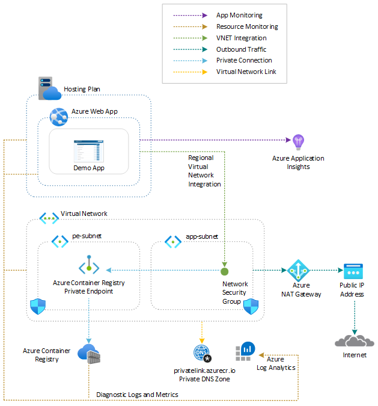

# Azure Web App with Custom Docker Image

This sample demonstrates a Python Flask web application hosted on an [Azure Web App](https://learn.microsoft.com/en-us/azure/app-service/overview) using a custom Docker image. The app runs on an Azure App Service Plan and uses a container image stored in an [Azure Container Registry](https://learn.microsoft.com/azure/container-registry/container-registry-intro). For more information on configuring a web app to use a custom container, see [Configure a custom container for Azure App Service](https://learn.microsoft.com/azure/app-service/configure-custom-container?tabs=debian&pivots=container-linux).

## Architecture

The following diagram illustrates the architecture of the solution:



The solution is composed of the following Azure resources:

1. [Azure Resource Group](https://learn.microsoft.com/en-us/azure/azure-resource-manager/management/manage-resource-groups-cli): A logical container scoping all resources in this sample.
2. [Azure Virtual Network](https://learn.microsoft.com/azure/virtual-network/virtual-networks-overview): Hosts two subnets:
	- *app-subnet*: Dedicated to [regional VNet integration](https://learn.microsoft.com/azure/azure-functions/functions-networking-options?tabs=azure-portal#outbound-networking-features) with the Web App.
	- *pe-subnet*: Used for hosting Azure Private Endpoints.
3. [Azure Private DNS Zone](https://learn.microsoft.com/azure/dns/private-dns-privatednszone): Handles DNS resolution for the Azure Container Registry Private Endpoint within the virtual network.
4. [Azure Private Endpoint](https://learn.microsoft.com/azure/private-link/private-endpoint-overview): Secures network access to the Azure Container Registry via a private IP within the VNet.
5. [Azure NAT Gateway](https://learn.microsoft.com/azure/nat-gateway/nat-overview): Provides deterministic outbound connectivity for the Web App. Included for completeness; the sample app does not call any external services.
6. [Azure Network Security Group](https://learn.microsoft.com/en-us/azure/virtual-network/network-security-groups-overview): Enforces inbound and outbound traffic rules across the virtual network's subnets.
7. [Azure Log Analytics Workspace](https://learn.microsoft.com/azure/azure-monitor/logs/log-analytics-overview): Centralizes the diagnostic logs and metrics of every resource, the telemetry of Application Insights, and the audit records of the queries run on it.
8. [Azure Application Insights](https://learn.microsoft.com/en-us/azure/azure-monitor/app/app-insights-overview) `<prefix>-insights-<suffix>`: A workspace-based resource that collects the requests, the log records, the exceptions, the custom events and the custom metric of the web app, which the Microsoft OpenTelemetry Distro sends to the connection string of the `APPLICATIONINSIGHTS_CONNECTION_STRING` app setting. See [Application Insights](#application-insights).
9. [Azure Container Registry](https://learn.microsoft.com/azure/container-registry/container-registry-intro): A fully-managed container registry service based on the open-source [Docker platform](https://docs.docker.com/get-started/docker-overview/) used to hold the container image used by the web app.
10. [User-Assigned Managed Identity](https://learn.microsoft.com/en-us/azure/active-directory/managed-identities-azure-resources/overview): Assigned the [AcrPull](https://learn.microsoft.com/en-us/azure/role-based-access-control/built-in-roles/containers#acrpull) role on the Azure Container Registry, enabling the Web App to pull the container image without storing credentials.
11. [Azure App Service Plan](https://learn.microsoft.com/en-us/azure/app-service/overview-hosting-plans): The underlying compute tier that hosts the web application.
12. [Azure Web App](https://learn.microsoft.com/en-us/azure/app-service/overview): Runs the Python Flask application from the custom container image stored in the Azure Container Registry.

## Prerequisites

- [lstk CLI](https://docs.localstack.cloud/aws/developer-tools/running-localstack/lstk/)
- [Azure Subscription](https://azure.microsoft.com/free/)
- [Azure CLI](https://learn.microsoft.com/en-us/cli/azure/install-azure-cli)
- [Docker](https://docs.docker.com/get-docker/)
- [Bicep](https://marketplace.visualstudio.com/items?itemName=ms-azuretools.vscode-bicep), if you plan to install the sample via Bicep.
- [Terraform](https://developer.hashicorp.com/terraform/downloads), if you plan to install the sample via Terraform.
- [lstk CLI](https://docs.localstack.cloud/aws/developer-tools/running-localstack/lstk/): LocalStack command-line interface (proxies the Azure CLI via `lstk az`)
- [jq](https://jqlang.org/): JSON processor for scripting and parsing command outputs

## Deployment

Set up the Azure emulator using the LocalStack for Azure Docker image. Before starting, ensure you have a valid `LOCALSTACK_AUTH_TOKEN` to access the Azure emulator. Refer to the [Auth Token guide](https://docs.localstack.cloud/getting-started/auth-token/) to obtain your Auth Token and set it in the `LOCALSTACK_AUTH_TOKEN` environment variable. The Azure Docker image is available on the [LocalStack Docker Hub](https://hub.docker.com/r/localstack/localstack-azure). To pull the image, execute:

```bash
docker pull localstack/localstack-azure
```

Start the LocalStack Azure emulator by running:

```bash
# Set the authentication token
export LOCALSTACK_AUTH_TOKEN=<your_auth_token>

# Start the LocalStack Azure emulator
lstk start --type azure

# Route all Azure CLI calls to the LocalStack Azure emulator
lstk az start-interception
```

Deploy the application to LocalStack for Azure using one of these methods:

- [Azure CLI Deployment](./scripts/README.md)
- [Bicep Deployment](./bicep/README.md)
- [Terraform Deployment](./terraform/README.md)

All deployment methods have been fully tested against Azure and the LocalStack for Azure local emulator.

> [!NOTE]
> When you deploy the application to LocalStack for Azure for the first time, the initialization process involves downloading and building Docker images. This is a one-time operation—subsequent deployments will be significantly faster. Depending on your internet connection and system resources, this initial setup may take several minutes.

## Test

You can use the `call-web-app.sh` Bash script below to call the web app. The script calls the web app via the default hostname `<web-app-name>.azurewebsites.azure.localhost.localstack.cloud:4566`.

## Application Insights

The web app sends its telemetry to `<prefix>-insights-<suffix>`, a workspace-based [Application Insights](https://learn.microsoft.com/en-us/azure/azure-monitor/app/app-insights-overview) resource that stores it in the `<prefix>-log-analytics-<suffix>` workspace. The three deployment methods set the `APPLICATIONINSIGHTS_CONNECTION_STRING` app setting to the connection string of the resource, and the application in the image turns on the [Microsoft OpenTelemetry Distro](https://learn.microsoft.com/en-us/azure/azure-monitor/app/opentelemetry-enable?tabs=python) when the setting is present. The application also sends the `StatusRequested` [custom event](https://learn.microsoft.com/en-us/azure/azure-monitor/app/opentelemetry-add-modify#send-custom-events) for each call to `/api/status`, and counts these calls in the `status_requests` [custom metric](https://learn.microsoft.com/en-us/azure/azure-monitor/app/opentelemetry-add-modify#add-custom-metrics):

```python
from microsoft.opentelemetry import use_microsoft_opentelemetry

# The logger of the application
LOGGER_NAME = "webapp"

if os.environ.get("APPLICATIONINSIGHTS_CONNECTION_STRING"):
    use_microsoft_opentelemetry(enable_azure_monitor=True, logger_name=LOGGER_NAME)

from flask import Flask, jsonify, render_template
from opentelemetry import metrics

status_counter = metrics.get_meter(LOGGER_NAME).create_counter(
    "status_requests", unit="{request}", description="The number of status requests the app answered."
)


@app.route("/api/status")
def status():
    image = image_name()
    hostname = socket.gethostname()
    logger.info(
        f"StatusRequested: {image}",
        extra={"microsoft.custom_event.name": "StatusRequested", "image.name": image, "hostname": hostname},
    )
    status_counter.add(1, {"image": image})
```

The container runs `flask run`, which imports Flask before the application: the distro still wraps the application, because its Flask instrumentation replaces the `Flask` class that `app.py` imports after the distro starts.

The workspace keeps the telemetry in these tables:

| Table           | What the web app sends                                                                                          |
| --------------- | --------------------------------------------------------------------------------------------------------------- |
| `AppRequests`   | The requests it serves, such as `GET /` and `GET /api/status`                                                   |
| `AppTraces`     | The records of its loggers                                                                                      |
| `AppEvents`     | The `StatusRequested` custom events, with the image in `image.name` and the container's host name in `hostname` |
| `AppMetrics`    | The `status_requests` custom metric, with the image in `image`                                                  |
| `AppExceptions` | The exceptions of the requests that fail, with their stack trace                                                |

[`scripts/query-telemetry.sh`](./scripts/query-telemetry.sh) calls the home page and the status endpoint, and reads the tables back, retrying until their records arrive. While it waits it calls the web app again: on Azure, App Service applies the connection string that `deploy.sh` sets last by starting a new container about a minute after the deployment, and the calls an earlier container served may never reach the workspace. It shows the exceptions without waiting for them: a healthy run has none.

## Logs and metrics

The web app, its App Service plan, the container registry, the VNet, the two NSGs, the NAT Gateway and its public IP prefix each have a diagnostic setting that sends their resource logs, their platform metrics or both to the `<prefix>-log-analytics-<suffix>` Log Analytics workspace, and the workspace has one that sends the audit records of the queries run on it (`Audit`, table `LAQueryLogs`) to itself. The Application Insights resource has none: its telemetry is already in the workspace it's based on, and a diagnostic setting of a workspace-based Application Insights resource [can't send to that workspace](https://learn.microsoft.com/en-us/azure/azure-monitor/app/export-telemetry#diagnostic-settings-based-export). The private endpoint, the private DNS zone and the managed identity offer no diagnostic settings.

| Resource           | Log categories                                                                                                                                                                  | Tables in the workspace                                             | What it records                                                                                                                                           |
| ------------------ | ------------------------------------------------------------------------------------------------------------------------------------------------------------------------------- | ------------------------------------------------------------------- | --------------------------------------------------------------------------------------------------------------------------------------------------------- |
| Web App            | `AppServiceHTTPLogs`, `AppServiceConsoleLogs`, `AppServicePlatformLogs`, `AppServiceAppLogs`, `AppServiceAuditLogs`, `AppServiceIPSecAuditLogs`, `AppServiceAuthenticationLogs` | One table per category, named after it                              | The requests it serves, its console output and the start of its container                                                                                 |
| Container registry | `ContainerRegistryLoginEvents`, `ContainerRegistryRepositoryEvents`                                                                                                             | `ContainerRegistryLoginEvents`, `ContainerRegistryRepositoryEvents` | The logins to the registry and the pushes and pulls of its images, once the setting exists: the deployment pushes the image before it creates the setting |

Their platform metrics land in the `AzureMetrics` table. The VNet and the two NSGs send their network logs; on the emulator these categories stay empty, because no traffic crosses an emulated network security group.

[`scripts/query-logs-and-metrics.sh`](./scripts/query-logs-and-metrics.sh) shows the diagnostic settings, calls the web app and reads these tables back, retrying until their records arrive, then reads the same platform metrics from the Azure Monitor metrics API. On Azure the first records of a new diagnostic setting can take up to 90 minutes: raise `RETRY_COUNT` there. On Azure the script reads the exported platform metrics (`AzureMetrics`) only once: Azure exports them late and irregularly, so the script shows those that arrived and notes how many are still missing, without failing.

## References

- [Azure Web Apps Documentation](https://learn.microsoft.com/en-us/azure/app-service/)
- [Azure Container Registry Documentation](https://learn.microsoft.com/azure/container-registry/container-registry-intro)
- [Configure a custom container for Azure App Service](https://learn.microsoft.com/azure/app-service/configure-custom-container?tabs=debian&pivots=container-linux)
- [Azure Identity Client Library for Python](https://learn.microsoft.com/en-us/python/api/overview/azure/identity-readme?view=azure-python)
- [LocalStack for Azure](https://docs.localstack.cloud/azure/)
- [lstk CLI](https://docs.localstack.cloud/aws/developer-tools/running-localstack/lstk/)
- [lstk GitHub repository](https://github.com/localstack/lstk)
