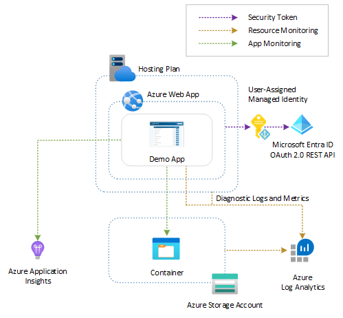
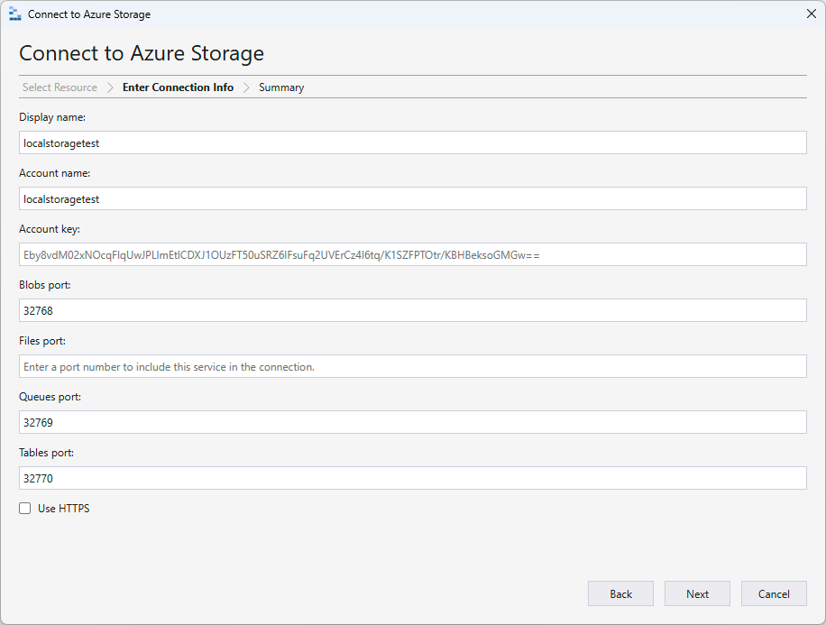

# Azure Web App with Managed Identity

This sample demonstrates a Python Flask single-page web application called *Vacation Planner* hosted on an [Azure Web App](https://learn.microsoft.com/en-us/azure/app-service/overview). The app runs on an Azure App Service Plan and stores activity data in an `activities` container within [Azure Blob Storage](https://learn.microsoft.com/en-us/azure/storage/blobs/storage-blobs-introduction). The web app uses a user-assigned or system-assigned managed identity to access storage.

A managed identity from Microsoft Entra ID allows your app to easily access other Microsoft Entra-protected resources, such as Azure Key Vault. The Azure platform manages the identity, so you don't need to provision or rotate any secrets. For more information about managed identities in Microsoft Entra ID, see [Managed identities for Azure resources](https://learn.microsoft.com/en-us/azure/active-directory/managed-identities-azure-resources/overview).

You can configure the Azure Web App to use two types of managed identities:

- A **system-assigned identity** is tied to the application and is deleted when the application is deleted. An application can have only one system-assigned identity.
- A **user-assigned identity** is a standalone Azure resource that can be assigned to your application. An application can have multiple user-assigned identities. A single user-assigned identity can be assigned to multiple Azure resources, such as multiple App Service applications.

For more information on how to create a managed identity for Azure App Service and Azure Functions applications, and how to use it to access other resources, see [Use managed identities for App Service and Azure Functions](https://learn.microsoft.com/en-us/azure/app-service/overview-managed-identity).

## Architecture

The following diagram illustrates the architecture of the solution:



- **Azure Web App**: Hosts the Python Flask application
- **Azure App Service Plan**: Provides compute resources for the web app
- **Azure Blob Storage**: Stores activity data as blobs in a container
- **Azure Entra Tenant**: Issues security tokens via OAuth 2.0
- **Azure Application Insights**: Collects the requests, the calls to Blob Storage and the log records of the web app
- **Azure Log Analytics Workspace**: Stores the telemetry of Application Insights, and the logs and metrics that the diagnostic settings of the web app and of the App Service plan send to it

## Security

This sample demonstrates how to configure an [Azure App Service](https://learn.microsoft.com/en-us/azure/app-service/configure-authentication-provider-aad?tabs=workforce-configuration), specifically a Web App, to use either a user-assigned identity or a system-assigned identity to acquire a security token from [Microsoft Entra ID](https://learn.microsoft.com/en-us/entra/fundamentals/what-is-entra) for accessing downstream services such as Azure Blob Storage. You must configure the target resource to allow access from your app. For most Azure services, configure the target resource by [creating a role assignment](https://learn.microsoft.com/en-us/azure/role-based-access-control/role-assignments-steps) for the user-assigned or system-assigned managed identity used by the application via Azure role-based access control (Azure RBAC). For more information, see [What is Azure RBAC?](https://learn.microsoft.com/en-us/azure/role-based-access-control/overview)

Some services use mechanisms other than Azure role-based access control. To understand how to configure access using an identity, refer to the Azure documentation for each target resource. To learn more about which resources support Microsoft Entra tokens, see [Azure services that support Microsoft Entra authentication](https://learn.microsoft.com/en-us/azure/active-directory/managed-identities-azure-resources/services-support-managed-identities#azure-services-that-support-azure-ad-authentication).

For example, if you [request a token](https://learn.microsoft.com/en-us/azure/app-service/overview-managed-identity?tabs=portal%2Chttp#connect-to-azure-services-in-app-code) to access a secret in Azure Key Vault, you must also create a role assignment that allows the managed identity to work with secrets in the target vault. Otherwise, Key Vault will reject your calls even if you use a valid token. The same is true for Azure SQL Database and other Azure services.

In this sample, the provisioning process assigns the [Storage Blob Data Contributor](https://learn.microsoft.com/en-us/azure/role-based-access-control/built-in-roles/storage#storage-blob-data-contributor) built-in role to the managed identity used by the web app, with the demo storage account as the scope. This ensures the managed identity has the proper permissions to allow the application code to read and write blobs in the target container.

The LocalStack emulator emulates the following services, which are necessary at provisioning time and runtime:

- **Microsoft Entra Tenant**: This REST API is responsible for issuing a security token to the application to access the target service. For more information, see [Microsoft identity platform and OAuth 2.0 authorization code flow](https://learn.microsoft.com/en-us/entra/identity-platform/v2-oauth2-auth-code-flow).
- **Microsoft Graph REST API**: Microsoft Graph is the gateway to Microsoft cloud services like Microsoft Entra and Microsoft 365. In particular, it provides access to [service principals](https://learn.microsoft.com/en-us/graph/api/resources/serviceprincipal?view=graph-rest-1.0) used by applications via [workload identities](https://learn.microsoft.com/en-us/entra/workload-id/workload-identities-overview). In Microsoft Entra, workload identities are applications, service principals, and managed identities.
- **Azure Role-Based Access Control (RBAC)**: Azure role-based access control (Azure RBAC) helps you manage who has access to Azure resources, what they can do with those resources, and what areas they have access to. LocalStack for Azure fully supports and mocks built-in [role definitions](https://learn.microsoft.com/en-us/azure/role-based-access-control/role-definitions), custom role definitions, and [role assignments](https://learn.microsoft.com/en-us/azure/role-based-access-control/role-assignments), but does not enforce or check permissions.

## Prerequisites

- [lstk CLI](https://docs.localstack.cloud/aws/developer-tools/running-localstack/lstk/)
- [Azure Subscription](https://azure.microsoft.com/free/)
- [Azure CLI](https://learn.microsoft.com/en-us/cli/azure/install-azure-cli)
- [Python](https://www.python.org/downloads/)
- [Flask](https://flask.palletsprojects.com/)
- [Bicep extension](https://marketplace.visualstudio.com/items?itemName=ms-azuretools.vscode-bicep), if you plan to install the sample via Bicep.
- [Terraform](https://developer.hashicorp.com/terraform/downloads), if you plan to install the sample via Terraform.

> [!IMPORTANT]
> **Macs with Apple silicon**: this sample deploys a web app from code. The emulator builds it with Microsoft's Oryx build image and runs it on an Oryx runtime image, and Microsoft publishes both for amd64 only ([microsoft/Oryx#2133](https://github.com/microsoft/Oryx/issues/2133) asks for arm64).
> On a Mac with Apple silicon they run only under Docker Desktop's amd64 emulation: in Docker Desktop's settings, under **General**, select the **Apple Virtualization framework** as the Virtual Machine Manager and turn on **Use Rosetta for x86_64/amd64 emulation on Apple Silicon**.
> Under QEMU, which Docker Desktop uses otherwise (Rosetta off, or Docker VMM, which has no Rosetta), the sample is not expected to work: Oryx is a .NET app, and [.NET does not support QEMU](https://github.com/dotnet/core/blob/main/release-notes/8.0/supported-os.md).
> The sample does not run on an arm64 Linux host without amd64 emulation.

## Deployment

Set up the Azure emulator using the LocalStack for Azure Docker image. Before starting, ensure you have a valid `LOCALSTACK_AUTH_TOKEN` to access the Azure emulator. Refer to the [Auth Token guide](https://docs.localstack.cloud/getting-started/auth-token/) to obtain your Auth Token and set it in the `LOCALSTACK_AUTH_TOKEN` environment variable. The Azure Docker image is available on the [LocalStack Docker Hub](https://hub.docker.com/r/localstack/localstack-azure). To pull the image, execute:

```bash
docker pull localstack/localstack-azure
```

Start the LocalStack Azure emulator by running:

```bash
# Set the authentication token
export LOCALSTACK_AUTH_TOKEN=<your_auth_token>

# Start the LocalStack Azure emulator
lstk start --type azure

# Route all Azure CLI calls to the LocalStack Azure emulator
lstk az start-interception
```

Deploy the application to LocalStack for Azure using one of these methods:

- [Azure CLI Deployment](./scripts/README.md)
- [Bicep Deployment](./bicep/README.md)
- [Terraform Deployment](./terraform/README.md)

All deployment methods have been fully tested with both user-assigned and system-assigned managed identities against Azure and the LocalStack for Azure local emulator.

> [!NOTE]
> When you deploy the application to LocalStack for Azure for the first time, the initialization process involves downloading and building Docker images. This is a one-time operation—subsequent deployments will be significantly faster. Depending on your internet connection and system resources, this initial setup may take several minutes.

## Test

1. Retrieve the host port Docker maps to the port the Web App listens on in its container, for example with `docker port <container-name>` (the container's name starts with `ls-<web-app-name>`). Do not assume port 80: the app listens on the port its `WEBSITES_PORT` app setting names, when it has one.
2. Open a web browser and navigate to `http://localhost:<published-port>`.
3. If the deployment was successful, you will see the following user interface for adding and removing activities:


You can use the `call-web-app.sh` Bash script below to call the web app. The script demonstrates three methods for calling web apps:

1. **Through the LocalStack for Azure emulator**: Call the web app via the emulator using its default host name. The emulator acts as a proxy to the web app.
2. **Via localhost and host port mapped to the container's port**: Use `127.0.0.1` with the host port mapped to the container's port `80`.
3. **Via container IP address**: Use the app container's IP address on port `80`. This technique is only available when accessing the web app from the Docker host machine.
4. **Via the default hostname**: Call the web app via the default hostname `<web-app-name>.azurewebsites.azure.localhost.localstack.cloud:4566`.

## Application Insights

The web app sends its telemetry to `<prefix>-insights-<suffix>`, a workspace-based [Application Insights](https://learn.microsoft.com/en-us/azure/azure-monitor/app/app-insights-overview) resource that stores it in the `<prefix>-log-analytics-<suffix>` [Log Analytics workspace](https://learn.microsoft.com/en-us/azure/azure-monitor/logs/log-analytics-workspace-overview). The three deployment methods set the `APPLICATIONINSIGHTS_CONNECTION_STRING` app setting to the connection string of the resource, and the application turns on the [Microsoft OpenTelemetry Distro](https://learn.microsoft.com/en-us/azure/azure-monitor/app/opentelemetry-enable?tabs=python), the `microsoft-opentelemetry` package, when the setting is present:

```python
from microsoft.opentelemetry import use_microsoft_opentelemetry

# The logger of the application
LOGGER_NAME = "webapp"

if os.environ.get("APPLICATIONINSIGHTS_CONNECTION_STRING"):
    use_microsoft_opentelemetry(enable_azure_monitor=True, logger_name=LOGGER_NAME)

from flask import Flask
```

The distro starts before the application imports Flask, so that its Flask instrumentation wraps the application. The workspace keeps the telemetry in these tables:

| Table             | What the web app sends                                                                       |
| ----------------- | -------------------------------------------------------------------------------------------- |
| `AppRequests`     | The requests it serves, such as `GET /`                                                      |
| `AppDependencies` | Its calls to Blob Storage, such as `GET /activities` and `ContainerClient.list_blobs`        |
| `AppTraces`       | The records of its `webapp` logger, such as `Read 3 activities from container 'activities'.` |

The `az monitor log-analytics query` command of the `log-analytics` extension of the Azure CLI reads them, given the workspace id (`customerId`) of the workspace:

```bash
az extension add --name log-analytics

WORKSPACE_ID=$(az monitor log-analytics workspace show \
  --resource-group local-rg \
  --workspace-name local-log-analytics-test \
  --query customerId \
  --output tsv)

az monitor log-analytics query \
  --workspace "$WORKSPACE_ID" \
  --analytics-query "AppDependencies | project TimeGenerated, Name, Target, ResultCode, Success | order by TimeGenerated desc | take 3" \
  --output table
```

```text
Name                                        ResultCode    Success    TableName      Target                                                             TimeGenerated
------------------------------------------  ------------  ---------  -------------  -----------------------------------------------------------------  ---------------------------
GET /activities                             200           True       PrimaryResult  localstoragetest.blob.core.azure.localhost.localstack.cloud:4566   2026-11-16T09:12:54.085751Z
ContainerOperations.list_blob_flat_segment  0             True       PrimaryResult                                                                     2026-11-16T09:12:54.08549Z
ContainerClient.list_blobs                  0             True       PrimaryResult                                                                     2026-11-16T09:12:54.085223Z
```

[`scripts/query-telemetry.sh`](./scripts/query-telemetry.sh) calls the web app and reads the three tables back, retrying until their records arrive. It exits with a non-zero code when the web app does not answer, or when a query still lacks its records after `RETRY_COUNT` attempts (30 by default) made `SLEEP` seconds apart (10 by default).

## Logs and metrics

The web app and its App Service plan each have a [diagnostic setting](https://learn.microsoft.com/en-us/azure/azure-monitor/data-collection/diagnostic-settings) named `default` that sends their resource logs and their platform metrics (`AllMetrics`) to the same workspace:

| Resource         | Log categories                                                                                                                                                                  | Tables in the workspace                | What the web app leaves there                                                                                                       |
| ---------------- | ------------------------------------------------------------------------------------------------------------------------------------------------------------------------------- | -------------------------------------- | ----------------------------------------------------------------------------------------------------------------------------------- |
| Web App          | `AppServiceHTTPLogs`, `AppServiceConsoleLogs`, `AppServicePlatformLogs`, `AppServiceAppLogs`, `AppServiceAuditLogs`, `AppServiceIPSecAuditLogs`, `AppServiceAuthenticationLogs` | One table per category, named after it | The requests it serves, its console output (the Gunicorn request lines and the records of its `webapp` logger) and the start of its container |
| App Service plan | None: metrics only                                                                                                                                                              | `AzureMetrics`                         | The CPU and memory use of its instances                                                                                             |

The platform metrics of the web app, such as `Requests`, `Http2xx` and `BytesSent`, land in the `AzureMetrics` table too. A few queries to try:

```kusto
// The requests per minute, which the Logs page of the portal draws as a chart
AppServiceHTTPLogs
| summarize Requests = count() by bin(TimeGenerated, 1m)
| render columnchart

// The records of the application's logger in the console output
AppServiceConsoleLogs
| where ResultDescription has "activities"
| project TimeGenerated, ResultDescription

// The CPU and memory use of the App Service plan, minute by minute
AzureMetrics
| where MetricName in ("CpuPercentage", "MemoryPercentage")
| project TimeGenerated, MetricName, Average
```

The platform metrics need no diagnostic setting: the Azure Monitor metrics API serves them directly.

```bash
WEB_APP_ID=$(az webapp show \
  --name local-webapp-test \
  --resource-group local-rg \
  --query id \
  --output tsv)

az monitor metrics list \
  --resource "$WEB_APP_ID" \
  --metrics Requests Http2xx BytesSent \
  --interval PT1M \
  --aggregation Total \
  --query "value[].{Metric:name.value,Total:sum(timeseries[].data[].total)}" \
  --output table
```

[`scripts/query-logs-and-metrics.sh`](./scripts/query-logs-and-metrics.sh) does all of this in one go: it lists the diagnostic settings of the web app and of the plan, calls the web app, reads the HTTP requests, the console output and the platform events of the web app and the exported platform metrics of both resources until their records arrive, and prints the metrics of the web app. It exits with a non-zero code in the same cases as `query-telemetry.sh`.

### Delivery times

On the emulator the records are queryable within seconds, and the platform metrics (`AzureMetrics`) once their one-minute window is over. On Azure the telemetry of Application Insights takes a few minutes, and the first records of a new diagnostic setting can take [up to 90 minutes](https://learn.microsoft.com/en-us/azure/azure-monitor/data-collection/diagnostic-settings#expected-latency-after-creating-a-diagnostic-setting): run the queries again later, or raise `RETRY_COUNT` for the scripts. On Azure the records of what the app did while it started can be missing for good when its diagnostic setting was created shortly before: the scripts read the latest records, which their own calls produced.

## Storage Contents

You can use [Azure Storage Explorer](https://learn.microsoft.com/en-us/azure/storage/storage-explorer/vs-azure-tools-storage-manage-with-storage-explorer) to confirm that your Azure Web App creates the blobs in the `activities` container in the emulated storage account. To do this:

- Expand **Emulator & Attached**.
- Right-click **Storage Accounts**.
- Select **Connect to Azure Storage...**.
- In the dialog that appears, enter the name of the emulated storage account and specify the published ports, as shown in the following picture:



> [!TIP]
> When sending commands to an emulated storage account, make sure to use the primary key generated by the emulator itself. For convenience, if you're connecting to the storage account directly with Azure Storage Explorer, you can use the default Azurite password. For more details, see [Connect to Azurite with SDKs and tools](https://learn.microsoft.com/en-us/azure/storage/common/storage-connect-azurite).

## References

- [Azure Web Apps Documentation](https://learn.microsoft.com/en-us/azure/app-service/)
- [What is Azure Blob storage?](https://learn.microsoft.com/en-us/azure/storage/blobs/storage-blobs-overview)
- [What is managed identities for Azure resources?](https://learn.microsoft.com/en-us/entra/identity/managed-identities-azure-resources/overview)
- [How managed identities for Azure resources work with Azure virtual machines](https://learn.microsoft.com/en-us/entra/identity/managed-identities-azure-resources/how-managed-identities-work-vm)
- [Application Insights overview](https://learn.microsoft.com/en-us/azure/azure-monitor/app/app-insights-overview)
- [Diagnostic settings in Azure Monitor](https://learn.microsoft.com/en-us/azure/azure-monitor/data-collection/diagnostic-settings)
- [Log Analytics workspace overview](https://learn.microsoft.com/en-us/azure/azure-monitor/logs/log-analytics-workspace-overview)
- [Enable Azure Monitor OpenTelemetry](https://learn.microsoft.com/en-us/azure/azure-monitor/app/opentelemetry-enable?tabs=python)
- [LocalStack for Azure](https://docs.localstack.cloud/azure/)
- [lstk CLI](https://docs.localstack.cloud/aws/developer-tools/running-localstack/lstk/)
- [lstk GitHub repository](https://github.com/localstack/lstk)
