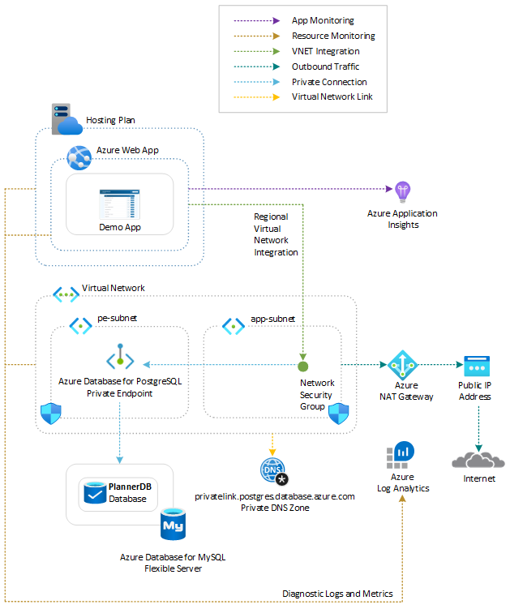

# Azure Web App with Azure Database for MySQL flexible server

This sample demonstrates an ASP.NET Core Razor Pages single-page web application called *Vacation Planner* hosted on an [Azure Web App](https://learn.microsoft.com/en-us/azure/app-service/overview). The app runs on an Azure App Service Plan and stores activity data in the `activities` table of the `plannerdb` database on an [Azure Database for MySQL flexible server](https://learn.microsoft.com/en-us/azure/mysql/flexible-server/overview). The server is reached through a [Private Endpoint](https://learn.microsoft.com/azure/private-link/private-endpoint-overview) (group `mysqlServer`) with the `privatelink.mysql.database.azure.com` Private DNS Zone, while a permissive server-level firewall rule lets the deploy machine run the post-create mysql bootstrap that creates the application user and seeds the schema.

## Architecture



The web app enables users to plan and manage vacation activities; all data is persisted in MySQL. The solution is composed of the following Azure resources:

1. [Azure Resource Group](https://learn.microsoft.com/en-us/azure/azure-resource-manager/management/manage-resource-groups-cli): A logical container scoping all resources in this sample.
2. [Azure Virtual Network](https://learn.microsoft.com/azure/virtual-network/virtual-networks-overview): Hosts two subnets:
   - *app-subnet*: Delegated to `Microsoft.Web/serverFarms` for regional VNet integration of the Web App.
   - *pe-subnet*: Hosts the Private Endpoint to the MySQL flexible server.
3. [Azure Private DNS Zone](https://learn.microsoft.com/azure/dns/private-dns-privatednszone) `privatelink.mysql.database.azure.com`, linked to the VNet. The Private Endpoint's DNS-zone group auto-registers the `A` record for the server, so the Web App resolves the server's private IP through the VNet.
4. [Azure Private Endpoint](https://learn.microsoft.com/azure/private-link/private-endpoint-overview) (group `mysqlServer`): Secures access to the MySQL flexible server from the VNet.
5. [Azure NAT Gateway](https://learn.microsoft.com/azure/nat-gateway/nat-overview): Deterministic outbound connectivity for both subnets.
6. [Azure Network Security Group](https://learn.microsoft.com/en-us/azure/virtual-network/network-security-groups-overview): One NSG per subnet.
7. [Azure Log Analytics Workspace](https://learn.microsoft.com/azure/azure-monitor/logs/log-analytics-overview): Centralizes the diagnostic logs and metrics of every resource, the telemetry of Application Insights, and the audit records of the queries run on it.
8. [Azure Application Insights](https://learn.microsoft.com/en-us/azure/azure-monitor/app/app-insights-overview) `<prefix>-insights-<suffix>`: A workspace-based resource that collects the requests, the calls to MySQL, the log records, the exceptions, the custom events and the custom metric of the web app, which the Microsoft OpenTelemetry Distro sends to the connection string of the `APPLICATIONINSIGHTS_CONNECTION_STRING` app setting. See [Application Insights](#application-insights).
9. [Azure Database for MySQL flexible server](https://learn.microsoft.com/en-us/azure/mysql/flexible-server/overview): Public-access server hosting the `plannerdb` database. Burstable `Standard_B1ms`, version 8.0.21, 32 GiB storage, 7-day backup retention, HA disabled. A permissive firewall rule (`0.0.0.0–255.255.255.255`) is created so the deploy machine can run the post-create mysql bootstrap; the Web App itself reaches the server through the Private Endpoint.
10. [MySQL database](https://learn.microsoft.com/en-us/azure/mysql/flexible-server/how-to-create-manage-databases) `plannerdb`: Created at provisioning time; the post-deploy mysql step creates the `activities` table and seeds the demo rows.
11. [Azure App Service Plan](https://learn.microsoft.com/en-us/azure/app-service/overview-hosting-plans): The underlying compute tier that hosts the web application.
12. [Azure Web App](https://learn.microsoft.com/en-us/azure/app-service/overview): Runs the ASP.NET Core *Vacation Planner* app with regional VNet integration into *app-subnet*. The Web App connects to MySQL using a dedicated application user (`testuser`) — the server-admin login is never used at runtime.
13. [App Service Source Control](https://learn.microsoft.com/en-us/rest/api/appservice/web-apps/create-or-update-source-control?view=rest-appservice-2024-11-01): *(Optional)* Configures continuous deployment from a public GitHub repository.

The deploy scripts follow the same pattern as the sibling [`web-app-postgresql-flexible-server`](../../web-app-postgresql-flexible-server/dotnet/) sample: after provisioning, they (i) connect as the server admin via the public endpoint + firewall rule, (ii) create the application user `testuser` with its own password, (iii) grant privileges on `plannerdb`, (iv) create the `activities` table, (v) seed sample rows, and (vi) write `MYSQL_USER=testuser` + `MYSQL_PASSWORD` onto the Web App's app settings. The server-admin login is never written into the Web App's runtime configuration.

## Prerequisites

- [lstk CLI](https://docs.localstack.cloud/aws/developer-tools/running-localstack/lstk/)
- [Azure Subscription](https://azure.microsoft.com/free/)
- [Azure CLI](https://learn.microsoft.com/en-us/cli/azure/install-azure-cli)
- [.NET SDK 10.0](https://dotnet.microsoft.com/en-us/download/dotnet/10.0)
- [ASP.NET Core](https://learn.microsoft.com/en-us/aspnet/core/)
- [MySqlConnector](https://mysqlconnector.net/)
- [MySQL client tools](https://dev.mysql.com/downloads/) (`mysql`) — required by the deploy scripts to create the application user and seed data
- [Bicep extension](https://marketplace.visualstudio.com/items?itemName=ms-azuretools.vscode-bicep), if you plan to install the sample via Bicep
- [Terraform](https://developer.hashicorp.com/terraform/downloads), if you plan to install the sample via Terraform

> [!IMPORTANT]
> **Macs with Apple silicon**: this sample deploys a web app from code. The emulator builds it with Microsoft's Oryx build image and runs it on an Oryx runtime image, and Microsoft publishes both for amd64 only ([microsoft/Oryx#2133](https://github.com/microsoft/Oryx/issues/2133) asks for arm64).
> On a Mac with Apple silicon they run only under Docker Desktop's amd64 emulation: in Docker Desktop's settings, under **General**, select the **Apple Virtualization framework** as the Virtual Machine Manager and turn on **Use Rosetta for x86_64/amd64 emulation on Apple Silicon**.
> Under QEMU, which Docker Desktop uses otherwise (Rosetta off, or Docker VMM, which has no Rosetta), the sample is not expected to work: Oryx is a .NET app, and [.NET does not support QEMU](https://github.com/dotnet/core/blob/main/release-notes/8.0/supported-os.md).
> The sample does not run on an arm64 Linux host without amd64 emulation.

## Deployment

Set up the Azure emulator using the LocalStack for Azure Docker image. Before starting, ensure you have a valid `LOCALSTACK_AUTH_TOKEN`. Refer to the [Auth Token guide](https://docs.localstack.cloud/getting-started/auth-token/) to obtain yours. Pull and start the emulator:

```bash
docker pull localstack/localstack-azure

export LOCALSTACK_AUTH_TOKEN=<your_auth_token>
lstk start --type azure

# Route all Azure CLI calls to the LocalStack Azure emulator
lstk az start-interception
```

Deploy the application using one of these methods:

- [Azure CLI Deployment](./scripts/README.md)
- [Bicep Deployment](./bicep/README.md)
- [Terraform Deployment](./terraform/README.md)

All three variants provision the same topology: VNet + pe-subnet hosting a Private Endpoint targeting a public-access MySQL flexible server, with a Private DNS Zone linked to the VNet.

> [!NOTE]
> When you deploy the application to LocalStack for Azure for the first time, the initialization process pulls and builds Docker images (LocalStack itself plus the `mysql:8` backing container for the flexible-server emulator). This is a one-time operation — subsequent deployments are much faster.

## Test

1. Retrieve the host port Docker maps to the port the Web App listens on in its container, for example with `docker port <container-name>` (the container's name starts with `ls-<web-app-name>`). Do not assume port 80: the app listens on the port its `WEBSITES_PORT` app setting names, when it has one.
2. Open a web browser and navigate to `http://localhost:<published-port>`.
3. If the deployment was successful, you will see the *Vacation Planner* UI with the seeded activities and can add, edit, and remove activities.


You can use the `scripts/call-web-app.sh` Bash script to call the web app from outside the emulator. The script demonstrates four call paths:

1. **Through the LocalStack for Azure emulator** via the default hostname.
2. **Via localhost and host port** mapped to the container's port `80`.
3. **Via container IP address** on port `80`.
4. **Via the default hostname** `<web-app-name>.azurewebsites.azure.localhost.localstack.cloud:4566`.

## Application Insights

The web app sends its telemetry to `<prefix>-insights-<suffix>`, a workspace-based [Application Insights](https://learn.microsoft.com/en-us/azure/azure-monitor/app/app-insights-overview) resource that stores it in the `<prefix>-log-analytics-<suffix>` workspace. The three deployment methods set the `APPLICATIONINSIGHTS_CONNECTION_STRING` app setting to the connection string of the resource, and the application turns on the [Microsoft OpenTelemetry Distro](https://learn.microsoft.com/en-us/azure/azure-monitor/app/opentelemetry-enable?tabs=aspnetcore) when the setting is present. The application also sends a [custom event](https://learn.microsoft.com/en-us/azure/azure-monitor/app/opentelemetry-add-modify#send-custom-events) for each activity it adds, updates or deletes, counts these operations in the `activities` [custom metric](https://learn.microsoft.com/en-us/azure/azure-monitor/app/opentelemetry-add-modify#add-custom-metrics), and logs the exceptions it catches:

```csharp
if (!string.IsNullOrEmpty(builder.Configuration["APPLICATIONINSIGHTS_CONNECTION_STRING"]))
{
    builder.Services.ConfigureOpenTelemetryMeterProvider(
        (_, meterProvider) => meterProvider.AddMeter(ActivityTelemetry.MeterName));
    builder.Services.ConfigureOpenTelemetryTracerProvider(
        (_, tracerProvider) => tracerProvider.AddSource("MySqlConnector"));
    builder.UseMicrosoftOpenTelemetry(options =>
    {
        options.Exporters = ExportTarget.AzureMonitor;
    });
}

// Services/ActivityTelemetry.cs
public static void Track(ILogger logger, string eventName, string operation, string activityId)
{
    logger.LogInformation("{microsoft.custom_event.name} {activity.id}", eventName, activityId);
    Activities.Add(1, new KeyValuePair<string, object?>("operation", operation));
}
```

MySqlConnector traces the commands the app sends to MySQL with its own activity source, `MySqlConnector`, which the distro exports once it's told about it.

The workspace keeps the telemetry in these tables:

| Table             | What the web app sends                                                                                                   |
| ----------------- | ------------------------------------------------------------------------------------------------------------------------ |
| `AppRequests`     | The requests it serves, such as `GET /`                                                                                  |
| `AppDependencies` | Its calls to MySQL                                                                                                       |
| `AppTraces`       | The records of its loggers                                                                                               |
| `AppEvents`       | The `ActivityAdded`, `ActivityUpdated` and `ActivityDeleted` custom events, with the id of the activity in `activity.id` |
| `AppMetrics`      | The `activities` custom metric, with the operation (`add`, `update` or `delete`) in `operation`                          |
| `AppExceptions`   | The exceptions it logs, with their stack trace, when a call to MySQL fails                                               |

[`scripts/query-telemetry.sh`](./scripts/query-telemetry.sh) calls the web app, adds an activity, and reads the tables back, retrying until their records arrive. It shows the exceptions without waiting for them: a healthy run has none.

## Logs and metrics

The web app, its App Service plan, the MySQL server, the VNet, the two NSGs, the NAT Gateway and its public IP each have a diagnostic setting that sends their resource logs, their platform metrics or both to the `<prefix>-log-analytics-<suffix>` Log Analytics workspace, and the workspace has one that sends the audit records of the queries run on it (`Audit`, table `LAQueryLogs`) to itself. The Application Insights resource has none: its telemetry is already in the workspace it's based on, and a diagnostic setting of a workspace-based Application Insights resource [can't send to that workspace](https://learn.microsoft.com/en-us/azure/azure-monitor/app/export-telemetry#diagnostic-settings-based-export). The private endpoint and the private DNS zone offer no diagnostic settings. Two of the resources record what the application does:

| Resource              | Log categories                                                                                                                                                                  | Tables in the workspace                | What the application leaves there                                              |
| --------------------- | ------------------------------------------------------------------------------------------------------------------------------------------------------------------------------- | -------------------------------------- | ------------------------------------------------------------------------------ |
| Web App               | `AppServiceHTTPLogs`, `AppServiceConsoleLogs`, `AppServicePlatformLogs`, `AppServiceAppLogs`, `AppServiceAuditLogs`, `AppServiceIPSecAuditLogs`, `AppServiceAuthenticationLogs` | One table per category, named after it | The requests it serves, its console output and the start of its container      |
| MySQL flexible server | `MySqlAuditLogs`, `MySqlSlowLogs`                                                                                                                                               | `MySqlAuditLogs`, `MySqlSlowLogs`      | The connections and disconnections of the application's user, in the audit log |

Their platform metrics land in the `AzureMetrics` table. The setting of the MySQL server writes to the resource-specific tables, which Microsoft recommends over the shared `AzureDiagnostics` table: the Azure CLI script passes `--export-to-resource-specific true`, the Bicep module sets `logAnalyticsDestinationType: 'Dedicated'` and the Terraform module `log_analytics_destination_type = "Dedicated"`. App Service writes to resource-specific tables only. The VNet and the two NSGs send their network logs; on the emulator these categories stay empty, because no traffic crosses an emulated network security group. Azure turns the [audit log](https://learn.microsoft.com/en-us/azure/mysql/flexible-server/concepts-audit-logs) and the slow query log of a MySQL flexible server off by default: the three deployment methods turn the audit log on for the connection events (the `audit_log_enabled` and `audit_log_events` server parameters) and leave the slow query log off, so `MySqlSlowLogs` holds no records.

[`scripts/query-logs-and-metrics.sh`](./scripts/query-logs-and-metrics.sh) shows the diagnostic settings, calls the web app and reads these tables back, retrying until their records arrive, then reads the same platform metrics from the Azure Monitor metrics API. On Azure the first records of a new diagnostic setting can take up to 90 minutes: raise `RETRY_COUNT` there. On Azure the script reads the exported platform metrics (`AzureMetrics`) only once: Azure exports them late and irregularly, so the script shows those that arrived and notes how many are still missing, without failing. To query the workspace yourself, add the `log-analytics` extension of the Azure CLI (`az extension add --name log-analytics`); the query API identifies a workspace by its workspace id (`customerId`):

```bash
WORKSPACE_ID=$(az monitor log-analytics workspace show \
  --resource-group local-rg \
  --workspace-name local-log-analytics-test \
  --query customerId \
  --output tsv)

az monitor log-analytics query \
  --workspace "$WORKSPACE_ID" \
  --analytics-query "MySqlAuditLogs | project TimeGenerated, EventClass, EventSubclass, User | order by TimeGenerated desc | take 5" \
  --output table
```

## MySQL Tooling

You can use [MySQL Workbench](https://www.mysql.com/products/workbench/) to explore and manage the deployed database. Connect using:

| Field    | Value                                                                          |
| -------- | ------------------------------------------------------------------------------ |
| Host     | `localhost`                                                                    |
| Port     | (see `docker ps` for the host-mapped port of the backing `mysql:8` container)  |
| Database | `plannerdb`                                                                    |
| Username | `testuser` *(or `myadmin` for admin operations)*                               |
| Password | `TestP@ssw0rd123` *(or `P@ssw0rd1234!` for the admin)*                          |

Or use the [`mysql`](https://dev.mysql.com/doc/refman/8.0/en/mysql.html) command-line client:

```bash
MYSQL_PWD='TestP@ssw0rd123' mysql -h localhost -P <port> -u testuser plannerdb
mysql> SELECT id, username, activity, created_at FROM activities;
```

## References

- [Azure Web Apps Documentation](https://learn.microsoft.com/en-us/azure/app-service/)
- [Azure Database for MySQL — flexible server](https://learn.microsoft.com/en-us/azure/mysql/flexible-server/)
- [Quickstart: Deploy an ASP.NET web app to Azure App Service](https://learn.microsoft.com/en-us/azure/app-service/quickstart-dotnetcore?pivots=development-environment-cli)
- [MySqlConnector documentation](https://mysqlconnector.net/)
- [LocalStack for Azure](https://docs.localstack.cloud/azure/)
- [lstk CLI](https://docs.localstack.cloud/aws/developer-tools/running-localstack/lstk/)
- [lstk GitHub repository](https://github.com/localstack/lstk)
