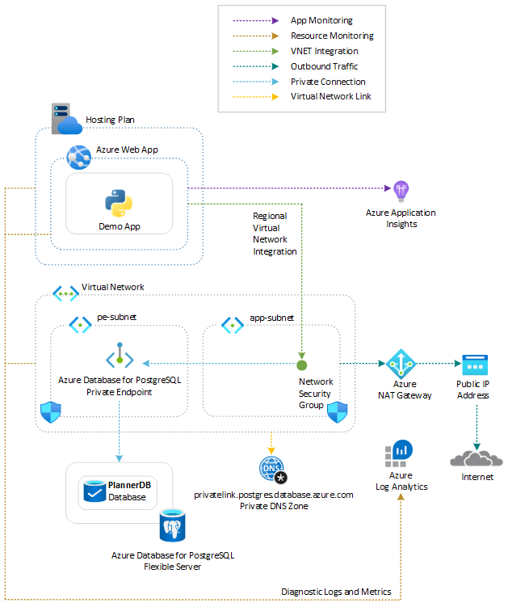

# Azure Web App with Azure Database for PostgreSQL flexible server

This sample demonstrates a Python Flask single-page web application called *Vacation Planner* hosted on an [Azure Web App](https://learn.microsoft.com/en-us/azure/app-service/overview). The app runs on an Azure App Service Plan and stores activity data in the `activities` table of the `PlannerDB` database on an [Azure Database for PostgreSQL flexible server](https://learn.microsoft.com/en-us/azure/postgresql/flexible-server/overview). The server is reached through a [Private Endpoint](https://learn.microsoft.com/azure/private-link/private-endpoint-overview) (group `postgresqlServer`) with the `privatelink.postgres.database.azure.com` Private DNS Zone, while a permissive server-level firewall rule lets the deploy machine run the post-create psql bootstrap that creates the application role and seeds the schema.

## Architecture



The web app enables users to plan and manage vacation activities; all data is persisted in PostgreSQL. The solution is composed of the following Azure resources:

1. [Azure Resource Group](https://learn.microsoft.com/en-us/azure/azure-resource-manager/management/manage-resource-groups-cli): A logical container scoping all resources in this sample.
2. [Azure Virtual Network](https://learn.microsoft.com/azure/virtual-network/virtual-networks-overview): Hosts two subnets:
   - *app-subnet*: Delegated to `Microsoft.Web/serverFarms` for regional VNet integration of the Web App.
   - *pe-subnet*: Hosts the Private Endpoint to the PostgreSQL flexible server.
3. [Azure Private DNS Zone](https://learn.microsoft.com/azure/dns/private-dns-privatednszone) `privatelink.postgres.database.azure.com`, linked to the VNet. The Private Endpoint's DNS-zone group auto-registers the `A` record for the server, so the Web App resolves the server's private IP through the VNet.
4. [Azure Private Endpoint](https://learn.microsoft.com/azure/private-link/private-endpoint-overview) (group `postgresqlServer`): Secures access to the PostgreSQL flexible server from the VNet.
5. [Azure NAT Gateway](https://learn.microsoft.com/azure/nat-gateway/nat-overview): Deterministic outbound connectivity for both subnets.
6. [Azure Network Security Group](https://learn.microsoft.com/en-us/azure/virtual-network/network-security-groups-overview): One NSG per subnet.
7. [Azure Log Analytics Workspace](https://learn.microsoft.com/azure/azure-monitor/logs/log-analytics-overview): Centralizes the diagnostic logs and metrics of every resource, the telemetry of Application Insights, and the audit records of the queries run on it.
8. [Azure Application Insights](https://learn.microsoft.com/en-us/azure/azure-monitor/app/app-insights-overview) `<prefix>-insights-<suffix>`: A workspace-based resource that collects the requests, the calls to PostgreSQL, the log records, the exceptions, the custom events and the custom metric of the web app, which the Microsoft OpenTelemetry Distro sends to the connection string of the `APPLICATIONINSIGHTS_CONNECTION_STRING` app setting. See [Application Insights](#application-insights).
9. [Azure Database for PostgreSQL flexible server](https://learn.microsoft.com/en-us/azure/postgresql/flexible-server/overview): Public-access server hosting the `PlannerDB` database. Burstable `Standard_B1ms`, version 16, 32 GiB storage, 7-day backup retention, HA disabled. A permissive firewall rule (`0.0.0.0–255.255.255.255`) is created so the deploy machine can run the post-create psql bootstrap; the Web App itself reaches the server through the Private Endpoint.
10. [PostgreSQL database](https://learn.microsoft.com/en-us/azure/postgresql/flexible-server/concepts-servers) `PlannerDB`: Created at provisioning time; the post-deploy psql step creates the `activities` table and seeds three demo rows.
11. [Azure App Service Plan](https://learn.microsoft.com/en-us/azure/app-service/overview-hosting-plans): The underlying compute tier that hosts the web application.
12. [Azure Web App](https://learn.microsoft.com/en-us/azure/app-service/overview): Runs the Python Flask *Vacation Planner* app with regional VNet integration into *app-subnet*. The Web App connects to PostgreSQL using a dedicated application role (`testuser`) — the server-admin login is never used at runtime.
13. [App Service Source Control](https://learn.microsoft.com/en-us/rest/api/appservice/web-apps/create-or-update-source-control?view=rest-appservice-2024-11-01): *(Optional)* Configures continuous deployment from a public GitHub repository.

The deploy scripts follow the same pattern as the sibling [`web-app-sql-database`](../../web-app-sql-database/python/) sample: after provisioning, they (i) connect as the server admin via the public endpoint + firewall rule, (ii) create the application role `testuser` with its own password, (iii) grant minimum schema privileges on `PlannerDB`, (iv) create the `activities` table, (v) seed three sample rows, and (vi) write `PG_USER=testuser` + `PG_PASSWORD` onto the Web App's app settings. The server-admin login is never written into the Web App's runtime configuration.

## Prerequisites

- [lstk CLI](https://docs.localstack.cloud/aws/developer-tools/running-localstack/lstk/)
- [Azure Subscription](https://azure.microsoft.com/free/)
- [Azure CLI](https://learn.microsoft.com/en-us/cli/azure/install-azure-cli)
- [Python 3.11+](https://www.python.org/downloads/)
- [Flask](https://flask.palletsprojects.com/)
- [psycopg2](https://www.psycopg.org/docs/) (`psycopg2-binary` for development)
- [PostgreSQL client tools](https://www.postgresql.org/download/) (`psql`) — required by the deploy scripts to create the application role and seed data
- [Bicep extension](https://marketplace.visualstudio.com/items?itemName=ms-azuretools.vscode-bicep), if you plan to install the sample via Bicep
- [Terraform](https://developer.hashicorp.com/terraform/downloads), if you plan to install the sample via Terraform

> [!IMPORTANT]
> **Macs with Apple silicon**: this sample deploys a web app from code. The emulator builds it with Microsoft's Oryx build image and runs it on an Oryx runtime image, and Microsoft publishes both for amd64 only ([microsoft/Oryx#2133](https://github.com/microsoft/Oryx/issues/2133) asks for arm64).
> On a Mac with Apple silicon they run only under Docker Desktop's amd64 emulation: in Docker Desktop's settings, under **General**, select the **Apple Virtualization framework** as the Virtual Machine Manager and turn on **Use Rosetta for x86_64/amd64 emulation on Apple Silicon**.
> Under QEMU, which Docker Desktop uses otherwise (Rosetta off, or Docker VMM, which has no Rosetta), the sample is not expected to work: Oryx is a .NET app, and [.NET does not support QEMU](https://github.com/dotnet/core/blob/main/release-notes/8.0/supported-os.md).
> The sample does not run on an arm64 Linux host without amd64 emulation.

## Deployment

Set up the Azure emulator using the LocalStack for Azure Docker image. Before starting, ensure you have a valid `LOCALSTACK_AUTH_TOKEN`. Refer to the [Auth Token guide](https://docs.localstack.cloud/getting-started/auth-token/) to obtain yours. Pull and start the emulator:

```bash
docker pull localstack/localstack-azure

export LOCALSTACK_AUTH_TOKEN=<your_auth_token>
lstk start --type azure

# Route all Azure CLI calls to the LocalStack Azure emulator
lstk az start-interception
```

Deploy the application using one of these methods:

- [Azure CLI Deployment](./scripts/README.md)
- [Bicep Deployment](./bicep/README.md)
- [Terraform Deployment](./terraform/README.md)

All three variants provision the same topology: VNet + pe-subnet hosting a Private Endpoint targeting a public-access PostgreSQL flexible server, with a Private DNS Zone linked to the VNet.

> [!NOTE]
> When you deploy the application to LocalStack for Azure for the first time, the initialization process pulls and builds Docker images (LocalStack itself plus the `postgres:18` backing container for the flexible-server emulator). This is a one-time operation — subsequent deployments are much faster.

## Test

1. Retrieve the host port Docker maps to the port the Web App listens on in its container, for example with `docker port <container-name>` (the container's name starts with `ls-<web-app-name>`). Do not assume port 80: the app listens on the port its `WEBSITES_PORT` app setting names, when it has one.
2. Open a web browser and navigate to `http://localhost:<published-port>`.
3. If the deployment was successful, you will see the *Vacation Planner* UI with the three seeded activities (*Go to Paris*, *Go to London*, *Go to Mexico*) and can add, edit, and remove activities.


You can use the `scripts/call-web-app.sh` Bash script to call the web app from outside the emulator. The script demonstrates four call paths:

1. **Through the LocalStack for Azure emulator** via the default hostname.
2. **Via localhost and host port** mapped to the container's port `80`.
3. **Via container IP address** on port `80`.
4. **Via the default hostname** `<web-app-name>.azurewebsites.azure.localhost.localstack.cloud:4566`.

On Azure, where the web app runs in no container on your machine, the script calls its default host name over HTTPS instead, and retries while the web app starts.

## Application Insights

The web app sends its telemetry to `<prefix>-insights-<suffix>`, a workspace-based [Application Insights](https://learn.microsoft.com/en-us/azure/azure-monitor/app/app-insights-overview) resource that stores it in the `<prefix>-log-analytics-<suffix>` workspace. The three deployment methods set the `APPLICATIONINSIGHTS_CONNECTION_STRING` app setting to the connection string of the resource, and the application turns on the [Microsoft OpenTelemetry Distro](https://learn.microsoft.com/en-us/azure/azure-monitor/app/opentelemetry-enable?tabs=python) when the setting is present. The application also sends a [custom event](https://learn.microsoft.com/en-us/azure/azure-monitor/app/opentelemetry-add-modify#send-custom-events) for each activity it adds, updates or deletes, counts these operations in the `activities` [custom metric](https://learn.microsoft.com/en-us/azure/azure-monitor/app/opentelemetry-add-modify#add-custom-metrics), and logs the exceptions it catches:

```python
from microsoft.opentelemetry import use_microsoft_opentelemetry

# The logger of the application
LOGGER_NAME = "webapp"

if os.environ.get("APPLICATIONINSIGHTS_CONNECTION_STRING"):
    use_microsoft_opentelemetry(enable_azure_monitor=True, logger_name=LOGGER_NAME)

from flask import Flask
from opentelemetry import metrics

activity_counter = metrics.get_meter(LOGGER_NAME).create_counter(
    "activities", unit="{activity}", description="The number of activities added, updated and deleted."
)


def track_activity_event(event_name: str, operation: str, activity_id: str) -> None:
    logger.info(
        f"{event_name}: {activity_id}",
        extra={"microsoft.custom_event.name": event_name, "activity.id": activity_id},
    )
    activity_counter.add(1, {"operation": operation})
```

The distro starts before the application imports Flask and psycopg2, so that its instrumentations wrap them, and it collects the records of the `webapp` logger and of its child `webapp.database`.

The workspace keeps the telemetry in these tables:

| Table             | What the web app sends                                                                                                   |
| ----------------- | ------------------------------------------------------------------------------------------------------------------------ |
| `AppRequests`     | The requests it serves, such as `GET /`                                                                                  |
| `AppDependencies` | Its calls to PostgreSQL                                                                                                  |
| `AppTraces`       | The records of its loggers                                                                                               |
| `AppEvents`       | The `ActivityAdded`, `ActivityUpdated` and `ActivityDeleted` custom events, with the id of the activity in `activity.id` |
| `AppMetrics`      | The `activities` custom metric, with the operation (`add`, `update` or `delete`) in `operation`                          |
| `AppExceptions`   | The exceptions it logs, with their stack trace, when a call to PostgreSQL fails                                          |

[`scripts/query-telemetry.sh`](./scripts/query-telemetry.sh) calls the web app, adds an activity, and reads the tables back, retrying until their records arrive. It shows the exceptions without waiting for them: a healthy run has none.

### Query the telemetry on the Logs page

Besides the custom events, the web app logs a trace at the end of each operation on the activities, with the id of the activity: `Activities read: <count>` when it reads the list, `Activity added: <id> (<text>)`, `Activity updated: <id> (<text>)` and `Activity deleted: <id>`. An update or a delete that finds no activity logs the warning `Activity not found: <id>`, and a failure logs the exception with its stack trace. [`scripts/query-telemetry.sh`](./scripts/query-telemetry.sh) waits for the `Activity added` trace of the activity it adds.

To query the telemetry yourself, open the `<prefix>-insights-<suffix>` Application Insights resource and select **Logs** under **Monitoring**:

- On Azure, open the resource in the [Azure portal](https://portal.azure.com).
- On the emulator, open the emulated Azure portal at `http://localhost:4566/_localstack/portal/` (see [Azure Portal Emulator](https://docs.localstack.cloud/azure/developer-tools/portal/)) and select **Sign in**: the sign-in is a mock and asks for no credentials. Then select **Resource groups**, `local-rg`, the `local-insights-test` resource and **Logs**.

Type a query in the [Kusto Query Language](https://docs.localstack.cloud/azure/developer-tools/kusto-query-language/) (KQL) and select **Run**: the **Results** tab lists the records, and the **Chart** tab draws the chart of a query that ends with `render`. The Logs page of an Application Insights resource reads the classic Application Insights tables, which hold the same records as the tables of the Log Analytics workspace under other names:

| Application Insights | Log Analytics workspace | Records                                       |
| -------------------- | ----------------------- | --------------------------------------------- |
| `requests`           | `AppRequests`           | The requests the web app serves               |
| `dependencies`       | `AppDependencies`       | The calls to other services                   |
| `traces`             | `AppTraces`             | The records of the loggers                    |
| `exceptions`         | `AppExceptions`         | The exceptions logged, with their stack trace |
| `customEvents`       | `AppEvents`             | The custom events                             |
| `customMetrics`      | `AppMetrics`            | The custom metrics                            |

Their columns are renamed too, for example `timestamp` (`TimeGenerated`), `name` (`Name`), `success` (`Success`), `duration` (`DurationMs`), `resultCode` (`ResultCode`), `operation_Id` (`OperationId`), `operation_Name` (`OperationName`), `cloud_RoleName` (`AppRoleName`), `severityLevel` (`SeverityLevel`), `message` (`Message`), `type` (`ExceptionType`), `valueSum` (`Sum`) and `customDimensions` (`Properties`). To run the queries below on the workspace, with its **Logs** page or `az monitor log-analytics query`, use the names in parentheses.

The `customDimensions` column holds the custom properties of each record: the `ActivityAdded`, `ActivityUpdated` and `ActivityDeleted` events carry the id of the activity in `activity.id`, and the `activities` metric carries the operation in `operation`. Read a property with `tostring(customDimensions["<name>"])`, for example in the latest `ActivityAdded` events:

```kusto
customEvents
| where timestamp > ago(1h) and name == "ActivityAdded"
| project timestamp, ActivityId = tostring(customDimensions["activity.id"])
| order by timestamp desc
```

These queries read the telemetry and draw charts of it:

- **Requests and failures over time.** The requests and the failed requests (`success == false`) in 5-second buckets, to spot traffic spikes and error regressions:

  ```kusto
  requests
  | where timestamp > ago(6h)
  | summarize
      TotalRequests = count(),
      FailedRequests = countif(success == false)
      by bin(timestamp, 5s)
  | render timechart
  ```

- **Latency percentiles per endpoint.** The 50th, 95th and 99th percentiles of the duration of each endpoint, which show the slow requests that an average hides:

  ```kusto
  requests
  | where timestamp > ago(24h)
  | summarize
      RequestCount = count(),
      P50_ms = percentile(duration, 50),
      P95_ms = percentile(duration, 95),
      P99_ms = percentile(duration, 99)
      by name
  | where RequestCount > 1
  | top 10 by P95_ms desc
  | project name, P50_ms, P95_ms, P99_ms
  | render columnchart
  ```

- **Status codes over time.** The `2xx`, `4xx` and `5xx` responses over time, to tell client errors from server faults:

  ```kusto
  requests
  | where timestamp > ago(12h)
  | extend StatusBucket = strcat(substring(resultCode, 0, 1), "xx")
  | summarize Count = count() by bin(timestamp, 15m), StatusBucket
  | render columnchart with (kind=stacked)
  ```

- **Top exceptions.** The exceptions by type and by the operation that raised them, to find the most frequent failures:

  ```kusto
  exceptions
  | where timestamp > ago(24h)
  | summarize ExceptionCount = count() by type, operation_Name
  | top 10 by ExceptionCount desc
  | render barchart
  ```

- **Traces by severity.** The records of the loggers by severity level (`0` Verbose, `1` Information, `2` Warning, `3` Error, `4` Critical), to catch a storm of warnings before requests start failing:

  ```kusto
  traces
  | where timestamp > ago(6h)
  | extend Severity = case(
      severityLevel == 0, "Verbose",
      severityLevel == 1, "Information",
      severityLevel == 2, "Warning",
      severityLevel == 3, "Error",
      severityLevel == 4, "Critical",
      "Unknown")
  | summarize LogCount = count() by bin(timestamp, 5m), Severity
  | render areachart with (kind=stacked)
  ```

- **The deletes.** The delete requests:

  ```kusto
  requests
  | where name startswith "POST /delete"
  | project timestamp, name
  ```

- **Traces that start with a text.** The traces of the last 30 minutes whose message starts with a given text, here the confirmations of the activities added:

  ```kusto
  let text = "Activity added";
  traces
  | where timestamp > ago(30m) and message startswith text
  | project timestamp, message
  ```

- **Requests by name.** The number of requests of each name:

  ```kusto
  requests
  | summarize Count = count() by Name = name
  | render scatterchart
  ```

- **Custom events per minute.** The custom events per minute, by name:

  ```kusto
  customEvents
  | summarize Count = count() by bin(timestamp, 1m), Name = name
  | render timechart
  ```

- **Custom metric.** The `activities` custom metric per minute, by operation (`add`, `update`, `delete`):

  ```kusto
  customMetrics
  | where timestamp > ago(6h) and name == "activities"
  | summarize Total = sum(valueSum) by bin(timestamp, 1m), Operation = tostring(customDimensions["operation"])
  | render columnchart with (kind=stacked)
  ```

## Logs and metrics

The web app, its App Service plan, the PostgreSQL server, the VNet, the two NSGs, the NAT Gateway and its public IP each have a diagnostic setting that sends their resource logs, their platform metrics or both to the `<prefix>-log-analytics-<suffix>` Log Analytics workspace, and the workspace has one that sends the audit records of the queries run on it (`Audit`, table `LAQueryLogs`) to itself. The Application Insights resource has none: its telemetry is already in the workspace it's based on, and a diagnostic setting of a workspace-based Application Insights resource [can't send to that workspace](https://learn.microsoft.com/en-us/azure/azure-monitor/app/export-telemetry#diagnostic-settings-based-export). The private endpoint and the private DNS zone offer no diagnostic settings. Two of the resources record what the application does:

| Resource                   | Log categories                                                                                                                                                                  | Tables in the workspace                | What the application leaves there                                         |
| -------------------------- | ------------------------------------------------------------------------------------------------------------------------------------------------------------------------------- | -------------------------------------- | ------------------------------------------------------------------------- |
| Web App                    | `AppServiceHTTPLogs`, `AppServiceConsoleLogs`, `AppServicePlatformLogs`, `AppServiceAppLogs`, `AppServiceAuditLogs`, `AppServiceIPSecAuditLogs`, `AppServiceAuthenticationLogs` | One table per category, named after it | The requests it serves, its console output and the start of its container |
| PostgreSQL flexible server | `PostgreSQLLogs`                                                                                                                                                                | `PGSQLServerLogs`                      | The connections of the `testuser` role                                    |

Their platform metrics land in the `AzureMetrics` table. The setting of the PostgreSQL server writes to the resource-specific tables, which Microsoft recommends over the shared `AzureDiagnostics` table: the Azure CLI script passes `--export-to-resource-specific true`, the Bicep module sets `logAnalyticsDestinationType: 'Dedicated'` and the Terraform module `log_analytics_destination_type = "Dedicated"`. App Service writes to resource-specific tables only. The VNet and the two NSGs send their network logs; on the emulator these categories stay empty, because no traffic crosses an emulated network security group.

[`scripts/query-logs-and-metrics.sh`](./scripts/query-logs-and-metrics.sh) shows the diagnostic settings, calls the web app and reads these tables back, retrying until their records arrive, then reads the same platform metrics from the Azure Monitor metrics API. On Azure the first records of a new diagnostic setting can take up to 90 minutes: raise `RETRY_COUNT` there. On Azure the script reads the exported platform metrics (`AzureMetrics`) only once: Azure exports them late and irregularly, so the script shows those that arrived and notes how many are still missing, without failing. To query the workspace yourself, add the `log-analytics` extension of the Azure CLI (`az extension add --name log-analytics`); the query API identifies a workspace by its workspace id (`customerId`):

```bash
WORKSPACE_ID=$(az monitor log-analytics workspace show \
  --resource-group local-rg \
  --workspace-name local-log-analytics-test \
  --query customerId \
  --output tsv)

az monitor log-analytics query \
  --workspace "$WORKSPACE_ID" \
  --analytics-query "PGSQLServerLogs | project TimeGenerated, ErrorLevel, Message | order by TimeGenerated desc | take 5" \
  --output table
```

## PostgreSQL Tooling

You can use [pgAdmin](https://www.pgadmin.org/) to explore and manage the deployed database. Connect using:

| Field    | Value                                                                       |
| -------- | --------------------------------------------------------------------------- |
| Host     | `localhost`                                                                 |
| Port     | (see `docker ps` for the host-mapped port of the backing `postgres:18` container) |
| Database | `PlannerDB`                                                                 |
| Username | `testuser` *(or `pgadmin` for admin operations)*                            |
| Password | `TestP@ssw0rd123` *(or `P@ssw0rd1234!` for the admin)*                      |

Or use [psql](https://www.postgresql.org/docs/current/app-psql.html):

```bash
PGPASSWORD='TestP@ssw0rd123' psql -h localhost -p <port> -U testuser -d PlannerDB
PlannerDB=> SELECT id, username, activity, created_at FROM activities;
```

## References

- [Azure Web Apps Documentation](https://learn.microsoft.com/en-us/azure/app-service/)
- [Azure Database for PostgreSQL — flexible server](https://learn.microsoft.com/en-us/azure/postgresql/flexible-server/)
- [Quickstart: Python Flask on Azure](https://learn.microsoft.com/en-us/azure/app-service/quickstart-python?tabs=flask%2Cbrowser)
- [psycopg2 documentation](https://www.psycopg.org/docs/)
- [LocalStack for Azure](https://docs.localstack.cloud/azure/)
- [lstk CLI](https://docs.localstack.cloud/aws/developer-tools/running-localstack/lstk/)
- [lstk GitHub repository](https://github.com/localstack/lstk)
