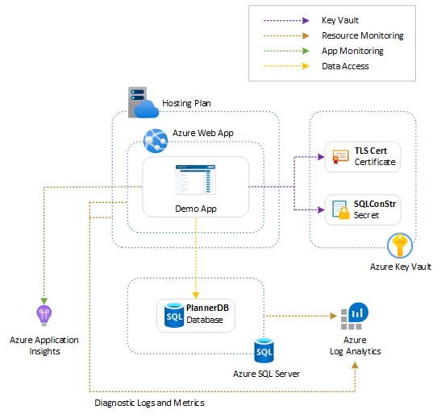
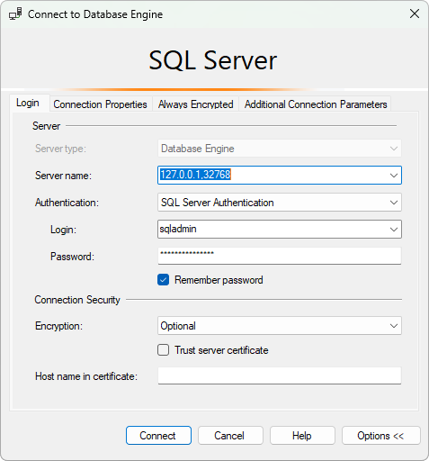
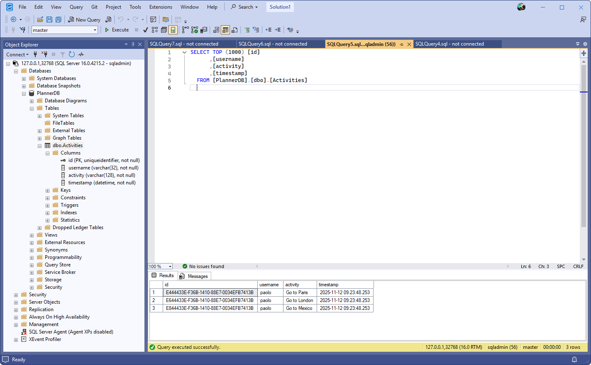

# Azure Web App with Azure SQL Database and Azure Key Vault

This sample demonstrates a ASP.NET Core Razor Pages single-page web application called *Vacation Planner* hosted on an [Azure Web App](https://learn.microsoft.com/en-us/azure/app-service/overview). The app runs on an Azure App Service Plan and stores activity data in an `Activities` table within the `PlannerDB` database on an [Azure SQL Database](https://learn.microsoft.com/en-us/azure/azure-sql/database/) instance. The connection string of the SQL database is stored as a secret in [Azure Key Vault](https://learn.microsoft.com/en-us/azure/key-vault/general/overview). The application also retrieves its certificate from Key Vault to serve traffic over HTTPS. The SQL server encrypts its databases at rest with [Transparent Data Encryption (TDE)](https://learn.microsoft.com/en-us/azure/azure-sql/database/transparent-data-encryption-byok-overview) protected by a customer-managed key: an RSA key in Key Vault that the server reaches through a user-assigned managed identity.


## Architecture

The following diagram illustrates the architecture of the solution:



- **Azure Web App**: Hosts the ASP.NET Core application
- **Azure App Service Plan**: Provides compute resources for the web app
- **Azure SQL Database**: Stores activity data in a relational table, encrypted at rest with TDE
- **Azure Key Vault**: Stores the database connection string, the certificate used to secure HTTPS traffic, and the RSA key that serves as the TDE protector of the SQL server
- **User-Assigned Managed Identity**: The identity the SQL server uses to wrap and unwrap its database encryption keys with the Key Vault key
- **Azure Log Analytics Workspace**: Stores the telemetry of Application Insights, and the resource logs and platform metrics that the diagnostic settings of the web app, the App Service plan, the database, the key vault and the workspace itself send to it. See [Logs and metrics](#logs-and-metrics).
- **Azure Application Insights**: A workspace-based resource that collects the requests, the calls to Azure SQL Database and Key Vault, the log records, the exceptions, the custom events and the custom metric of the web app, which the Microsoft OpenTelemetry Distro sends to the connection string of the `APPLICATIONINSIGHTS_CONNECTION_STRING` app setting. See [Application Insights](#application-insights).

## Prerequisites

- [lstk CLI](https://docs.localstack.cloud/aws/developer-tools/running-localstack/lstk/)
- [Azure Subscription](https://azure.microsoft.com/free/)
- [Azure CLI](https://learn.microsoft.com/en-us/cli/azure/install-azure-cli)
- [.NET SDK 10.0](https://dotnet.microsoft.com/en-us/download/dotnet/10.0)
- [ASP.NET Core](https://learn.microsoft.com/en-us/aspnet/core/)
- [Microsoft.Data.SqlClient](https://learn.microsoft.com/en-us/sql/connect/ado-net/microsoft-ado-net-sql-server)
- [Bicep extension](https://marketplace.visualstudio.com/items?itemName=ms-azuretools.vscode-bicep), if you plan to install the sample via Bicep.
- [Terraform](https://developer.hashicorp.com/terraform/downloads), if you plan to install the sample via Terraform.

> [!IMPORTANT]
> **Macs with Apple silicon**: this sample deploys a web app from code. The emulator builds it with Microsoft's Oryx build image and runs it on an Oryx runtime image, and Microsoft publishes both for amd64 only ([microsoft/Oryx#2133](https://github.com/microsoft/Oryx/issues/2133) asks for arm64).
> On a Mac with Apple silicon they run only under Docker Desktop's amd64 emulation: in Docker Desktop's settings, under **General**, select the **Apple Virtualization framework** as the Virtual Machine Manager and turn on **Use Rosetta for x86_64/amd64 emulation on Apple Silicon**.
> Under QEMU, which Docker Desktop uses otherwise (Rosetta off, or Docker VMM, which has no Rosetta), the sample is not expected to work: Oryx is a .NET app, and [.NET does not support QEMU](https://github.com/dotnet/core/blob/main/release-notes/8.0/supported-os.md).
> Its SQL Database runs Microsoft's SQL Server image, which is amd64-only as well, and Microsoft [does not test or support SQL Server under emulation](https://learn.microsoft.com/azure/azure-sql/database/local-dev-experience-dev-containers).
> The sample does not run on an arm64 Linux host without amd64 emulation.

## Security Configuration

The Vacation Planner Web App supports two common approaches for accessing Azure SQL Database securely:

1. **Using a SQL Database connection string**: Provide a standard SQL connection string using the following environment variables:

- SQL_SERVER: The SQL server container IP address (e.g. 172.17.0.4).
- SQL_DATABASE: The name of the SQL database (e.g.PlannerDB).
- SQL_USERNAME: The username to connect to the SQL database (e.g. testuser).
- SQL_PASSWORD: The password to connect to the SQL database (e.g. TestP@ssw0rd123).

2. **Using Microsoft Entra ID service principal credentials**: Specify the service principal credentials in your environment using the following environment variables:

 - [AZURE_CLIENT_ID](https://learn.microsoft.com/en-us/dotnet/api/azure.identity.environmentcredential): The service principal's client ID.
 - [AZURE_CLIENT_SECRET](https://learn.microsoft.com/en-us/dotnet/api/azure.identity.environmentcredential): One of the service principal's client secrets.
 - [AZURE_TENANT_ID](https://learn.microsoft.com/en-us/dotnet/api/azure.identity.environmentcredential): The Microsoft Entra Tenant ID.

This flexibility allows the app to run securely in Azure or in emulated environments like [LocalStack for Azure](https://docs.localstack.cloud/azure/). The client code supports both authentication modes using [`ClientSecretCredential`](https://learn.microsoft.com/en-us/dotnet/api/azure.identity.clientsecretcredential) or [`DefaultAzureCredential`](https://learn.microsoft.com/en-us/dotnet/api/azure.identity.defaultazurecredential) from the Azure SDK.

## Azure Key Vault Integration
The application integrates with Azure Key Vault for managing secrets and certificates, and the SQL server uses a Key Vault key to protect its data at rest:

Secrets: The SQL connection string is stored as a secret in Key Vault. At runtime, the app retrieves it using the Azure Key Vault Secrets SDK. This is configured via the KEY_VAULT_NAME and SECRET_NAME environment variables.

Certificates: A self-signed certificate is created in Key Vault during deployment. The app exposes a GET /api/certificate endpoint that retrieves the certificate using the Azure Key Vault Certificates SDK and returns its name, confirming the integration works. This is configured via the KEYVAULT_URI and CERT_NAME environment variables.

Keys: An RSA key in Key Vault is the TDE protector of the SQL server, the customer-managed key that encrypts the database encryption key of every database on the server. The server reaches the key through its user-assigned managed identity, which holds the `get`, `wrapKey` and `unwrapKey` key permissions, and picks up new versions of the key automatically (auto-rotation). Azure requires soft delete and purge protection on the vault. With purge protection, a deleted vault cannot be purged: after the resource group is deleted, the vault stays soft-deleted for the 7-day retention period, and its name cannot be reused anywhere until then. Vault names are global, so a soft-deleted vault from any earlier deployment of this sample, yours or someone else's, blocks the name for everyone. To deploy to Azure under a new name, change `PREFIX` or `SUFFIX` in the deployment script you use and in `scripts/validate.sh`; `scripts/call-web-app.sh` finds the web app by itself.

On LocalStack, the emulator registers the key on the server and checks that the key exists and that the server identity holds `get`, `wrapKey` and `unwrapKey` on it, but it does not encrypt the database with it, and unlike Azure it does not require purge protection on the vault. The Azure CLI variant registers the key and the protector with `az resource create`, because `az sql server key create` and `az sql server tde-key set` only accept key ids on the public Key Vault domains and reject the ones the emulator issues.

## Deployment

Set up the Azure emulator using the LocalStack for Azure Docker image. Before starting, ensure you have a valid `LOCALSTACK_AUTH_TOKEN` to access the Azure emulator. Refer to the [Auth Token guide](https://docs.localstack.cloud/getting-started/auth-token/) to obtain your Auth Token and set it in the `LOCALSTACK_AUTH_TOKEN` environment variable. The Azure Docker image is available on the [LocalStack Docker Hub](https://hub.docker.com/r/localstack/localstack-azure). To pull the image, execute:

```bash
docker pull localstack/localstack-azure
```

> [!IMPORTANT]
> Each logical server you create runs a Microsoft SQL Server container, so you must accept the [SQL Server End-User Licensing Agreement](https://go.microsoft.com/fwlink/?LinkId=746388) before the emulator provisions one.
> Start the emulator with `MSSQL_ACCEPT_EULA` set to `Y`:
> 
> ```bash
> LOCALSTACK_MSSQL_ACCEPT_EULA=Y lstk start --type azure
> ```
> 
> Host variables prefixed with `LOCALSTACK_` are forwarded to the emulator, so the container receives `MSSQL_ACCEPT_EULA=Y`.
> 
> To accept it once rather than on every start, add it to an environment profile in your `lstk` config:
> 
> ```toml
> [[containers]]
> type = "azure"
> tag  = "latest"
> port = "4566"
> env  = ["mssql"]
> 
> [env.mssql]
> MSSQL_ACCEPT_EULA = "Y"
> ```
> 
> A profile's values are injected into the container directly, so the `LOCALSTACK_` prefix is not used here.
> `lstk` reads the first `config.toml` it finds, starting with `./.lstk/config.toml` in the current directory and then `$HOME/.config/lstk/config.toml`.
> See [Config file search order](https://docs.localstack.cloud/azure/developer-tools/running-localstack/lstk/configuration/#config-file-search-order) for the full list and [Passing environment variables to the container](https://docs.localstack.cloud/azure/developer-tools/running-localstack/lstk/configuration/#passing-environment-variables-to-the-container) for how profiles work.
> 
> If you start the emulator with the `docker` CLI or Docker Compose, set `MSSQL_ACCEPT_EULA=Y` directly in the container environment instead.
> Without it, `az sql server create` fails with `(EulaNotAccepted)`.

Start the LocalStack Azure emulator by running:

```bash
# Set the authentication token
export LOCALSTACK_AUTH_TOKEN=<your_auth_token>

# Start the LocalStack Azure emulator
lstk start --type azure

# Route all Azure CLI calls to the LocalStack Azure emulator
lstk az start-interception
```

Deploy the application to LocalStack for Azure using one of these methods:

- [Azure CLI Deployment](./scripts/README.md)
- [Bicep Deployment](./bicep/README.md)
- [Terraform Deployment](./terraform/README.md)

All deployment methods have been fully tested against Azure and the LocalStack for Azure local emulator.

> [!NOTE]
> When you deploy the application to LocalStack for Azure for the first time, the initialization process involves downloading and building Docker images. This is a one-time operation—subsequent deployments will be significantly faster. Depending on your internet connection and system resources, this initial setup may take several minutes.

## Test

1. Retrieve the host port Docker maps to the port the Web App listens on in its container, for example with `docker port <container-name>` (the container's name starts with `ls-<web-app-name>`). Do not assume port 80: the app listens on the port its `WEBSITES_PORT` app setting names, when it has one.
2. Open a web browser and navigate to `http://localhost:<published-port>`. As an alternative, you can retrieve the URL using the following command and call the Web App using the HTTP or HTTPS protocol:

   ```bash
   az webapp show \
       --name local-webapp-test \
       --resource-group local-rg \
       --query defaultHostName \
       --output tsv
   ```

3. If the deployment was successful, you will see the following user interface for adding and removing activities:


You can use the `call-web-app.sh` Bash script below to call the web app. The script demonstrates three methods for calling web apps:

1. **Through the LocalStack for Azure emulator**: Call the web app via the emulator using its default host name. The emulator acts as a proxy to the web app.
2. **Via localhost and host port mapped to the container's port**: Use `127.0.0.1` with the host port mapped to the container's port `80`.
3. **Via container IP address**: Use the app container's IP address on port `80`. This technique is only available when accessing the web app from the Docker host machine.
4. **Via the default hostname**: Call the web app via the default hostname `<web-app-name>.azurewebsites.azure.localhost.localstack.cloud:4566`.

## Application Insights

The web app sends its telemetry to `<prefix>-insights-<suffix>`, a workspace-based [Application Insights](https://learn.microsoft.com/en-us/azure/azure-monitor/app/app-insights-overview) resource that stores it in the `<prefix>-log-analytics-<suffix>` workspace. The three deployment methods set the `APPLICATIONINSIGHTS_CONNECTION_STRING` app setting to the connection string of the resource, and the application turns on the [Microsoft OpenTelemetry Distro](https://learn.microsoft.com/en-us/azure/azure-monitor/app/opentelemetry-enable?tabs=aspnetcore) when the setting is present. The distro's SQL Client instrumentation, on by default, traces the commands the app sends to Azure SQL Database through `Microsoft.Data.SqlClient`. The application also sends a [custom event](https://learn.microsoft.com/en-us/azure/azure-monitor/app/opentelemetry-add-modify#send-custom-events) for each activity it adds, updates or deletes, counts these operations in the `activities` [custom metric](https://learn.microsoft.com/en-us/azure/azure-monitor/app/opentelemetry-add-modify#add-custom-metrics), and logs the exceptions it catches:

```csharp
if (!string.IsNullOrEmpty(builder.Configuration["APPLICATIONINSIGHTS_CONNECTION_STRING"]))
{
    // The distro exports the custom metrics of the meters it's told about
    builder.Services.ConfigureOpenTelemetryMeterProvider(
        (_, meterProvider) => meterProvider.AddMeter(ActivityTelemetry.MeterName));
    builder.UseMicrosoftOpenTelemetry(options =>
    {
        options.Exporters = ExportTarget.AzureMonitor;
    });
}

// Services/ActivityTelemetry.cs
public static void Track(ILogger logger, string eventName, string operation, string activityId)
{
    logger.LogInformation("{microsoft.custom_event.name} {activity.id}", eventName, activityId);
    Activities.Add(1, new KeyValuePair<string, object?>("operation", operation));
}
```

The workspace keeps the telemetry in these tables:

| Table             | What the web app sends                                                                                                   |
| ----------------- | ------------------------------------------------------------------------------------------------------------------------ |
| `AppRequests`     | The requests it serves, such as `GET /`                                                                                  |
| `AppDependencies` | Its calls to Azure SQL Database and to Key Vault                                                                         |
| `AppTraces`       | The records of its loggers                                                                                               |
| `AppEvents`       | The `ActivityAdded`, `ActivityUpdated` and `ActivityDeleted` custom events, with the id of the activity in `activity.id` |
| `AppMetrics`      | The `activities` custom metric, with the operation (`add`, `update` or `delete`) in `operation`                          |
| `AppExceptions`   | The exceptions it logs, with their stack trace, when a call to the database or to Key Vault fails                        |

[`scripts/query-telemetry.sh`](./scripts/query-telemetry.sh) calls the web app, adds an activity, and reads the tables back, retrying until their records arrive. It shows the exceptions without waiting for them: a healthy run has none.

## Logs and metrics

The web app, its App Service plan, the database, the key vault and the workspace each have a diagnostic setting that sends their resource logs, their platform metrics or both to the `<prefix>-log-analytics-<suffix>` Log Analytics workspace; the workspace's sends the audit records of the queries run on it (`Audit`, table `LAQueryLogs`). The Application Insights resource has none: its telemetry is already in the workspace it's based on, and a diagnostic setting of a workspace-based Application Insights resource [can't send to that workspace](https://learn.microsoft.com/en-us/azure/azure-monitor/app/export-telemetry#diagnostic-settings-based-export). The logical server has none either: Microsoft documents no platform metrics for it, and auditing at the server level goes through the diagnostic settings of its `master` database. The managed identity offers no diagnostic settings. Three of the resources record what the application does:

| Resource     | Log categories                                                                                                                                                                               | Tables in the workspace                            | What the application leaves there                                                                          |
| ------------ | -------------------------------------------------------------------------------------------------------------------------------------------------------------------------------------------- | -------------------------------------------------- | ---------------------------------------------------------------------------------------------------------- |
| Web App      | `AppServiceHTTPLogs`, `AppServiceConsoleLogs`, `AppServicePlatformLogs`, `AppServiceAppLogs`, `AppServiceAuditLogs`, `AppServiceIPSecAuditLogs`, `AppServiceAuthenticationLogs`              | One table per category, named after it             | The requests it serves, its console output and the start of its container                                  |
| SQL database | `SQLInsights`, `AutomaticTuning`, `QueryStoreRuntimeStatistics`, `QueryStoreWaitStatistics`, `Errors`, `DatabaseWaitStatistics`, `Timeouts`, `Blocks`, `Deadlocks`, `SQLSecurityAuditEvents` | `AzureDiagnostics`                                 | The audit records of the batches the app runs and of its sign-ins, and the statements the database refuses |
| Key vault    | `AuditEvent`, `AzurePolicyEvaluationDetails`                                                                                                                                                 | `AZKVAuditLogs`, `AZKVPolicyEvaluationDetailsLogs` | The reads of the connection string secret and of the certificate                                           |

Their platform metrics land in the `AzureMetrics` table. A database names three metric categories instead of `AllMetrics`, and its setting enables all of them: `Basic` (connections, CPU, storage, sessions and workers), `InstanceAndAppAdvanced` (the CPU and memory of the SQL instance and the `tempdb` files) and `WorkloadManagement`, which groups the metrics of dedicated SQL pools and so exports none for this database. None of the database's log categories has a resource-specific table, so it writes them to `AzureDiagnostics`. The audit records come from the auditing policy of the database, which sends to Azure Monitor: the Azure CLI script turns it on with `az sql db audit-policy update`, which keeps the `SQLSecurityAuditEvents` category in a diagnostic setting of its own, named `SQLSecurityAuditEvents_<id>`, while the Bicep and Terraform deployments list the category in the database's setting. The key vault's setting writes to the resource-specific tables.

[`scripts/query-logs-and-metrics.sh`](./scripts/query-logs-and-metrics.sh) shows the diagnostic settings, calls the web app and reads these tables back, retrying until their records arrive, then reads the same platform metrics from the Azure Monitor metrics API. On Azure the first records of a new diagnostic setting can take up to 90 minutes: raise `RETRY_COUNT` there. To query the workspace yourself, add the `log-analytics` extension of the Azure CLI (`az extension add --name log-analytics`); the query API identifies a workspace by its workspace id (`customerId`):

```bash
WORKSPACE_ID=$(az monitor log-analytics workspace show \
  --resource-group local-rg \
  --workspace-name local-log-analytics-test \
  --query customerId \
  --output tsv)

az monitor log-analytics query \
  --workspace "$WORKSPACE_ID" \
  --analytics-query "AzureDiagnostics | where Category == 'SQLSecurityAuditEvents' | project TimeGenerated, action_name_s, statement_s | order by TimeGenerated desc | take 5" \
  --output table
```

## SQL Server Tooling

You can use [SQL Server Management Studio](https://learn.microsoft.com/en-us/ssms/install/install) to explore and manage your SQL databases. When connecting, use SQL Server Authentication and specify `127.0.0.1,port` as the server name in the Connect dialog box, where `port` is the host port mapped to the container's internal SQL Server port `1433`, as shown in the following picture:



SQL Server Management Studio allows you to manage database objects such as tables and stored procedures, as well as query data, as shown in the following picture:




Alternatively, you can use the [sqlcmd](https://learn.microsoft.com/en-us/sql/tools/sqlcmd/sqlcmd-utility?view=sql-server-ver17&tabs=go%2Cwindows-support&pivots=cs1-bash) to interact with and administer your SQL databases, as shown in the following table:

```bash
~$ sqlcmd -S 172.17.0.4 -d PlannerDB -U testuser -P TestP@ssw0rd123
1> SELECT id, username, SUBSTRING(activity, 1, 20) FROM Activities;
2> GO
id                                   username
------------------------------------ -------------------------------- --------------------
e444433e-f36b-1410-88e7-0034efb7413b paolo                            Go to Paris
e644433e-f36b-1410-88e7-0034efb7413b paolo                            Go to London
e844433e-f36b-1410-88e7-0034efb7413b paolo                            Go to Mexico

(3 rows affected)
```

## References

- [Azure Web Apps Documentation](https://learn.microsoft.com/en-us/azure/app-service/)
- [Azure SQL Database Documentation](https://learn.microsoft.com/en-us/azure/azure-sql/database/)
- [Quickstart: Deploy an ASP.NET web app to Azure App Service](https://learn.microsoft.com/en-us/azure/app-service/quickstart-dotnetcore?pivots=development-environment-cli)
- [Microsoft.Data.SqlClient](https://learn.microsoft.com/en-us/sql/connect/ado-net/microsoft-ado-net-sql-server)
- [Azure Identity client library for .NET](https://learn.microsoft.com/en-us/dotnet/api/overview/azure/identity-readme)
- [LocalStack for Azure](https://docs.localstack.cloud/azure/)
- [lstk CLI](https://docs.localstack.cloud/aws/developer-tools/running-localstack/lstk/)
- [lstk GitHub repository](https://github.com/localstack/lstk)
